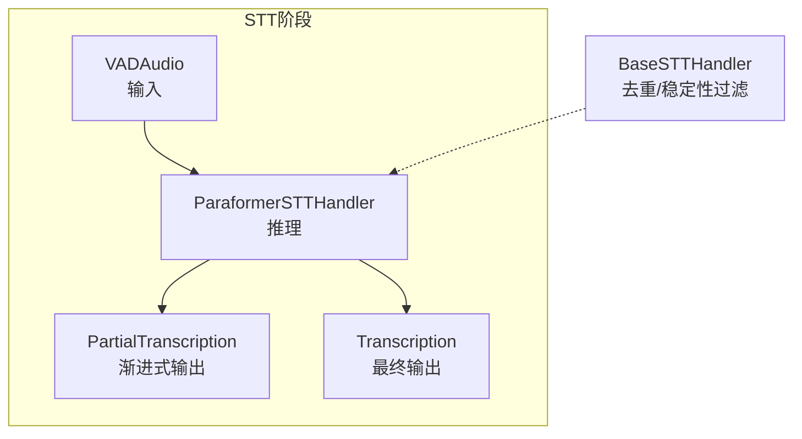
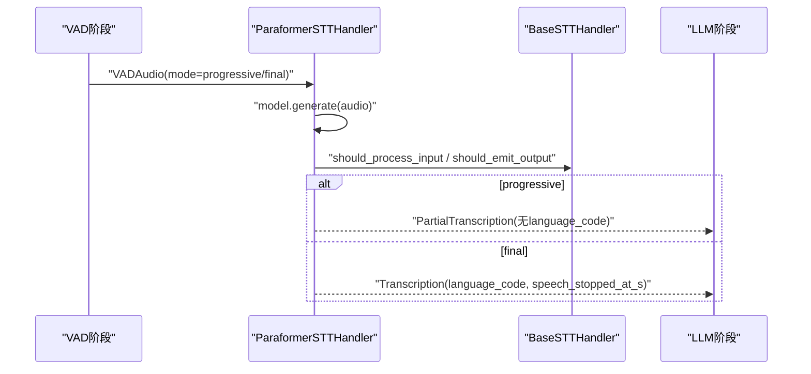
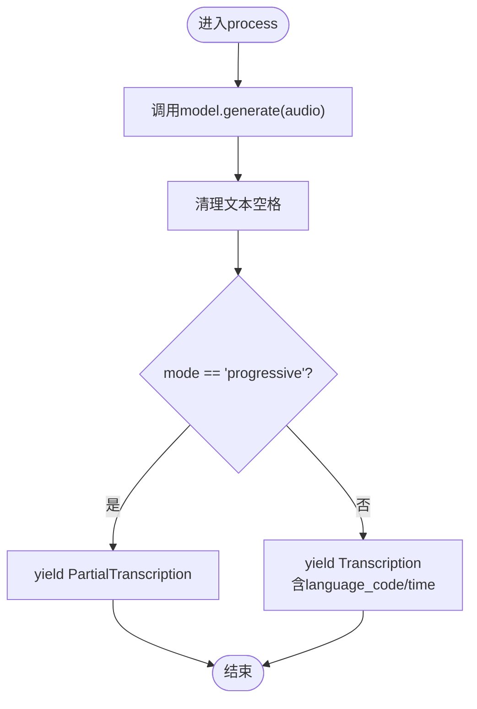
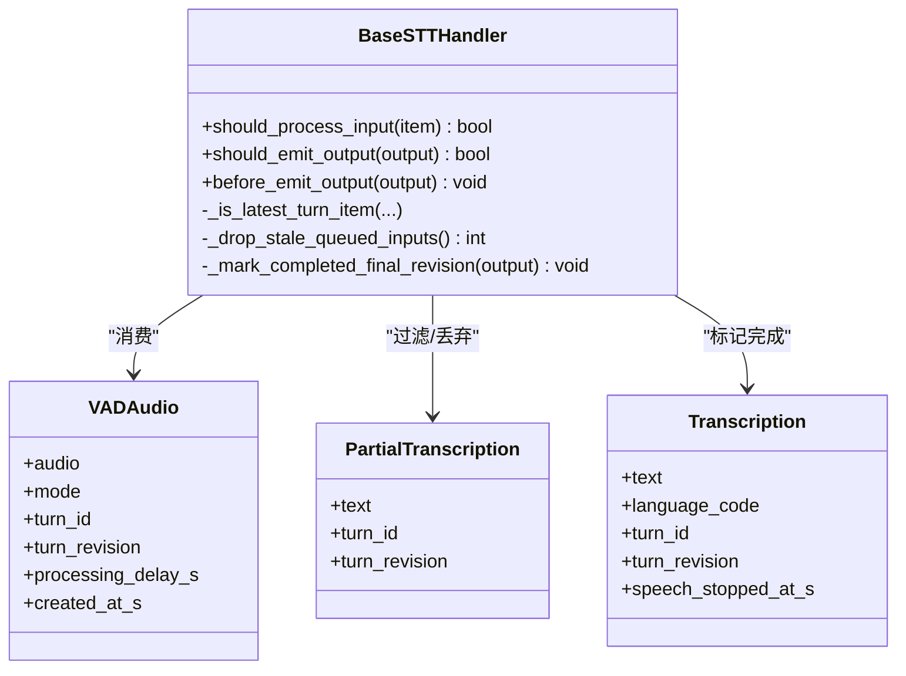
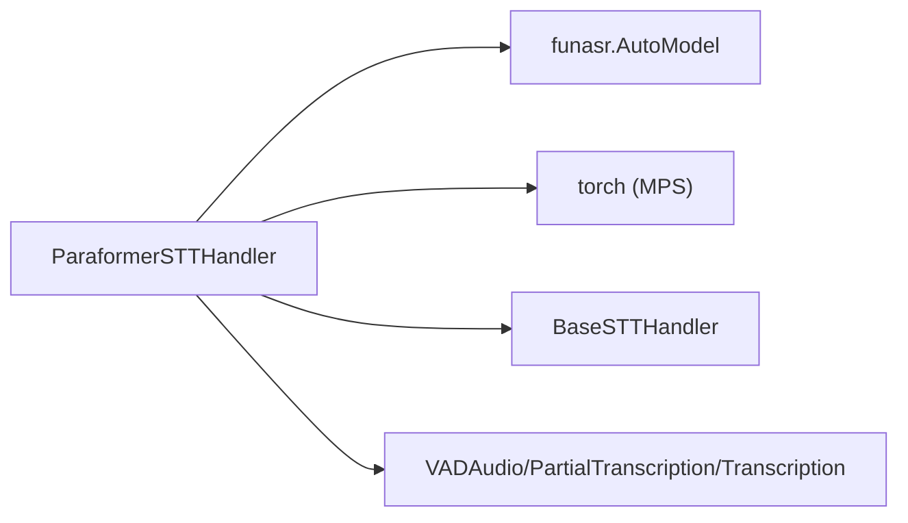

# Paraformer后端

<cite>
**本文引用的文件**
- [paraformer_handler.py](file://src/speech_to_speech/STT/paraformer_handler.py)
- [paraformer_stt_arguments.py](file://src/speech_to_speech/arguments_classes/paraformer_stt_arguments.py)
- [base_stt_handler.py](file://src/speech_to_speech/STT/base_stt_handler.py)
- [messages.py](file://src/speech_to_speech/pipeline/messages.py)
- [handler_types.py](file://src/speech_to_speech/pipeline/handler_types.py)
- [test_paraformer_transcription_events.py](file://tests/test_paraformer_transcription_events.py)
- [README-CN.md](file://README-CN.md)
- [benchmark_stt.py](file://scripts/benchmark_stt.py)
</cite>

## 目录
1. [简介](#简介)
2. [项目结构](#项目结构)
3. [核心组件](#核心组件)
4. [架构总览](#架构总览)
5. [详细组件分析](#详细组件分析)
6. [依赖关系分析](#依赖关系分析)
7. [性能考量](#性能考量)
8. [故障排查指南](#故障排查指南)
9. [结论](#结论)
10. [附录](#附录)

## 简介
本文件为 Paraformer 后端的完整技术文档，聚焦其在语音转文本（STT）流水线中的角色与实现。Paraformer 由阿里达摩院开发，通过 FunASR 集成到本项目的 STT 阶段，默认针对中文优化，同时支持其他亚洲语言模型变体。该后端提供：
- 增量转录机制：在“progressive”模式下输出中间结果，便于实时展示；在“final”模式下输出最终结果并携带语言代码和时间戳。
- 流式处理：与 VAD 切分的音频片段配合，按轮次（turn_id、turn_revision）进行去重与稳定性控制。
- 设备与内存优化：支持 CUDA/CPU/MPS，并在 Apple Silicon 上自动清理 MPS 缓存以降低峰值内存占用。
- 安装与配置：通过可选 extra 安装依赖，使用参数类管理模型名与设备选择。

## 项目结构
Paraformer 后端位于 STT 模块中，遵循统一的处理器接口与消息协议：
- 处理器实现：继承自 BaseSTTHandler，封装模型加载、预热与推理流程。
- 输入输出类型：基于 pipeline/messages.py 的 VADAudio、PartialTranscription、Transcription 等消息类型。
- 参数定义：通过 arguments_classes 下的数据类暴露 CLI/配置选项。
- 测试覆盖：单元测试验证语言解析、渐进式/最终输出行为及平台特定逻辑。

图表来源
- [paraformer_handler.py:19-81](file://src/speech_to_speech/STT/paraformer_handler.py#L19-L81)
- [base_stt_handler.py:16-71](file://src/speech_to_speech/STT/base_stt_handler.py#L16-L71)
- [messages.py:46-79](file://src/speech_to_speech/pipeline/messages.py#L46-L79)

章节来源
- [paraformer_handler.py:19-81](file://src/speech_to_speech/STT/paraformer_handler.py#L19-L81)
- [base_stt_handler.py:16-71](file://src/speech_to_speech/STT/base_stt_handler.py#L16-L71)
- [messages.py:46-79](file://src/speech_to_speech/pipeline/messages.py#L46-L79)

## 核心组件
- ParaformerSTTHandler：负责加载 FunASR AutoModel、执行推理、根据模式产出 PartialTranscription 或 Transcription，并进行 MPS 缓存清理。
- BaseSTTHandler：提供输入门控、输出过滤、陈旧项丢弃、完成标记与日志统计，确保多轮并发下的正确性。
- 消息类型：VADAudio（带 mode、turn_id、turn_revision）、PartialTranscription、Transcription、TranscriptionFailure。
- 参数类：ParaformerSTTHandlerArguments 暴露 model_name 与 device 两个关键配置项。

章节来源
- [paraformer_handler.py:19-81](file://src/speech_to_speech/STT/paraformer_handler.py#L19-L81)
- [base_stt_handler.py:16-214](file://src/speech_to_speech/STT/base_stt_handler.py#L16-L214)
- [messages.py:46-89](file://src/speech_to_speech/pipeline/messages.py#L46-L89)
- [paraformer_stt_arguments.py:4-16](file://src/speech_to_speech/arguments_classes/paraformer_stt_arguments.py#L4-L16)

## 架构总览
下图展示了从 VAD 到 STT 再到下游的消息流转与处理器协作关系，突出 Paraformer 在其中的位置与职责。

图表来源
- [paraformer_handler.py:56-81](file://src/speech_to_speech/STT/paraformer_handler.py#L56-L81)
- [base_stt_handler.py:24-71](file://src/speech_to_speech/STT/base_stt_handler.py#L24-L71)
- [messages.py:46-79](file://src/speech_to_speech/pipeline/messages.py#L46-L79)

## 详细组件分析

### ParaformerSTTHandler 分析
- 模型加载与语言推断：
  - 通过 funasr.AutoModel 加载指定模型名，支持形如 “paraformer-zh”、“funasr/paraformer-en” 等命名约定。
  - 自动从模型名提取 language_code（例如 zh/en），用于最终输出的语言标识。
- 预热与推理：
  - 使用固定长度 dummy 输入执行一次 generate 以触发编译/图捕获等初始化步骤。
  - 对传入的 audio 调用 generate，返回文本并做空白清理。
- 平台内存优化：
  - 当 device 为 mps 时，推理后调用 torch.mps.empty_cache() 释放缓存，避免累积占用。
- 输出模式：
  - progressive：输出 PartialTranscription，不包含 language_code。
  - final：输出 Transcription，包含 language_code 与 speech_stopped_at_s。

图表来源
- [paraformer_handler.py:56-81](file://src/speech_to_speech/STT/paraformer_handler.py#L56-L81)

章节来源
- [paraformer_handler.py:19-81](file://src/speech_to_speech/STT/paraformer_handler.py#L19-L81)
- [test_paraformer_transcription_events.py:25-47](file://tests/test_paraformer_transcription_events.py#L25-L47)
- [test_paraformer_transcription_events.py:49-95](file://tests/test_paraformer_transcription_events.py#L49-L95)
- [test_paraformer_transcription_events.py:97-111](file://tests/test_paraformer_transcription_events.py#L97-L111)
- [test_paraformer_transcription_events.py:113-132](file://tests/test_paraformer_transcription_events.py#L113-L132)

### BaseSTTHandler 与消息类型
- 输入门控：
  - 若已存在完成的 final revision，则丢弃后续 progressive 或陈旧输入。
  - 若队列中存在同 revision 的 final，则丢弃其前的 progressive。
  - 使用 SpeculativeTurnTracker 判断是否为最新 turn_item，必要时等待稳定性窗口。
- 输出过滤：
  - 对已完成 final 的 partial 输出进行丢弃，保证下游仅接收有效内容。
- 完成标记与陈旧项清理：
  - 记录已完成 final 的 revision key，限制最大数量以避免无限增长。
  - 安全地扫描输入队列，丢弃陈旧项并通知生产者。

图表来源
- [base_stt_handler.py:16-214](file://src/speech_to_speech/STT/base_stt_handler.py#L16-L214)
- [messages.py:46-89](file://src/speech_to_speech/pipeline/messages.py#L46-L89)

章节来源
- [base_stt_handler.py:16-214](file://src/speech_to_speech/STT/base_stt_handler.py#L16-L214)
- [messages.py:46-89](file://src/speech_to_speech/pipeline/messages.py#L46-L89)
- [handler_types.py:31-37](file://src/speech_to_speech/pipeline/handler_types.py#L31-L37)

### 参数与配置
- 模型选择：
  - paraformer_stt_model_name：默认 “paraformer-zh”，可从 FunASR 仓库中选择其他模型（如英文或流式变体）。
- 设备设置：
  - paraformer_stt_device：默认 “cuda”，可切换至 “cpu” 或 “mps”。
- 运行时行为：
  - 渐进式/最终模式由上游 VAD 决定（VADAudio.mode），非处理器直接配置。
  - 批处理大小：当前实现为单段音频推理，未内置批处理；如需批处理需在上游聚合或修改处理器。

章节来源
- [paraformer_stt_arguments.py:4-16](file://src/speech_to_speech/arguments_classes/paraformer_stt_arguments.py#L4-L16)
- [messages.py:46-57](file://src/speech_to_speech/pipeline/messages.py#L46-L57)

## 依赖关系分析
- 外部依赖：
  - funasr.AutoModel：动态导入，缺失时会抛出明确提示，要求通过可选 extra 安装。
  - torch：用于 MPS 缓存清理。
- 内部依赖：
  - BaseSTTHandler：提供通用门控与过滤逻辑。
  - Pipeline 消息：严格类型化的输入输出契约，保障上下游一致性。

图表来源
- [paraformer_handler.py:26-45](file://src/speech_to_speech/STT/paraformer_handler.py#L26-L45)
- [base_stt_handler.py:16-71](file://src/speech_to_speech/STT/base_stt_handler.py#L16-L71)
- [messages.py:46-89](file://src/speech_to_speech/pipeline/messages.py#L46-L89)

章节来源
- [paraformer_handler.py:26-45](file://src/speech_to_speech/STT/paraformer_handler.py#L26-L45)
- [base_stt_handler.py:16-71](file://src/speech_to_speech/STT/base_stt_handler.py#L16-L71)
- [messages.py:46-89](file://src/speech_to_speech/pipeline/messages.py#L46-L89)

## 性能考量
- 预热与首次延迟：
  - 处理器在 setup 后执行一次 dummy 推理以触发编译/图捕获，降低首次推理延迟。
- 设备与内存：
  - 在 MPS 设备上推理后主动清空缓存，减少峰值内存占用。
  - CPU 模式下不执行 MPS 清理，避免无效调用。
- 吞吐与批处理：
  - 当前实现为逐段推理；可通过上游聚合音频或使用更高吞吐的 STT 后端（如 Parakeet TDT）提升整体吞吐。
- 基准工具：
  - 可使用 scripts/benchmark_stt.py 对不同 STT 后端进行对比，测量推理时间、TTFT 与错误率。

章节来源
- [paraformer_handler.py:47-64](file://src/speech_to_speech/STT/paraformer_handler.py#L47-L64)
- [test_paraformer_transcription_events.py:113-132](file://tests/test_paraformer_transcription_events.py#L113-L132)
- [benchmark_stt.py:110-263](file://scripts/benchmark_stt.py#L110-L263)

## 故障排查指南
- 缺少可选依赖：
  - 现象：导入 funasr 失败。
  - 解决：安装可选 extra “paraformer”，参考 README 的安装说明。
- 语言代码不正确：
  - 现象：最终输出 language_code 不符合预期。
  - 解决：检查模型名是否包含语言后缀（如 zh/en），或通过测试用例确认解析逻辑。
- 渐进式与最终输出混淆：
  - 现象：下游收到不应处理的 partial。
  - 解决：确认上游 VAD 的 mode 设置，以及 BaseSTTHandler 的门控逻辑是否正确丢弃陈旧项。
- MPS 内存泄漏：
  - 现象：长时间运行后显存持续增长。
  - 解决：确认 device 为 mps 且推理后执行了 empty_cache；CPU 模式不会调用 MPS 清理。

章节来源
- [paraformer_handler.py:37-45](file://src/speech_to_speech/STT/paraformer_handler.py#L37-L45)
- [test_paraformer_transcription_events.py:25-47](file://tests/test_paraformer_transcription_events.py#L25-L47)
- [test_paraformer_transcription_events.py:49-95](file://tests/test_paraformer_transcription_events.py#L49-L95)
- [test_paraformer_transcription_events.py:113-132](file://tests/test_paraformer_transcription_events.py#L113-L132)
- [README-CN.md:137-150](file://README-CN.md#L137-L150)

## 结论
Paraformer 后端在本项目中提供了稳定、易用的中文语音识别能力，并通过 FunASR 集成实现了灵活的模型选择与设备适配。结合 BaseSTTHandler 的输入门控与输出过滤，系统能够在多轮并发场景下保持正确的时序与一致性。对于需要更低延迟或更高吞吐的场景，可考虑启用渐进式输出或切换到其他高性能 STT 后端。

## 附录
- 安装与启用：
  - 通过 pip extras 安装 Paraformer 依赖，并在 CLI 或配置中设置模型名与设备。
  - 参考 README 的“可选组件”部分获取安装命令。
- 最佳实践：
  - 使用 progressive 模式进行实时展示，final 模式作为最终落盘或 LLM 输入。
  - 在 Apple Silicon 上开启 MPS 并依赖自动缓存清理。
  - 使用基准脚本评估不同后端与配置的性能差异。

章节来源
- [README-CN.md:98-150](file://README-CN.md#L98-L150)
- [benchmark_stt.py:333-386](file://scripts/benchmark_stt.py#L333-L386)