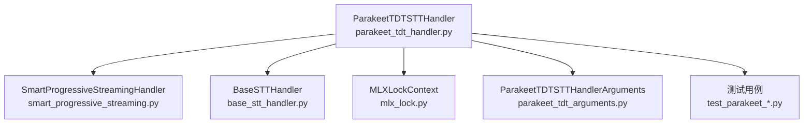
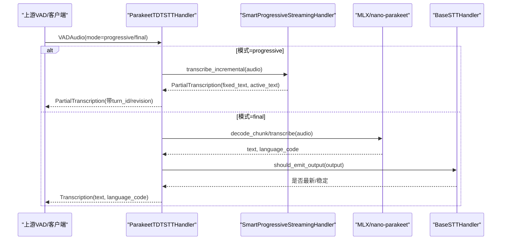
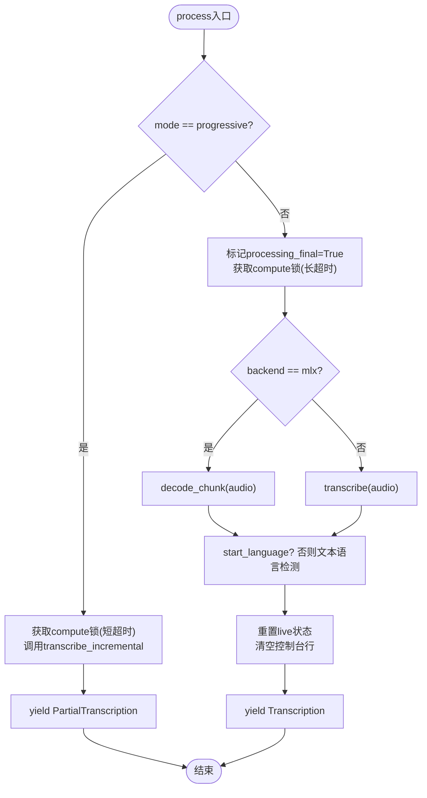
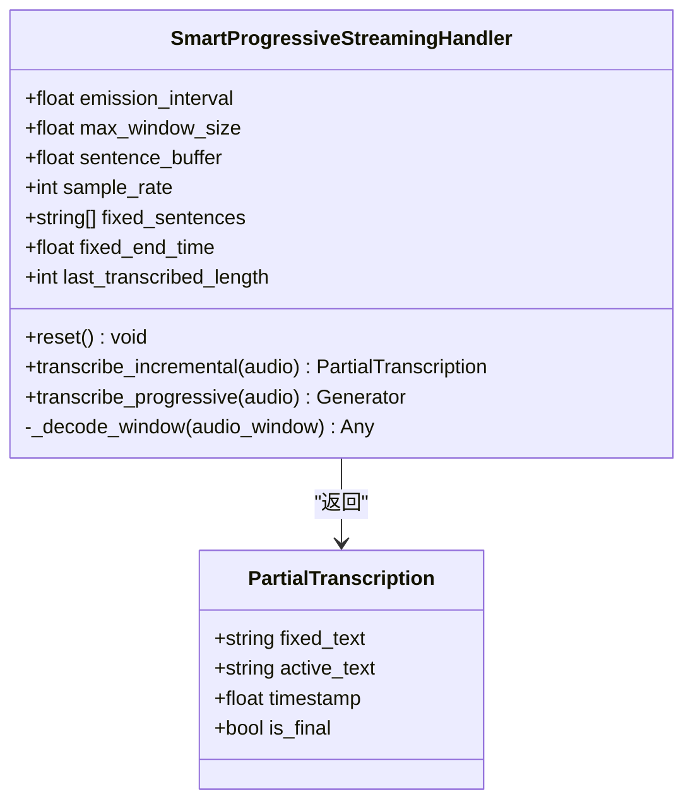
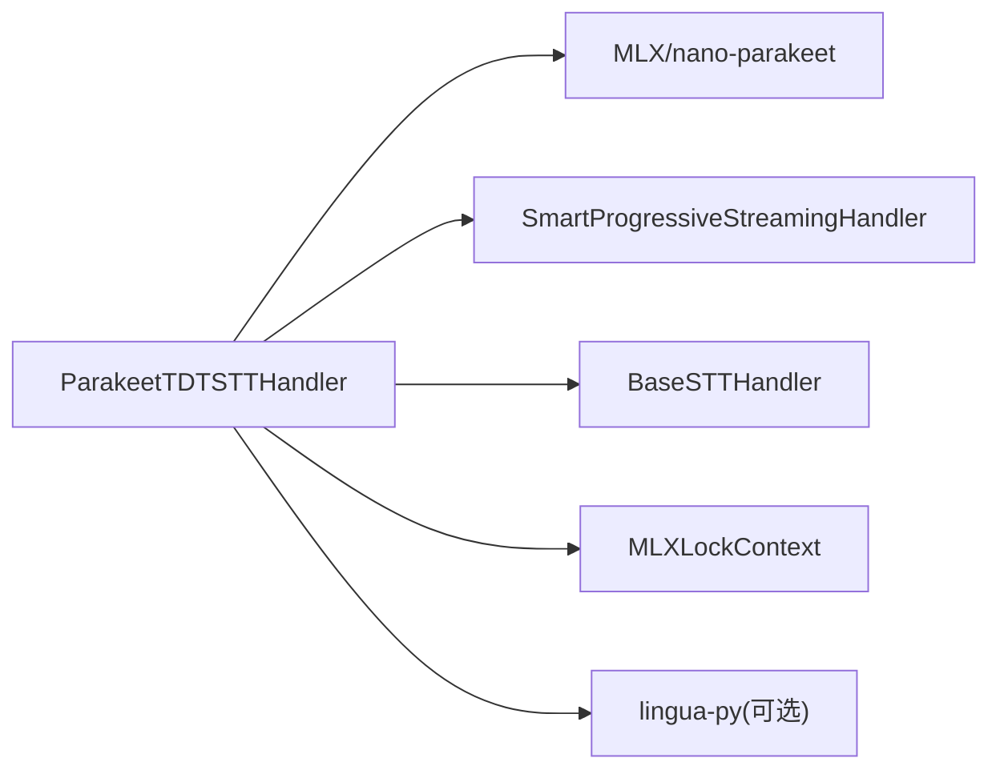

# Parakeet TDT 后端

<cite>
**本文引用的文件**
- [parakeet_tdt_handler.py](file://src/speech_to_speech/STT/parakeet_tdt_handler.py)
- [parakeet_tdt_arguments.py](file://src/speech_to_speech/arguments_classes/parakeet_tdt_arguments.py)
- [base_stt_handler.py](file://src/speech_to_speech/STT/base_stt_handler.py)
- [smart_progressive_streaming.py](file://src/speech_to_speech/STT/smart_progressive_streaming.py)
- [mlx_lock.py](file://src/speech_to_speech/utils/mlx_lock.py)
- [test_parakeet_language_detection.py](file://tests/test_parakeet_language_detection.py)
- [test_parakeet_transcription_events.py](file://tests/test_parakeet_transcription_events.py)
- [README-CN.md](file://README-CN.md)
</cite>

## 目录
1. [简介](#简介)
2. [项目结构](#项目结构)
3. [核心组件](#核心组件)
4. [架构总览](#架构总览)
5. [详细组件分析](#详细组件分析)
6. [依赖关系分析](#依赖关系分析)
7. [性能与内存优化](#性能与内存优化)
8. [故障排查指南](#故障排查指南)
9. [结论](#结论)
10. [附录：配置参数参考](#附录：配置参数参考)

## 简介
Parakeet TDT 是本项目的默认语音转文本（STT）后端，基于 NVIDIA Parakeet TDT 0.6B v3 模型，支持 25 种欧洲语言并具备自动语言检测能力。它提供两种运行路径：
- Apple Silicon（MPS）：通过 MLX Audio 加载 mlx-community/parakeet-tdt-0.6b-v3，利用 Metal 加速推理。
- CUDA/CPU：通过 nano-parakeet（纯 PyTorch）加载 nvidia/parakeet-tdt-0.6b-v3，无需 NeMo 即可推理。

该后端同时支持实时增量转录（流式处理），在用户说话时持续输出“固定部分 + 活动部分”的中间结果，并在最终音频到达后合并为完整转录。

**章节来源**
- [parakeet_tdt_handler.py:1-10](file://src/speech_to_speech/STT/parakeet_tdt_handler.py#L1-L10)
- [parakeet_tdt_handler.py:40-67](file://src/speech_to_speech/STT/parakeet_tdt_handler.py#L40-L67)
- [parakeet_tdt_handler.py:91-159](file://src/speech_to_speech/STT/parakeet_tdt_handler.py#L91-L159)
- [README-CN.md:106-113](file://README-CN.md#L106-L113)

## 项目结构
围绕 Parakeet TDT 的核心代码分布在 STT 模块、参数类、流式处理工具以及平台锁工具中：
- STT 处理器：实现设备选择、模型加载、推理流程、增量与最终转录、语言检测等。
- 参数类：暴露 CLI/配置项，如模型名、设备、计算精度、目标语言等。
- 流式处理：SmartProgressiveStreamingHandler 负责窗口滑动、句子边界固定、增量输出。
- 平台锁：MLXLockContext 保证 MLX 资源在多任务下的安全访问。
- 基类：BaseSTTHandler 提供推测轮次与陈旧输入过滤、队列清理等通用逻辑。

**图表来源**
- [parakeet_tdt_handler.py:91-178](file://src/speech_to_speech/STT/parakeet_tdt_handler.py#L91-L178)
- [smart_progressive_streaming.py:28-68](file://src/speech_to_speech/STT/smart_progressive_streaming.py#L28-L68)
- [base_stt_handler.py:16-71](file://src/speech_to_speech/STT/base_stt_handler.py#L16-L71)
- [mlx_lock.py:159-180](file://src/speech_to_speech/utils/mlx_lock.py#L159-L180)
- [parakeet_tdt_arguments.py:5-40](file://src/speech_to_speech/arguments_classes/parakeet_tdt_arguments.py#L5-L40)

**章节来源**
- [parakeet_tdt_handler.py:91-178](file://src/speech_to_speech/STT/parakeet_tdt_handler.py#L91-L178)
- [smart_progressive_streaming.py:28-68](file://src/speech_to_speech/STT/smart_progressive_streaming.py#L28-L68)
- [base_stt_handler.py:16-71](file://src/speech_to_speech/STT/base_stt_handler.py#L16-L71)
- [mlx_lock.py:159-180](file://src/speech_to_speech/utils/mlx_lock.py#L159-L180)
- [parakeet_tdt_arguments.py:5-40](file://src/speech_to_speech/arguments_classes/parakeet_tdt_arguments.py#L5-L40)

## 核心组件
- ParakeetTDTSTTHandler：封装设备选择、模型加载、推理、增量与最终转录、语言检测、控制台输出、会话状态管理。
- SmartProgressiveStreamingHandler：智能流式处理，按句边界固定已完成句子，仅对活动部分重转录，控制窗口大小和更新频率。
- BaseSTTHandler：提供推测轮次门控、陈旧输入丢弃、完成修订追踪、日志统计等通用机制。
- MLXLockContext：全局可重入锁，避免多并发下 MLX/Metal 资源竞争导致的不稳定。
- 参数类：定义 CLI/配置项，便于在不同硬件上切换模型和设备。

**章节来源**
- [parakeet_tdt_handler.py:91-178](file://src/speech_to_speech/STT/parakeet_tdt_handler.py#L91-L178)
- [smart_progressive_streaming.py:28-68](file://src/speech_to_speech/STT/smart_progressive_streaming.py#L28-L68)
- [base_stt_handler.py:16-71](file://src/speech_to_speech/STT/base_stt_handler.py#L16-L71)
- [mlx_lock.py:159-180](file://src/speech_to_speech/utils/mlx_lock.py#L159-L180)
- [parakeet_tdt_arguments.py:5-40](file://src/speech_to_speech/arguments_classes/parakeet_tdt_arguments.py#L5-L40)

## 架构总览
Parakeet TDT 在后端层根据设备自动选择 MLX 或 nano-parakeet 路径；在启用实时转录时，使用 SmartProgressiveStreamingHandler 进行增量处理，最终转录阶段合并固定部分与活动部分，并通过 BaseSTTHandler 的门控机制确保只输出最新的、稳定的结果。

**图表来源**
- [parakeet_tdt_handler.py:236-370](file://src/speech_to_speech/STT/parakeet_tdt_handler.py#L236-L370)
- [smart_progressive_streaming.py:87-157](file://src/speech_to_speech/STT/smart_progressive_streaming.py#L87-L157)
- [base_stt_handler.py:24-71](file://src/speech_to_speech/STT/base_stt_handler.py#L24-L71)

## 详细组件分析

### ParakeetTDTSTTHandler：设备选择与推理流程
- 设备选择：auto 模式下，macOS 使用 MPS，其他平台优先 CUDA，否则回退 CPU。
- 模型加载：
  - MPS：通过 MLX Audio 加载 mlx-community/parakeet-tdt-0.6b-v3。
  - CUDA/CPU：通过 nano-parakeet 加载 nvidia/parakeet-tdt-0.6b-v3。
- 推理流程：
  - progressive：调用 SmartProgressiveStreamingHandler.transcribe_incremental，输出 PartialTranscription。
  - final：根据后端调用 decode_chunk 或 transcribe，得到文本与语言代码，结合 start_language 与文本语言检测结果确定最终语言。
- 实时转录：
  - 启用时维护 streaming_handler，跟踪 fixed_sentences 与 fixed_end_time，最终转录阶段复用已固定的句子以减少重复计算。
  - 使用 compute lock（MLX 或普通锁）控制并发，避免资源竞争。
- 语言检测：
  - 若未指定 start_language，则从转录文本使用 lingua-py 检测语言，并将特殊映射（如 nb→no）转换到支持的 25 种欧洲语言集合。
- 会话结束：
  - 重置 last_language、processing_final、streaming_handler 状态，确保下一轮会话干净。

**图表来源**
- [parakeet_tdt_handler.py:236-370](file://src/speech_to_speech/STT/parakeet_tdt_handler.py#L236-L370)
- [parakeet_tdt_handler.py:379-403](file://src/speech_to_speech/STT/parakeet_tdt_handler.py#L379-L403)
- [parakeet_tdt_handler.py:524-587](file://src/speech_to_speech/STT/parakeet_tdt_handler.py#L524-L587)
- [parakeet_tdt_handler.py:589-634](file://src/speech_to_speech/STT/parakeet_tdt_handler.py#L589-L634)

**章节来源**
- [parakeet_tdt_handler.py:102-178](file://src/speech_to_speech/STT/parakeet_tdt_handler.py#L102-L178)
- [parakeet_tdt_handler.py:180-211](file://src/speech_to_speech/STT/parakeet_tdt_handler.py#L180-L211)
- [parakeet_tdt_handler.py:213-235](file://src/speech_to_speech/STT/parakeet_tdt_handler.py#L213-L235)
- [parakeet_tdt_handler.py:236-370](file://src/speech_to_speech/STT/parakeet_tdt_handler.py#L236-L370)
- [parakeet_tdt_handler.py:379-403](file://src/speech_to_speech/STT/parakeet_tdt_handler.py#L379-L403)
- [parakeet_tdt_handler.py:524-587](file://src/speech_to_speech/STT/parakeet_tdt_handler.py#L524-L587)
- [parakeet_tdt_handler.py:589-634](file://src/speech_to_speech/STT/parakeet_tdt_handler.py#L589-L634)
- [parakeet_tdt_handler.py:636-649](file://src/speech_to_speech/STT/parakeet_tdt_handler.py#L636-L649)

### SmartProgressiveStreamingHandler：增量与窗口管理
- 策略：每 500ms 发出一次增量，窗口增长至最大 15s；超过阈值后按句边界固定已完成句子，仅对活动部分重转录。
- 关键属性：fixed_sentences、fixed_end_time、last_transcribed_length。
- 方法：
  - reset()：重置流式状态。
  - transcribe_incremental(audio)：增量转录，返回 PartialTranscription。
  - transcribe_progressive(audio)：生成器方式逐步产出增量。
- 解码适配：
  - MLX：直接调用 model.decode_chunk。
  - nano-parakeet：使用 timestamps=True 提取 segment 信息构建 sentences。

**图表来源**
- [smart_progressive_streaming.py:18-26](file://src/speech_to_speech/STT/smart_progressive_streaming.py#L18-L26)
- [smart_progressive_streaming.py:28-68](file://src/speech_to_speech/STT/smart_progressive_streaming.py#L28-L68)
- [smart_progressive_streaming.py:69-85](file://src/speech_to_speech/STT/smart_progressive_streaming.py#L69-L85)
- [smart_progressive_streaming.py:87-157](file://src/speech_to_speech/STT/smart_progressive_streaming.py#L87-L157)
- [smart_progressive_streaming.py:159-234](file://src/speech_to_speech/STT/smart_progressive_streaming.py#L159-L234)

**章节来源**
- [smart_progressive_streaming.py:28-68](file://src/speech_to_speech/STT/smart_progressive_streaming.py#L28-L68)
- [smart_progressive_streaming.py:69-85](file://src/speech_to_speech/STT/smart_progressive_streaming.py#L69-L85)
- [smart_progressive_streaming.py:87-157](file://src/speech_to_speech/STT/smart_progressive_streaming.py#L87-L157)
- [smart_progressive_streaming.py:159-234](file://src/speech_to_speech/STT/smart_progressive_streaming.py#L159-L234)

### BaseSTTHandler：推测轮次与陈旧输入过滤
- 功能：
  - should_process_input：丢弃已完成修订或陈旧输入，必要时清理队列中的陈旧项。
  - should_emit_output：仅输出最新且稳定的输出。
  - before_emit_output：标记完成的最终修订。
  - _is_latest_turn_item：依据 SpeculativeTurnTracker 判断是否为最新。
  - _drop_stale_queued_inputs：清理队列中的陈旧项。
- 作用：保障在多轮次、推测式处理场景下，只有最新的、稳定的转录被提交给下游。

**章节来源**
- [base_stt_handler.py:16-71](file://src/speech_to_speech/STT/base_stt_handler.py#L16-L71)
- [base_stt_handler.py:73-102](file://src/speech_to_speech/STT/base_stt_handler.py#L73-L102)
- [base_stt_handler.py:104-157](file://src/speech_to_speech/STT/base_stt_handler.py#L104-L157)
- [base_stt_handler.py:158-214](file://src/speech_to_speech/STT/base_stt_handler.py#L158-L214)

### MLXLockContext：跨线程 MLX 资源保护
- 目的：防止多并发下 MLX/Metal 资源竞争导致的 GPU 重启或索引错误。
- 特性：
  - 全局可重入锁（RLock）。
  - 记录持有者、等待时间、深度等信息，便于调试。
  - 提供上下文管理器 MLXLockContext，统一获取/释放。
- 使用：Parakeet TDT 在 MLX 后端通过该上下文管理 compute 锁，避免与其他 MLX 组件冲突。

**章节来源**
- [mlx_lock.py:1-15](file://src/speech_to_speech/utils/mlx_lock.py#L1-L15)
- [mlx_lock.py:87-134](file://src/speech_to_speech/utils/mlx_lock.py#L87-L134)
- [mlx_lock.py:137-180](file://src/speech_to_speech/utils/mlx_lock.py#L137-L180)

## 依赖关系分析
- ParakeetTDTSTTHandler 依赖：
  - MLX Audio（Apple Silicon）或 nano-parakeet（CUDA/CPU）。
  - SmartProgressiveStreamingHandler（可选，用于实时转录）。
  - BaseSTTHandler（通用门控与陈旧输入处理）。
  - MLXLockContext（MLX 后端并发安全）。
  - lingua-py（可选，用于文本语言检测）。
- 外部依赖：
  - numpy、torch（nano-parakeet）、rich（控制台输出）。
  - Hugging Face Hub 模型仓库（mlx-community 或 nvidia）。

**图表来源**
- [parakeet_tdt_handler.py:180-211](file://src/speech_to_speech/STT/parakeet_tdt_handler.py#L180-L211)
- [parakeet_tdt_handler.py:160-178](file://src/speech_to_speech/STT/parakeet_tdt_handler.py#L160-L178)
- [parakeet_tdt_handler.py:379-403](file://src/speech_to_speech/STT/parakeet_tdt_handler.py#L379-L403)

**章节来源**
- [parakeet_tdt_handler.py:180-211](file://src/speech_to_speech/STT/parakeet_tdt_handler.py#L180-L211)
- [parakeet_tdt_handler.py:160-178](file://src/speech_to_speech/STT/parakeet_tdt_handler.py#L160-L178)
- [parakeet_tdt_handler.py:379-403](file://src/speech_to_speech/STT/parakeet_tdt_handler.py#L379-L403)

## 性能与内存优化
- 设备与模型选择：
  - Apple Silicon：使用 MLX 路径，Metal 加速，适合本地低延迟场景。
  - CUDA/CPU：使用 nano-parakeet，无需 NeMo，部署简单。
- 计算精度：
  - 支持 float16/float32，默认 float16 以平衡速度与精度。
- 实时转录优化：
  - 增量更新间隔默认 0.5s，窗口最大 15s，句缓冲 2s，减少重复计算。
  - 最终转录阶段复用已固定句子，仅对剩余音频解码。
- 并发与锁：
  - MLX 后端使用全局可重入锁，避免多任务竞争；非 MLX 使用普通锁，短超时跳过陈旧增量。
- 内存管理：
  - 流式处理仅维护必要状态（fixed_sentences、fixed_end_time、last_transcribed_length）。
  - 会话结束时重置状态，避免泄漏。
- 预热：
  - 启动时执行 dummy 推理，降低首次请求延迟。

[本节为通用指导，不直接分析具体文件]

## 故障排查指南
- 导入错误：
  - MLX 路径缺少 mlx-audio：安装对应依赖。
  - CUDA/CPU 路径缺少 nano-parakeet：安装对应依赖。
- 语言检测失败：
  - lingua-py 未安装或文本过短：跳过检测，回退到 last_language。
- 锁竞争：
  - 长时间等待锁：检查是否有其他 MLX 组件占用资源；调整超时或并发度。
- 陈旧输入：
  - 观察到大量丢弃日志：确认推测轮次与稳定性窗口设置合理。
- 控制台输出异常：
  - 终端宽度限制导致截断：属预期行为，不影响转录质量。

**章节来源**
- [parakeet_tdt_handler.py:180-211](file://src/speech_to_speech/STT/parakeet_tdt_handler.py#L180-L211)
- [parakeet_tdt_handler.py:379-403](file://src/speech_to_speech/STT/parakeet_tdt_handler.py#L379-L403)
- [mlx_lock.py:87-134](file://src/speech_to_speech/utils/mlx_lock.py#L87-L134)
- [base_stt_handler.py:104-157](file://src/speech_to_speech/STT/base_stt_handler.py#L104-L157)
- [test_parakeet_transcription_events.py:30-80](file://tests/test_parakeet_transcription_events.py#L30-L80)

## 结论
Parakeet TDT 作为默认 STT 后端，提供了高质量的多语言识别、自动语言检测与实时增量转录能力。通过 MLX 与 nano-parakeet 双后端适配，可在 Apple Silicon 与 CUDA/CPU 平台上高效运行。结合 SmartProgressiveStreamingHandler 与 BaseSTTHandler 的流式与门控机制，系统在保证低延迟的同时维持高准确性与稳定性。合理的配置与优化建议可进一步提升性能与资源利用率。

[本节为总结性内容，不直接分析具体文件]

## 附录：配置参数参考
- 模型选择：
  - parakeet_tdt_model_name：默认 auto 选择 mlx-community/parakeet-tdt-0.6b-v3（MPS）或 nvidia/parakeet-tdt-0.6b-v3（CUDA/CPU）。
- 设备设置：
  - parakeet_tdt_device：auto/cuda/mps/cpu，auto 在 macOS 使用 mps，其他平台优先 cuda。
- 计算精度：
  - parakeet_tdt_compute_type：float16/float32，默认 float16。
- 语言检测：
  - parakeet_tdt_language：目标语言代码，None 表示自动检测；支持 25 种欧洲语言。
- 实时转录：
  - enable_live_transcription：启用增量转录。
  - live_transcription_update_interval：增量更新间隔（秒）。

**章节来源**
- [parakeet_tdt_arguments.py:5-40](file://src/speech_to_speech/arguments_classes/parakeet_tdt_arguments.py#L5-L40)
- [parakeet_tdt_handler.py:102-159](file://src/speech_to_speech/STT/parakeet_tdt_handler.py#L102-L159)
- [parakeet_tdt_handler.py:160-178](file://src/speech_to_speech/STT/parakeet_tdt_handler.py#L160-L178)