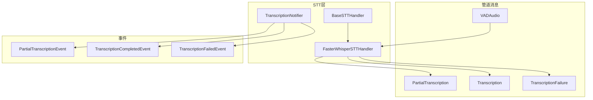
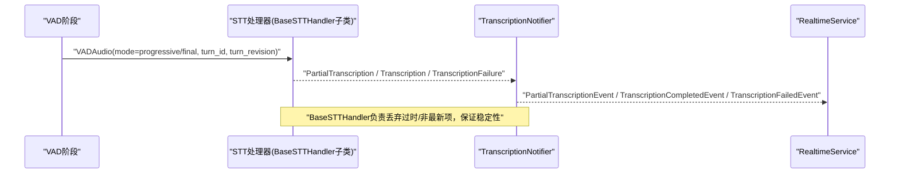
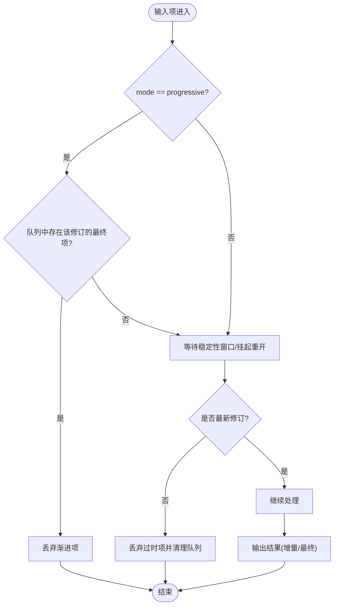
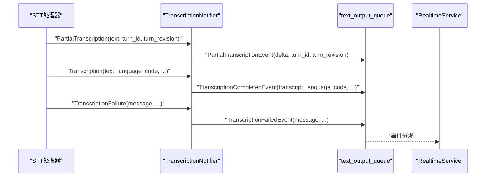
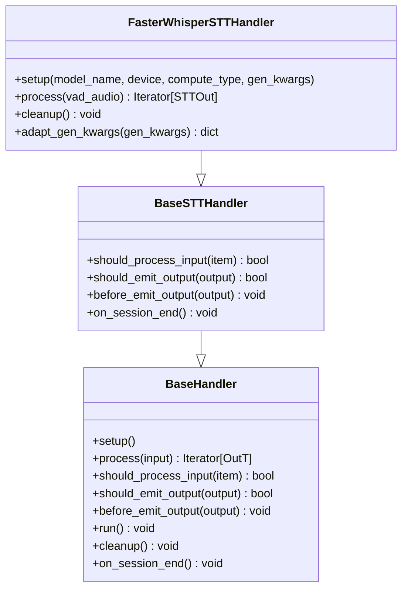
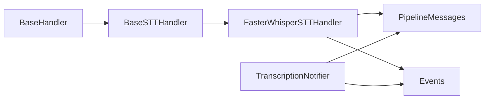

# STT基础架构

<cite>
**本文引用的文件**
- [base_stt_handler.py](file://src/speech_to_speech/STT/base_stt_handler.py)
- [transcription_notifier.py](file://src/speech_to_speech/STT/transcription_notifier.py)
- [messages.py](file://src/speech_to_speech/pipeline/messages.py)
- [events.py](file://src/speech_to_speech/pipeline/events.py)
- [handler_types.py](file://src/speech_to_speech/pipeline/handler_types.py)
- [baseHandler.py](file://src/speech_to_speech/baseHandler.py)
- [faster_whisper_handler.py](file://src/speech_to_speech/STT/faster_whisper_handler.py)
- [faster_whisper_stt_arguments.py](file://src/speech_to_speech/arguments_classes/faster_whisper_stt_arguments.py)
- [README.md](file://src/speech_to_speech/STT/README.md)
- [test_transcription_notifier.py](file://tests/test_transcription_notifier.py)
- [test_paraformer_transcription_events.py](file://tests/test_paraformer_transcription_events.py)
</cite>

## 目录
1. [简介](#简介)
2. [项目结构](#项目结构)
3. [核心组件](#核心组件)
4. [架构总览](#架构总览)
5. [详细组件分析](#详细组件分析)
6. [依赖关系分析](#依赖关系分析)
7. [性能考量](#性能考量)
8. [故障排查指南](#故障排查指南)
9. [结论](#结论)
10. [附录](#附录)

## 简介
本文件面向STT（语音转文本）模块的基础架构，系统性阐述BaseSTTHandler基类的设计模式与抽象接口、处理器生命周期管理、输入输出数据格式、转录通知机制（增量与最终事件）、以及自定义STT后端的开发与扩展方法。同时提供测试策略与调试技巧，帮助读者快速理解并安全地扩展现有STT后端或接入新的语音识别引擎。

## 项目结构
STT模块位于src/speech_to_speech/STT目录下，围绕统一的基类与消息类型构建，支持多种后端实现（Whisper、Faster-Whisper、Paraformer、Parakeet、OpenAI兼容等）。关键文件包括：
- 基类与通用逻辑：BaseSTTHandler、TranscriptionNotifier
- 管道消息与事件：PipelineMessage族、事件族
- 具体后端：如FasterWhisperSTTHandler等
- 参数配置：各后端的Arguments类
- 文档与示例：STT README

图表来源
- [base_stt_handler.py:16-214](file://src/speech_to_speech/STT/base_stt_handler.py#L16-L214)
- [faster_whisper_handler.py:36-149](file://src/speech_to_speech/STT/faster_whisper_handler.py#L36-L149)
- [transcription_notifier.py:26-107](file://src/speech_to_speech/STT/transcription_notifier.py#L26-L107)
- [messages.py:46-90](file://src/speech_to_speech/pipeline/messages.py#L46-L90)
- [events.py:56-83](file://src/speech_to_speech/pipeline/events.py#L56-L83)

章节来源
- [README.md:7-16](file://src/speech_to_speech/STT/README.md#L7-L16)

## 核心组件
- BaseSTTHandler：提供“推测性轮次”的过时输入过滤、最终修订完成跟踪、队列清理与日志统计，确保在实时流式场景下只处理最新且稳定的结果。
- TranscriptionNotifier：桥接STT与LLM，将STT输出转换为协议中立的转录事件（增量/完成/失败），并通过text_output_queue发布给上层服务。
- Pipeline消息：定义STT阶段输入输出类型，包括VADAudio、PartialTranscription、Transcription、TranscriptionFailure等。
- 事件模型：PartialTranscriptionEvent、TranscriptionCompletedEvent、TranscriptionFailedEvent等，供RealtimeService消费。
- 具体后端：以FasterWhisperSTTHandler为代表，演示如何实现process、cleanup、语言解析、渐进/最终模式输出。

章节来源
- [base_stt_handler.py:16-214](file://src/speech_to_speech/STT/base_stt_handler.py#L16-L214)
- [transcription_notifier.py:26-107](file://src/speech_to_speech/STT/transcription_notifier.py#L26-L107)
- [messages.py:46-90](file://src/speech_to_speech/pipeline/messages.py#L46-L90)
- [events.py:56-83](file://src/speech_to_speech/pipeline/events.py#L56-L83)
- [faster_whisper_handler.py:36-149](file://src/speech_to_speech/STT/faster_whisper_handler.py#L36-L149)

## 架构总览
STT流水线从VAD阶段产出VADAudio，进入STT阶段进行识别，产生PartialTranscription（增量）或Transcription/TranscriptionFailure（最终）。TranscriptionNotifier将这些消息转换为事件，通过text_output_queue推送给RealtimeService，用于更新对话状态和触发LLM请求。

图表来源
- [messages.py:46-90](file://src/speech_to_speech/pipeline/messages.py#L46-L90)
- [base_stt_handler.py:24-71](file://src/speech_to_speech/STT/base_stt_handler.py#L24-L71)
- [transcription_notifier.py:42-107](file://src/speech_to_speech/STT/transcription_notifier.py#L42-L107)

## 详细组件分析

### BaseSTTHandler：设计模式与抽象接口
- 设计模式
  - 模板方法：继承BaseHandler，重写should_process_input、should_emit_output、before_emit_output，统一处理流程。
  - 推测性轮次过滤：基于SpeculativeTurnTracker判断是否为最新修订，避免旧结果污染后续处理。
  - 最终修订完成跟踪：记录已完成最终修订，防止重复处理或输出。
- 关键行为
  - should_process_input：根据mode（progressive/final）与turn_revision决定是否处理；必要时清理队列中的过时项。
  - should_emit_output：对PartialTranscription/Transcription做最终修订检查与最新性校验。
  - before_emit_output：标记Transcription为已完成最终修订。
  - on_session_end：清理内部状态（如已完成修订集合）。
- 复杂度与性能
  - 队列清理使用互斥锁保护，时间复杂度与队列长度线性相关，但仅在必要时触发。
  - 日志聚合减少重复信息噪音，提升可观测性。

图表来源
- [base_stt_handler.py:24-71](file://src/speech_to_speech/STT/base_stt_handler.py#L24-L71)
- [base_stt_handler.py:104-128](file://src/speech_to_speech/STT/base_stt_handler.py#L104-L128)

章节来源
- [base_stt_handler.py:16-214](file://src/speech_to_speech/STT/base_stt_handler.py#L16-L214)

### TranscriptionNotifier：转录通知机制（发布订阅）
- 职责
  - 接收STT输出（PartialTranscription、Transcription、TranscriptionFailure），转换为协议中立事件。
  - 通过text_output_queue发布事件，供RealtimeService消费，更新对话状态并触发LLM请求。
  - 空最终转录时设置should_listen事件，重新启用监听。
- 事件类型
  - PartialTranscriptionEvent：增量转录事件，携带累积文本delta与turn上下文。
  - TranscriptionCompletedEvent：最终转录完成事件，包含完整文本、语言码、停止时间戳等。
  - TranscriptionFailedEvent：转录失败事件，携带错误信息与turn上下文。
- 行为要点
  - 增量事件仅用于前端展示或中间态，不直接转发到LLM。
  - 最终事件无论文本是否为空都会发出，保证客户端一致性。
  - 失败事件不改变监听状态，交由上层决定。

图表来源
- [transcription_notifier.py:42-107](file://src/speech_to_speech/STT/transcription_notifier.py#L42-L107)
- [events.py:56-83](file://src/speech_to_speech/pipeline/events.py#L56-L83)

章节来源
- [transcription_notifier.py:26-107](file://src/speech_to_speech/STT/transcription_notifier.py#L26-L107)
- [events.py:56-83](file://src/speech_to_speech/pipeline/events.py#L56-L83)

### 输入输出数据格式
- 输入（STTIn）
  - VADAudio：来自VAD阶段的音频片段，包含mode（progressive/final）、turn_id、turn_revision、processing_delay_s、created_at_s等元数据。
- 输出（STTOut）
  - PartialTranscription：增量转录，包含text、turn_id、turn_revision。
  - Transcription：最终转录，包含text、language_code、turn_id、turn_revision、speech_stopped_at_s。
  - TranscriptionFailure：失败信息，包含message、turn_id、turn_revision、speech_stopped_at_s。
- 事件（Events）
  - PartialTranscriptionEvent、TranscriptionCompletedEvent、TranscriptionFailedEvent：用于向RealtimeService上报。

章节来源
- [messages.py:46-90](file://src/speech_to_speech/pipeline/messages.py#L46-L90)
- [handler_types.py:35-37](file://src/speech_to_speech/pipeline/handler_types.py#L35-L37)
- [events.py:56-83](file://src/speech_to_speech/pipeline/events.py#L56-L83)

### 生命周期管理
- 初始化（setup）
  - 由BaseHandler.__init__调用，具体后端在此加载模型、准备生成参数等。
- 运行（run）
  - BaseHandler.run循环从queue_in取项，调用should_process_input过滤，执行process，再经should_emit_output与before_emit_output处理后放入queue_out。
  - 遇到SESSION_END控制消息时调用on_session_end，保持会话级状态清理。
- 清理（cleanup）
  - 线程退出前调用，释放资源（如模型句柄）。
- 会话结束（on_session_end）
  - BaseSTTHandler清理已完成最终修订集合，避免内存泄漏。

图表来源
- [baseHandler.py:25-186](file://src/speech_to_speech/baseHandler.py#L25-L186)
- [base_stt_handler.py:16-214](file://src/speech_to_speech/STT/base_stt_handler.py#L16-L214)
- [faster_whisper_handler.py:36-149](file://src/speech_to_speech/STT/faster_whisper_handler.py#L36-L149)

章节来源
- [baseHandler.py:25-186](file://src/speech_to_speech/baseHandler.py#L25-L186)
- [base_stt_handler.py:16-214](file://src/speech_to_speech/STT/base_stt_handler.py#L16-L214)
- [faster_whisper_handler.py:36-149](file://src/speech_to_speech/STT/faster_whisper_handler.py#L36-L149)

### 自定义STT后端开发指南
- 接口实现
  - 继承BaseSTTHandler，实现setup、process、cleanup。
  - process需根据VADAudio.mode返回PartialTranscription或Transcription/TranscriptionFailure。
  - 可选实现adapt_gen_kwargs以适配后端特定参数。
- 错误处理
  - 捕获异常并返回TranscriptionFailure，或通过BaseHandler.log_exception记录。
  - 确保空结果不阻塞下游，必要时仍发出完成事件。
- 性能优化
  - 合理使用mode=progressive进行增量输出，降低端到端延迟。
  - 利用BaseSTTHandler的过时过滤与队列清理，避免无效计算。
  - 调整compute_type、device、beam_size等参数平衡速度与质量。
- 扩展现有后端或新增引擎
  - 参考FasterWhisperSTTHandler的实现，遵循统一消息与事件契约。
  - 在arguments_classes中添加对应参数类，便于命令行配置。
  - 在STT README中登记新后端的使用方式与语言支持。

章节来源
- [faster_whisper_handler.py:36-149](file://src/speech_to_speech/STT/faster_whisper_handler.py#L36-L149)
- [faster_whisper_stt_arguments.py:1-64](file://src/speech_to_speech/arguments_classes/faster_whisper_stt_arguments.py#L1-L64)
- [README.md:7-16](file://src/speech_to_speech/STT/README.md#L7-L16)

### 测试策略与调试技巧
- 测试策略
  - 单元测试覆盖TranscriptionNotifier的事件转换逻辑，验证增量/完成/失败事件的字段与顺序。
  - 针对具体后端（如Paraformer）测试渐进与最终模式的输出类型与字段。
  - 使用mock替换外部依赖（如模型、torch.mps.empty_cache），隔离环境差异。
- 调试技巧
  - 启用DEBUG级别日志观察过时项丢弃与队列清理过程。
  - 关注BaseSTTHandler的stale drop计数与日志，定位时序问题。
  - 通过text_output_queue断点查看事件内容，确认RealtimeService消费正确。

章节来源
- [test_transcription_notifier.py:27-96](file://tests/test_transcription_notifier.py#L27-L96)
- [test_paraformer_transcription_events.py:49-132](file://tests/test_paraformer_transcription_events.py#L49-L132)

## 依赖关系分析
- 组件耦合
  - BaseSTTHandler依赖BaseHandler提供的生命周期与队列管理。
  - 具体后端依赖BaseSTTHandler的过滤与跟踪能力。
  - TranscriptionNotifier依赖消息与事件模型，解耦STT与RealtimeService。
- 外部依赖
  - faster_whisper库用于FasterWhisperSTTHandler。
  - numpy用于音频数据处理。
- 潜在循环依赖
  - 通过消息与事件类型解耦，避免直接循环引用。

图表来源
- [baseHandler.py:25-186](file://src/speech_to_speech/baseHandler.py#L25-L186)
- [base_stt_handler.py:16-214](file://src/speech_to_speech/STT/base_stt_handler.py#L16-L214)
- [faster_whisper_handler.py:36-149](file://src/speech_to_speech/STT/faster_whisper_handler.py#L36-L149)
- [messages.py:46-90](file://src/speech_to_speech/pipeline/messages.py#L46-L90)
- [events.py:56-83](file://src/speech_to_speech/pipeline/events.py#L56-L83)

章节来源
- [baseHandler.py:25-186](file://src/speech_to_speech/baseHandler.py#L25-L186)
- [base_stt_handler.py:16-214](file://src/speech_to_speech/STT/base_stt_handler.py#L16-L214)
- [faster_whisper_handler.py:36-149](file://src/speech_to_speech/STT/faster_whisper_handler.py#L36-L149)
- [messages.py:46-90](file://src/speech_to_speech/pipeline/messages.py#L46-L90)
- [events.py:56-83](file://src/speech_to_speech/pipeline/events.py#L56-L83)

## 性能考量
- 增量转录：使用mode=progressive尽早输出PartialTranscription，降低首字延迟。
- 过时过滤：BaseSTTHandler自动丢弃非最新修订，减少无效计算与网络请求。
- 队列清理：在检测到最终修订或过时项时批量清理，避免队列膨胀。
- 参数调优：根据设备与模型选择合适的compute_type、beam_size、max_new_tokens等。
- 日志与监控：通过timing日志与stale drop计数评估瓶颈与异常。

## 故障排查指南
- 常见问题
  - 无文本输出：检查VADAudio.mode与后端处理逻辑，确认是否进入final分支。
  - 事件未到达RealtimeService：检查text_output_queue是否正确注入TranscriptionNotifier。
  - 过时项过多：关注BaseSTTHandler日志，确认turn_id/turn_revision是否正确传递。
- 调试步骤
  - 启用DEBUG日志，观察should_process_input与should_emit_output决策。
  - 打印队列大小与元素，确认是否有堆积或死锁。
  - 使用单元测试模拟输入，验证事件输出是否符合预期。

章节来源
- [base_stt_handler.py:130-157](file://src/speech_to_speech/STT/base_stt_handler.py#L130-L157)
- [transcription_notifier.py:42-107](file://src/speech_to_speech/STT/transcription_notifier.py#L42-L107)
- [test_transcription_notifier.py:27-96](file://tests/test_transcription_notifier.py#L27-L96)

## 结论
STT模块通过BaseSTTHandler与TranscriptionNotifier构建了高内聚、低耦合的语音识别流水线。其设计充分考虑了实时场景下的稳定性与性能，提供了清晰的输入输出契约与事件机制。开发者可基于此快速实现或扩展新的STT后端，并通过完善的测试与调试手段保障质量。

## 附录
- 可用STT模式与后端列表参见STT README。
- 各后端参数配置请参考对应Arguments类。
- 事件与消息类型定义详见pipeline/messages.py与pipeline/events.py。