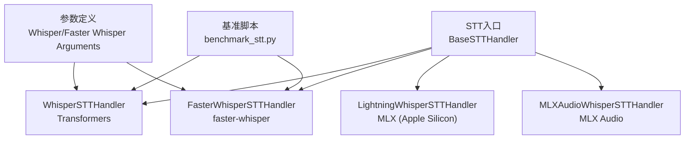
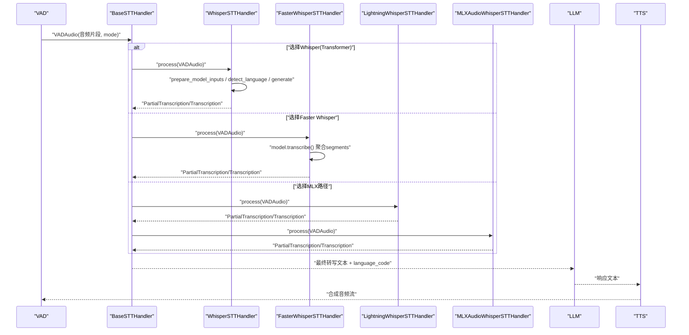
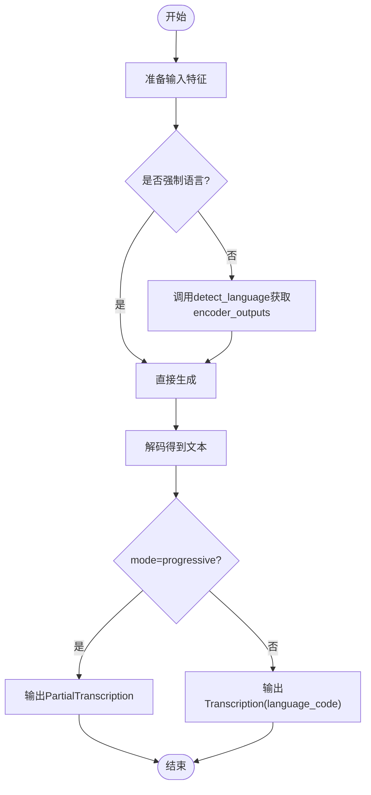
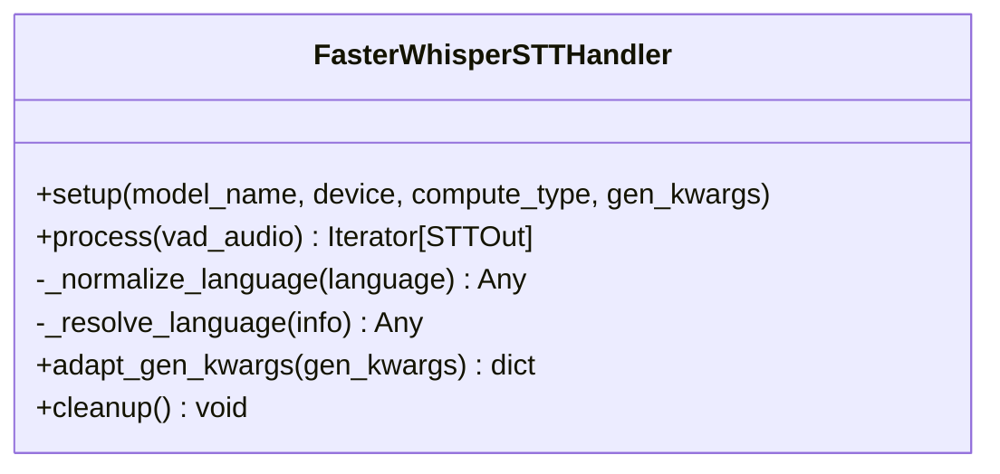
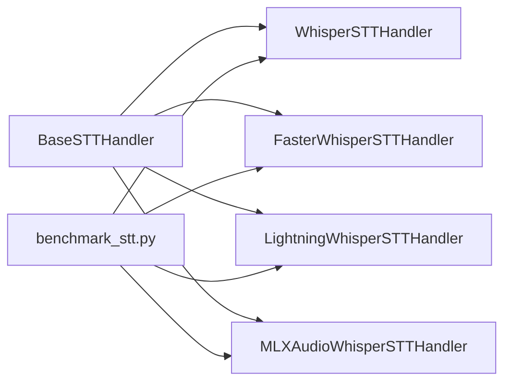
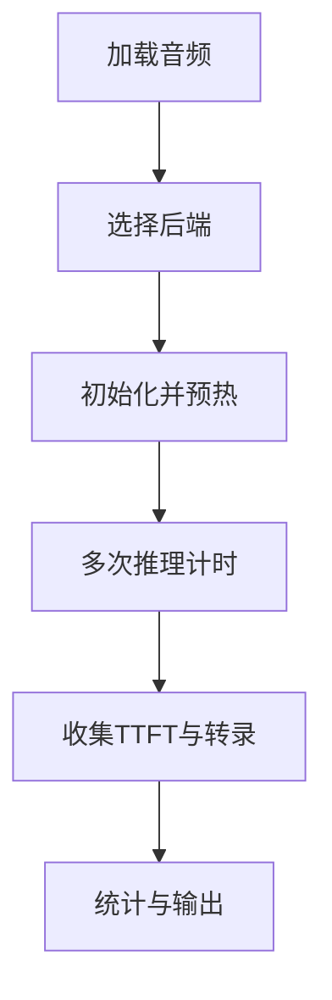

# Whisper系列后端

<cite>
**本文引用的文件**
- [whisper_stt_handler.py](file://src/speech_to_speech/STT/whisper_stt_handler.py)
- [faster_whisper_handler.py](file://src/speech_to_speech/STT/faster_whisper_handler.py)
- [lightning_whisper_mlx_handler.py](file://src/speech_to_speech/STT/lightning_whisper_mlx_handler.py)
- [mlx_audio_whisper_handler.py](file://src/speech_to_speech/STT/mlx_audio_whisper_handler.py)
- [base_stt_handler.py](file://src/speech_to_speech/STT/base_stt_handler.py)
- [whisper_stt_arguments.py](file://src/speech_to_speech/arguments_classes/whisper_stt_arguments.py)
- [faster_whisper_stt_arguments.py](file://src/speech_to_speech/arguments_classes/faster_whisper_stt_arguments.py)
- [benchmark_stt.py](file://scripts/benchmark_stt.py)
- [README.md](file://README.md)
- [openai-compatible-stt-CN.md](file://docs/openai-compatible-stt-CN.md)
- [test_whisper_language_detection.py](file://tests/test_whisper_language_detection.py)
- [test_faster_whisper_language_code.py](file://tests/test_faster_whisper_language_code.py)
- [test_whisper_progressive_transcription.py](file://tests/test_whisper_progressive_transcription.py)
</cite>

## 目录
1. [简介](#简介)
2. [项目结构](#项目结构)
3. [核心组件](#核心组件)
4. [架构总览](#架构总览)
5. [详细组件分析](#详细组件分析)
6. [依赖关系分析](#依赖关系分析)
7. [性能与基准](#性能与基准)
8. [配置指南](#配置指南)
9. [故障排查](#故障排查)
10. [结论](#结论)
11. [附录](#附录)

## 简介
本文件面向Whisper系列语音转文本（STT）后端的实现与使用，覆盖标准Whisper（基于Transformers）与Faster Whisper两种实现，并补充MLX路径（Lightning Whisper MLX、MLX Audio Whisper）。文档重点包括：
- 支持的模型规模与多语言支持、翻译能力
- 实时转录与增量输出机制
- 语言检测与语言回退策略
- Faster Whisper的性能优势与内存优化
- 配置要点：模型下载、设备选择、批处理、量化
- 基准测试方法与结果解读
- 按硬件资源与延迟目标选择模型的实践建议

## 项目结构
STT模块位于src/speech_to_speech/STT下，提供多种可插拔的STT后端；参数定义位于arguments_classes；基准脚本位于scripts。

**图表来源**
- [base_stt_handler.py:16-71](file://src/speech_to_speech/STT/base_stt_handler.py#L16-L71)
- [whisper_stt_handler.py:46-81](file://src/speech_to_speech/STT/whisper_stt_handler.py#L46-L81)
- [faster_whisper_handler.py:36-63](file://src/speech_to_speech/STT/faster_whisper_handler.py#L36-L63)
- [lightning_whisper_mlx_handler.py:36-57](file://src/speech_to_speech/STT/lightning_whisper_mlx_handler.py#L36-L57)
- [mlx_audio_whisper_handler.py:36-88](file://src/speech_to_speech/STT/mlx_audio_whisper_handler.py#L36-L88)
- [whisper_stt_arguments.py:5-53](file://src/speech_to_speech/arguments_classes/whisper_stt_arguments.py#L5-L53)
- [faster_whisper_stt_arguments.py:4-64](file://src/speech_to_speech/arguments_classes/faster_whisper_stt_arguments.py#L4-L64)
- [benchmark_stt.py:110-178](file://scripts/benchmark_stt.py#L110-L178)

**章节来源**
- [README.md:166-196](file://README.md#L166-L196)
- [base_stt_handler.py:16-71](file://src/speech_to_speech/STT/base_stt_handler.py#L16-L71)

## 核心组件
- BaseSTTHandler：统一输入门控、轮次稳定性过滤、最终版本提交与渐进式输出保护，确保在实时模式下不提前关闭对话轮次。
- WhisperSTTHandler：基于Transformers的Whisper实现，支持编译加速、自动语言检测、编码器复用、增量输出。
- FasterWhisperSTTHandler：基于faster-whisper的高效实现，支持量化、设备自动选择、语言报告与增量输出。
- LightningWhisperSTTHandler与MLXAudioWhisperSTTHandler：面向Apple Silicon的MLX路径，具备本地推理与缓存清理等特性。

关键职责与交互：
- 输入通过VAD分片进入STT，处理器根据mode决定PartialTranscription或Transcription。
- 语言检测与强制语言设置影响生成行为与语言代码上报。
- 基准脚本对多个后端进行统一评测，统计时延、TTFT、样本转录等指标。

**章节来源**
- [base_stt_handler.py:24-71](file://src/speech_to_speech/STT/base_stt_handler.py#L24-L71)
- [whisper_stt_handler.py:166-283](file://src/speech_to_speech/STT/whisper_stt_handler.py#L166-L283)
- [faster_whisper_handler.py:76-149](file://src/speech_to_speech/STT/faster_whisper_handler.py#L76-L149)
- [lightning_whisper_mlx_handler.py:70-114](file://src/speech_to_speech/STT/lightning_whisper_mlx_handler.py#L70-L114)
- [mlx_audio_whisper_handler.py:130-183](file://src/speech_to_speech/STT/mlx_audio_whisper_handler.py#L130-L183)
- [benchmark_stt.py:110-178](file://scripts/benchmark_stt.py#L110-L178)

## 架构总览
下图展示从音频输入到转写输出的端到端流程，以及不同Whisper后端的调用关系。

**图表来源**
- [whisper_stt_handler.py:225-283](file://src/speech_to_speech/STT/whisper_stt_handler.py#L225-L283)
- [faster_whisper_handler.py:107-149](file://src/speech_to_speech/STT/faster_whisper_handler.py#L107-L149)
- [lightning_whisper_mlx_handler.py:70-114](file://src/speech_to_speech/STT/lightning_whisper_mlx_handler.py#L70-L114)
- [mlx_audio_whisper_handler.py:130-183](file://src/speech_to_speech/STT/mlx_audio_whisper_handler.py#L130-L183)
- [base_stt_handler.py:24-71](file://src/speech_to_speech/STT/base_stt_handler.py#L24-L71)

## 详细组件分析

### WhisperSTTHandler（Transformers）
- 模型加载与预热：支持device、torch_dtype、compile_mode；warmup阶段执行generate以捕获CUDA图或预热编译。
- 语言检测：优先使用detect_language获取encoder_outputs并复用，避免重复编码；若不可用则回退到前缀token扫描或last_language。
- 增量输出：当mode为progressive时输出PartialTranscription，否则输出Transcription并携带language_code。
- 错误与健壮性：检测失败时记录警告并继续；不支持的语言仅影响sticky fallback，不会丢弃正确转录。

**图表来源**
- [whisper_stt_handler.py:53-81](file://src/speech_to_speech/STT/whisper_stt_handler.py#L53-L81)
- [whisper_stt_handler.py:166-283](file://src/speech_to_speech/STT/whisper_stt_handler.py#L166-L283)

**章节来源**
- [whisper_stt_handler.py:19-43](file://src/speech_to_speech/STT/whisper_stt_handler.py#L19-L43)
- [whisper_stt_handler.py:53-81](file://src/speech_to_speech/STT/whisper_stt_handler.py#L53-L81)
- [whisper_stt_handler.py:128-224](file://src/speech_to_speech/STT/whisper_stt_handler.py#L128-L224)
- [whisper_stt_handler.py:225-283](file://src/speech_to_speech/STT/whisper_stt_handler.py#L225-L283)
- [test_whisper_language_detection.py:157-216](file://tests/test_whisper_language_detection.py#L157-L216)
- [test_whisper_progressive_transcription.py:175-212](file://tests/test_whisper_progressive_transcription.py#L175-L212)

### FasterWhisperSTTHandler（faster-whisper）
- 模型初始化：支持device=auto、compute_type量化类型；默认tiny.en，可通过参数切换至small/medium/large等。
- 语言处理：start_language用于判断是否自动检测；transcribe返回info.language作为实际转录语言；自动模式会附加“-auto”后缀。
- 增量输出：同样区分progressive与final，输出PartialTranscription或Transcription。
- 清理：cleanup释放模型资源。

**图表来源**
- [faster_whisper_handler.py:36-149](file://src/speech_to_speech/STT/faster_whisper_handler.py#L36-L149)

**章节来源**
- [faster_whisper_handler.py:19-33](file://src/speech_to_speech/STT/faster_whisper_handler.py#L19-L33)
- [faster_whisper_handler.py:45-74](file://src/speech_to_speech/STT/faster_whisper_handler.py#L45-L74)
- [faster_whisper_handler.py:76-149](file://src/speech_to_speech/STT/faster_whisper_handler.py#L76-L149)
- [test_faster_whisper_language_code.py:37-88](file://tests/test_faster_whisper_language_code.py#L37-L88)

### LightningWhisperSTTHandler（MLX on Apple Silicon）
- 模型加载：LightningWhisperMLX，batch_size与quant参数可调；支持MPS设备与缓存清理。
- 语言处理：支持auto与指定语言；不支持的语言会记录警告但不丢弃转录。
- 增量输出：与Whisper一致，依据mode输出PartialTranscription或Transcription。

**章节来源**
- [lightning_whisper_mlx_handler.py:20-33](file://src/speech_to_speech/STT/lightning_whisper_mlx_handler.py#L20-L33)
- [lightning_whisper_mlx_handler.py:41-85](file://src/speech_to_speech/STT/lightning_whisper_mlx_handler.py#L41-L85)
- [lightning_whisper_mlx_handler.py:70-114](file://src/speech_to_speech/STT/lightning_whisper_mlx_handler.py#L70-L114)
- [test_whisper_progressive_transcription.py:227-243](file://tests/test_whisper_progressive_transcription.py#L227-L243)

### MLXAudioWhisperSTTHandler（MLX Audio on Apple Silicon）
- 模型加载：load_model与WhisperProcessor映射；支持auto语言与last_language回退。
- 并发安全：通过MLXLockContext序列化Metal命令队列，避免并发冲突。
- 增量输出：与前述一致，依据mode输出PartialTranscription或Transcription。

**章节来源**
- [mlx_audio_whisper_handler.py:18-33](file://src/speech_to_speech/STT/mlx_audio_whisper_handler.py#L18-L33)
- [mlx_audio_whisper_handler.py:42-88](file://src/speech_to_speech/STT/mlx_audio_whisper_handler.py#L42-L88)
- [mlx_audio_whisper_handler.py:104-128](file://src/speech_to_speech/STT/mlx_audio_whisper_handler.py#L104-L128)
- [mlx_audio_whisper_handler.py:130-183](file://src/speech_to_speech/STT/mlx_audio_whisper_handler.py#L130-L183)

## 依赖关系分析
- 组件耦合：所有STT后端继承BaseSTTHandler，共享输入门控与轮次管理逻辑；具体实现差异集中在模型加载、语言检测与输出构造。
- 外部依赖：
  - Transformers + torch（WhisperSTTHandler）
  - faster-whisper（FasterWhisperSTTHandler）
  - lightning_whisper_mlx、mlx-audio（MLX路径）
- 潜在循环依赖：无；各处理器独立实现，通过统一接口与消息类型解耦。
- 集成点：
  - 基准脚本通过统一接口实例化并评测各后端。
  - README列出可选安装项与平台支持。

**图表来源**
- [base_stt_handler.py:16-71](file://src/speech_to_speech/STT/base_stt_handler.py#L16-L71)
- [benchmark_stt.py:110-178](file://scripts/benchmark_stt.py#L110-L178)

**章节来源**
- [README.md:166-196](file://README.md#L166-L196)
- [benchmark_stt.py:110-178](file://scripts/benchmark_stt.py#L110-L178)

## 性能与基准
- 基准脚本功能：
  - 支持多后端对比：whisper、whisper-mlx、mlx-audio-whisper、faster-whisper等。
  - 指标：warmup时间、平均/最小/最大推理时间、标准差、首次令牌时间（TTFT）、样本转录。
  - 输出：控制台表格与JSON结果文件。
- 使用方法：
  - 提供音频文件路径与迭代次数；可选择handlers列表。
  - 示例：python scripts/benchmark_stt.py --audio_file path/to/audio.wav --iterations 10

**图表来源**
- [benchmark_stt.py:84-107](file://scripts/benchmark_stt.py#L84-L107)
- [benchmark_stt.py:110-178](file://scripts/benchmark_stt.py#L110-L178)
- [benchmark_stt.py:266-318](file://scripts/benchmark_stt.py#L266-L318)
- [benchmark_stt.py:333-386](file://scripts/benchmark_stt.py#L333-L386)

**章节来源**
- [benchmark_stt.py:1-10](file://scripts/benchmark_stt.py#L1-L10)
- [benchmark_stt.py:110-178](file://scripts/benchmark_stt.py#L110-L178)
- [benchmark_stt.py:266-318](file://scripts/benchmark_stt.py#L266-L318)
- [benchmark_stt.py:333-386](file://scripts/benchmark_stt.py#L333-L386)

## 配置指南
- 模型大小与支持范围：
  - Faster Whisper参数明确支持：tiny、tiny.en、base、base.en、small、small.en、distil-small.en、medium、medium.en、distil-medium.en、large-v1、large-v2、large-v3、large、distil-large-v2、distil-large-v3。
  - Whisper（Transformers）默认使用distil-whisper/distil-large-v3，可通过stt_model_name替换。
- 多语言支持与翻译：
  - 两者均支持多语言；Whisper支持任务“transcribe”，可用于翻译场景（通过任务参数控制）。
  - 语言检测：Whisper使用detect_language并复用encoder_outputs；Faster Whisper从info.language读取。
- 设备选择：
  - Whisper：device=cuda/cpu，torch_dtype=float16/bfloat16/float32，compile_mode可选default/reduce-overhead/max-autotune。
  - Faster Whisper：device=auto/cuda/cpu，compute_type=default/auto/int8/int8_float32/int8_float16/int8_bfloat16/int16/float16/float32/bfloat16。
- 批处理设置：
  - Lightning Whisper MLX支持batch_size参数（如6），有助于吞吐提升。
- 量化选项：
  - Faster Whisper支持多种compute_type量化；MLX路径支持量化变体（如6bit）。
- 实时转录与增量输出：
  - 所有Whisper家族处理器在mode=progressive时输出PartialTranscription，最终帧输出Transcription。
- OpenAI兼容STT：
  - 可通过OpenAI兼容端点将识别委托给远程服务（如vLLM Qwen3-ASR或OpenAI托管API）。

**章节来源**
- [faster_whisper_stt_arguments.py:6-17](file://src/speech_to_speech/arguments_classes/faster_whisper_stt_arguments.py#L6-L17)
- [whisper_stt_arguments.py:7-10](file://src/speech_to_speech/arguments_classes/whisper_stt_arguments.py#L7-L10)
- [whisper_stt_arguments.py:11-26](file://src/speech_to_speech/arguments_classes/whisper_stt_arguments.py#L11-L26)
- [faster_whisper_stt_arguments.py:18-34](file://src/speech_to_speech/arguments_classes/faster_whisper_stt_arguments.py#L18-L34)
- [lightning_whisper_mlx_handler.py:41-57](file://src/speech_to_speech/STT/lightning_whisper_mlx_handler.py#L41-L57)
- [whisper_stt_handler.py:53-81](file://src/speech_to_speech/STT/whisper_stt_handler.py#L53-L81)
- [faster_whisper_handler.py:45-63](file://src/speech_to_speech/STT/faster_whisper_handler.py#L45-L63)
- [openai-compatible-stt-CN.md:13-31](file://docs/openai-compatible-stt-CN.md#L13-L31)
- [openai-compatible-stt-CN.md:33-60](file://docs/openai-compatible-stt-CN.md#L33-L60)

## 故障排查
- 语言检测失败：
  - Whisper：若detect_language不可用或抛出异常，回退到前缀token扫描或last_language，并记录警告。
  - Faster Whisper：若info.language缺失，回退到start_language。
- 不支持语言：
  - Whisper：仅影响sticky fallback，不会丢弃正确转录；日志记录警告。
  - MLX路径：记录不支持语言的警告，但仍返回转录。
- 渐进式输出问题：
  - 所有Whisper家族处理器需依据mode输出PartialTranscription，避免提前关闭轮次；测试覆盖了该回归。
- 并发与锁：
  - MLX路径通过MLXLockContext序列化Metal命令队列，避免并发冲突。

**章节来源**
- [whisper_stt_handler.py:185-197](file://src/speech_to_speech/STT/whisper_stt_handler.py#L185-L197)
- [whisper_stt_handler.py:245-258](file://src/speech_to_speech/STT/whisper_stt_handler.py#L245-L258)
- [faster_whisper_handler.py:76-105](file://src/speech_to_speech/STT/faster_whisper_handler.py#L76-L105)
- [lightning_whisper_mlx_handler.py:74-85](file://src/speech_to_speech/STT/lightning_whisper_mlx_handler.py#L74-L85)
- [mlx_audio_whisper_handler.py:144-160](file://src/speech_to_speech/STT/mlx_audio_whisper_handler.py#L144-L160)
- [test_whisper_progressive_transcription.py:175-212](file://tests/test_whisper_progressive_transcription.py#L175-L212)

## 结论
- 标准Whisper（Transformers）适合需要编译优化与灵活语言检测的场景；Faster Whisper在推理速度与内存占用上更具优势，且提供丰富的量化选项。
- MLX路径针对Apple Silicon优化，具备本地推理与并发安全机制。
- 实时转录与增量输出在所有实现中保持一致，确保用户体验稳定。
- 基准脚本提供了统一的评测框架，便于在不同硬件与模型规模下进行对比。

## 附录
- 如何选择模型：
  - 低延迟、CPU或有限GPU：考虑tiny/small或Faster Whisper量化int8。
  - 高质量、GPU充足：medium/large或distil-large-v3；Whisper可启用compile_mode。
  - Apple Silicon：优先MLX路径（Lightning或MLX Audio），利用量化与本地优化。
- 最佳实践：
  - 开启自动语言检测以获得更准确的language_code；必要时固定语言以提升一致性。
  - 在实时模式下启用渐进式转录，结合BaseSTTHandler的轮次管理避免截断。
  - 使用基准脚本评估不同配置下的TTFT与推理时延，结合业务SLA选择合适方案。