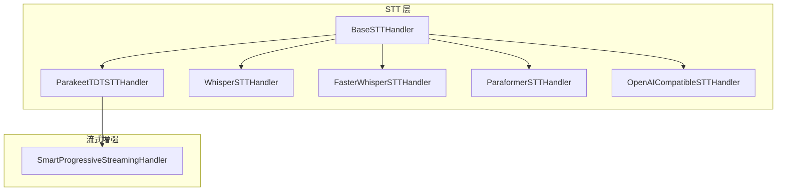
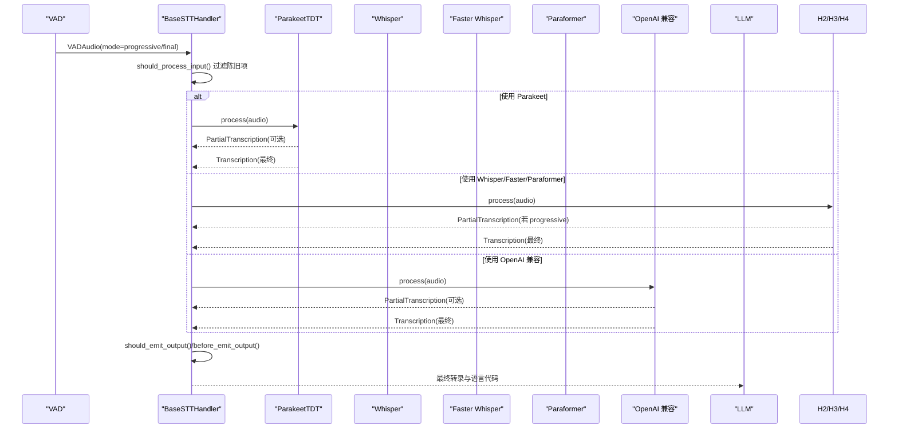
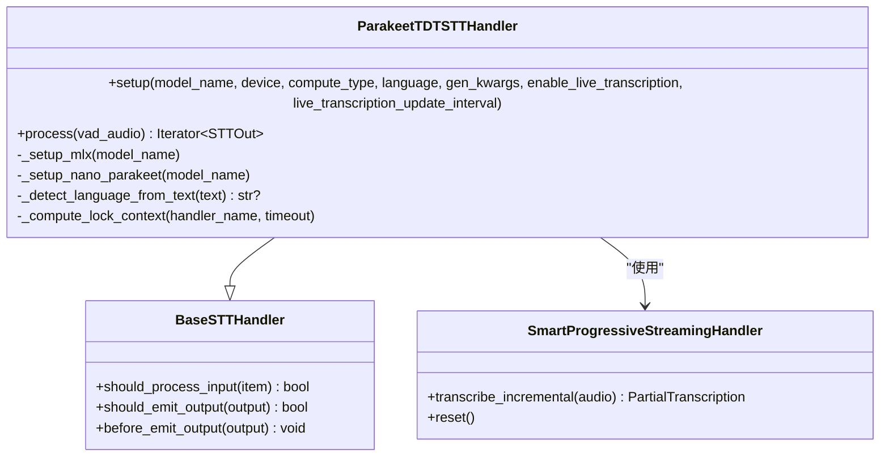
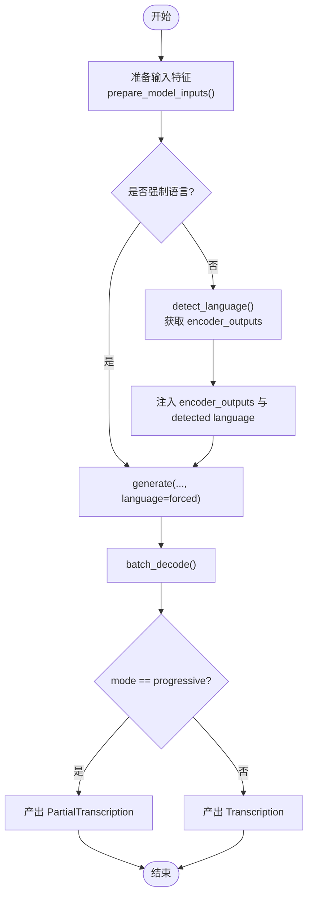
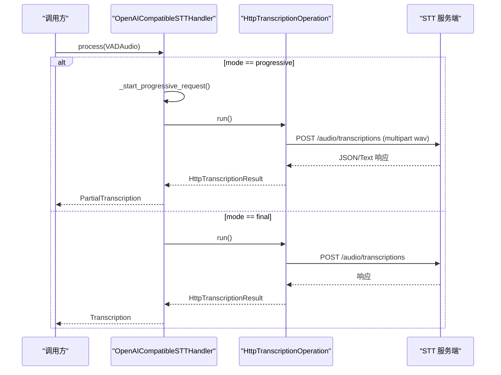
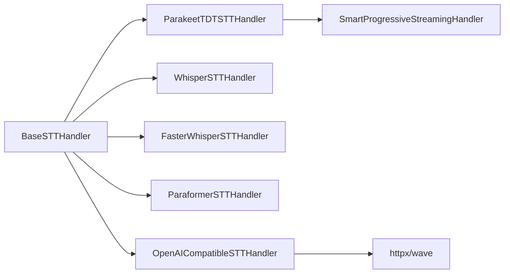

# 语音转文本模块

<cite>
**本文引用的文件**
- [base_stt_handler.py](file://src/speech_to_speech/STT/base_stt_handler.py)
- [parakeet_tdt_handler.py](file://src/speech_to_speech/STT/parakeet_tdt_handler.py)
- [faster_whisper_handler.py](file://src/speech_to_speech/STT/faster_whisper_handler.py)
- [whisper_stt_handler.py](file://src/speech_to_speech/STT/whisper_stt_handler.py)
- [paraformer_handler.py](file://src/speech_to_speech/STT/paraformer_handler.py)
- [openai_compatible_handler.py](file://src/speech_to_speech/STT/openai_compatible_handler.py)
- [smart_progressive_streaming.py](file://src/speech_to_speech/STT/smart_progressive_streaming.py)
- [parakeet_tdt_arguments.py](file://src/speech_to_speech/arguments_classes/parakeet_tdt_arguments.py)
- [faster_whisper_stt_arguments.py](file://src/speech_to_speech/arguments_classes/faster_whisper_stt_arguments.py)
- [paraformer_stt_arguments.py](file://src/speech_to_speech/arguments_classes/paraformer_stt_arguments.py)
- [openai_stt_arguments.py](file://src/speech_to_speech/arguments_classes/openai_stt_arguments.py)
- [benchmark_stt.py](file://scripts/benchmark_stt.py)
- [test_openai_stt_handler.py](file://tests/test_openai_stt_handler.py)
- [test_parakeet_transcription_events.py](file://tests/test_parakeet_transcription_events.py)
- [test_whisper_progressive_transcription.py](file://tests/test_whisper_progressive_transcription.py)
</cite>

## 目录
1. [简介](#简介)
2. [项目结构](#项目结构)
3. [核心组件](#核心组件)
4. [架构总览](#架构总览)
5. [详细组件分析](#详细组件分析)
6. [依赖关系分析](#依赖关系分析)
7. [性能考量](#性能考量)
8. [故障排查指南](#故障排查指南)
9. [结论](#结论)
10. [附录](#附录)

## 简介
本模块提供统一的“语音转文本（STT）”能力，抽象出多种后端实现，便于在不同硬件与部署环境下灵活选择。当前支持的 STT 后端包括：
- Parakeet TDT（默认推荐，支持 Apple Silicon 的 MLX 路径与 CUDA/CPU 的 nano-parakeet 路径）
- Whisper 系列（Transformers 原生实现）
- Faster Whisper（基于 CTranslate2 的高性能封装）
- Paraformer（FunASR 实现，默认中文）
- OpenAI 兼容 API（通过 HTTP POST /v1/audio/transcriptions 调用外部服务）

模块同时提供：
- 多语言支持与自动语言检测（各后端策略不同）
- 实时转录与增量输出机制（PartialTranscription vs Transcription）
- 参数配置与最佳实践
- 音频格式处理与错误恢复
- 基准测试脚本用于横向对比

## 项目结构
STT 模块位于 src/speech_to_speech/STT，采用“基类 + 多后端处理器”的设计。所有处理器继承自 BaseSTTHandler，统一输入输出消息类型与生命周期管理；每个后端处理器负责具体模型加载、推理与结果封装。

图表来源
- [base_stt_handler.py:16-214](file://src/speech_to_speech/STT/base_stt_handler.py#L16-L214)
- [parakeet_tdt_handler.py:91-178](file://src/speech_to_speech/STT/parakeet_tdt_handler.py#L91-L178)
- [smart_progressive_streaming.py:28-68](file://src/speech_to_speech/STT/smart_progressive_streaming.py#L28-L68)

章节来源
- [base_stt_handler.py:16-214](file://src/speech_to_speech/STT/base_stt_handler.py#L16-L214)
- [parakeet_tdt_handler.py:91-178](file://src/speech_to_speech/STT/parakeet_tdt_handler.py#L91-L178)
- [smart_progressive_streaming.py:28-68](file://src/speech_to_speech/STT/smart_progressive_streaming.py#L28-L68)

## 核心组件
- BaseSTTHandler：统一处理“推测性轮次”下的陈旧输入过滤、最终修订标记、队列清理与日志统计，确保在实时场景下不会因旧片段污染后续结果。
- 各后端处理器：封装各自模型的加载、推理、语言检测与输出构造。
- SmartProgressiveStreamingHandler：为 Parakeet TDT 提供智能分段式流式输出，固定已完成句子并仅重算活跃部分，提升长音频下的实时性与稳定性。
- OpenAI 兼容客户端：将音频编码为 WAV 并通过 HTTP 上传，解析 JSON/纯文本响应，支持渐进式请求与失败恢复。

章节来源
- [base_stt_handler.py:16-214](file://src/speech_to_speech/STT/base_stt_handler.py#L16-L214)
- [smart_progressive_streaming.py:28-200](file://src/speech_to_speech/STT/smart_progressive_streaming.py#L28-L200)
- [openai_compatible_handler.py:115-340](file://src/speech_to_speech/STT/openai_compatible_handler.py#L115-L340)

## 架构总览
下图展示从 VAD 到 STT 再到下游 LLM/TTS 的数据流，以及各后端的差异点。

图表来源
- [base_stt_handler.py:24-76](file://src/speech_to_speech/STT/base_stt_handler.py#L24-L76)
- [parakeet_tdt_handler.py:236-370](file://src/speech_to_speech/STT/parakeet_tdt_handler.py#L236-L370)
- [faster_whisper_handler.py:107-149](file://src/speech_to_speech/STT/faster_whisper_handler.py#L107-L149)
- [whisper_stt_handler.py:225-283](file://src/speech_to_speech/STT/whisper_stt_handler.py#L225-L283)
- [paraformer_handler.py:56-81](file://src/speech_to_speech/STT/paraformer_handler.py#L56-L81)
- [openai_compatible_handler.py:167-235](file://src/speech_to_speech/STT/openai_compatible_handler.py#L167-L235)

## 详细组件分析

### Parakeet TDT（默认）
- 设备与后端选择
  - Apple Silicon（MPS）：使用 mlx-audio 加载 MLX 转换模型。
  - CUDA/CPU：使用 nano-parakeet（纯 PyTorch）加载 NVIDIA 官方模型。
- 安装要求
  - MPS：需安装 mlx-audio。
  - CUDA/CPU：需安装 torch 与 nano-parakeet。
- 配置选项
  - model_name：自动根据设备选择默认模型。
  - device：auto/cuda/mps/cpu。
  - compute_type：float16/float32。
  - language：目标语言或 auto（自动检测）。
  - enable_live_transcription：是否启用实时流式输出。
  - live_transcription_update_interval：流式更新间隔（秒）。
- 多语言支持
  - 内置 25 种欧洲语言列表；可通过 lingua-py 对转录文本进行二次语言检测，回退到上次已知语言。
- 实时转录与增量输出
  - 使用 SmartProgressiveStreamingHandler 维护固定句与活跃句，按窗口滑动与句子边界切分，降低长音频重算成本。
  - progressive 模式产出 PartialTranscription；final 模式产出 Transcription。
- 错误恢复
  - 锁超时保护计算资源竞争；异常时记录日志并回退到 last_language。
- 性能特点
  - 流式模式下可显著降低首字延迟；最终转录阶段合并已固定句与新识别内容，减少重复计算。

图表来源
- [base_stt_handler.py:16-214](file://src/speech_to_speech/STT/base_stt_handler.py#L16-L214)
- [parakeet_tdt_handler.py:91-178](file://src/speech_to_speech/STT/parakeet_tdt_handler.py#L91-L178)
- [smart_progressive_streaming.py:28-68](file://src/speech_to_speech/STT/smart_progressive_streaming.py#L28-L68)

章节来源
- [parakeet_tdt_handler.py:91-178](file://src/speech_to_speech/STT/parakeet_tdt_handler.py#L91-L178)
- [parakeet_tdt_handler.py:236-370](file://src/speech_to_speech/STT/parakeet_tdt_handler.py#L236-L370)
- [parakeet_tdt_handler.py:379-435](file://src/speech_to_speech/STT/parakeet_tdt_handler.py#L379-L435)
- [parakeet_tdt_handler.py:436-649](file://src/speech_to_speech/STT/parakeet_tdt_handler.py#L436-L649)
- [smart_progressive_streaming.py:28-200](file://src/speech_to_speech/STT/smart_progressive_streaming.py#L28-L200)
- [parakeet_tdt_arguments.py:5-40](file://src/speech_to_speech/arguments_classes/parakeet_tdt_arguments.py#L5-L40)

### Whisper 系列（Transformers）
- 安装要求
  - transformers、torch；可选 compile_mode 以启用 torch.compile。
- 配置选项
  - model_name：如 distil-whisper/distil-large-v3。
  - device：cuda/cpu。
  - torch_dtype：float16/float32。
  - compile_mode：None/default/其他编译模式。
  - language：强制语言或 None（自动检测）。
- 多语言支持
  - 通过 detect_language 获取编码器输出并注入 generate，避免重复编码；若不可用则尝试从生成序列前缀提取语言 token。
- 实时转录与增量输出
  - progressive 模式产出 PartialTranscription；final 模式产出 Transcription。
- 错误恢复
  - 语言检测失败时降级为 last_language 或默认语言。
- 性能特点
  - 支持编译优化；首次 warmup 可能较长但后续稳定。

图表来源
- [whisper_stt_handler.py:53-81](file://src/speech_to_speech/STT/whisper_stt_handler.py#L53-L81)
- [whisper_stt_handler.py:166-219](file://src/speech_to_speech/STT/whisper_stt_handler.py#L166-L219)
- [whisper_stt_handler.py:225-283](file://src/speech_to_speech/STT/whisper_stt_handler.py#L225-L283)

章节来源
- [whisper_stt_handler.py:53-81](file://src/speech_to_speech/STT/whisper_stt_handler.py#L53-L81)
- [whisper_stt_handler.py:166-219](file://src/speech_to_speech/STT/whisper_stt_handler.py#L166-L219)
- [whisper_stt_handler.py:225-283](file://src/speech_to_speech/STT/whisper_stt_handler.py#L225-L283)

### Faster Whisper
- 安装要求
  - faster_whisper（CTranslate2 封装）。
- 配置选项
  - model_name：tiny.en/base/small/medium/large 等。
  - device：auto/cuda/cpu。
  - compute_type：int8/float16/float32 等量化/精度选项。
  - return_timestamps：是否返回时间戳（内部转换为 without_timestamps）。
  - task：transcribe/translate。
  - language：auto 表示自动检测（需多语种检查点）。
- 多语言支持
  - 报告实际转录语言，并在 auto 模式下附加 “-auto” 后缀以便下游区分。
- 实时转录与增量输出
  - progressive 模式产出 PartialTranscription；final 模式产出 Transcription。
- 错误恢复
  - 无显式异常捕获；空结果跳过。
- 性能特点
  - 量化与 CTranslate2 加速带来较低延迟与内存占用。

章节来源
- [faster_whisper_handler.py:19-33](file://src/speech_to_speech/STT/faster_whisper_handler.py#L19-L33)
- [faster_whisper_handler.py:45-105](file://src/speech_to_speech/STT/faster_whisper_handler.py#L45-L105)
- [faster_whisper_handler.py:107-149](file://src/speech_to_speech/STT/faster_whisper_handler.py#L107-L149)
- [faster_whisper_stt_arguments.py:5-64](file://src/speech_to_speech/arguments_classes/faster_whisper_stt_arguments.py#L5-L64)

### Paraformer（FunASR）
- 安装要求
  - funasr（通过 extra 安装）。
- 配置选项
  - model_name：如 paraformer-zh（默认中文）。
  - device：cuda/mps/cpu。
- 多语言支持
  - 从模型名解析语言代码；当前实现固定语言。
- 实时转录与增量输出
  - progressive 模式产出 PartialTranscription；final 模式产出 Transcription。
- 错误恢复
  - MPS 设备推理后释放缓存，降低内存压力。
- 性能特点
  - 中文场景表现良好；MPS 下注意缓存清理。

章节来源
- [paraformer_handler.py:19-81](file://src/speech_to_speech/STT/paraformer_handler.py#L19-L81)
- [paraformer_stt_arguments.py:5-16](file://src/speech_to_speech/arguments_classes/paraformer_stt_arguments.py#L5-L16)

### OpenAI 兼容 API
- 安装要求
  - httpx；服务端需实现 POST /v1/audio/transcriptions。
- 配置选项
  - base_url：API 基础地址。
  - api_key：Bearer Token（OpenAI 官方端点可从环境变量读取）。
  - model：可选模型标识；未设置时可由服务器根据 language 选择。
  - language：ISO 语言提示。
  - response_format：json 或 text。
  - timeout：请求超时（秒）。
- 多语言支持
  - 支持 gpt-transcribe 特殊字段 languages[]；解析响应中的 language 或 languages[].code。
- 实时转录与增量输出
  - progressive 模式通过后台线程发起请求，产出 PartialTranscription；final 模式产出 Transcription。
  - 同一 turn 的 progressive 请求会被抑制以避免重复。
- 错误恢复
  - 网络/协议错误包装为 TranscriptionRequestError；progressive 失败仅警告，不中断流程。
- 性能特点
  - 受限于网络与服务端；适合集中化部署与弹性扩缩容。

图表来源
- [openai_compatible_handler.py:115-340](file://src/speech_to_speech/STT/openai_compatible_handler.py#L115-L340)
- [test_openai_stt_handler.py:54-165](file://tests/test_openai_stt_handler.py#L54-L165)

章节来源
- [openai_compatible_handler.py:115-340](file://src/speech_to_speech/STT/openai_compatible_handler.py#L115-L340)
- [openai_stt_arguments.py:5-39](file://src/speech_to_speech/arguments_classes/openai_stt_arguments.py#L5-L39)
- [test_openai_stt_handler.py:54-165](file://tests/test_openai_stt_handler.py#L54-L165)

## 依赖关系分析
- BaseSTTHandler 是所有处理器的公共基类，提供输入门控、输出门控与陈旧项丢弃逻辑，保证在多路并发与推测性轮次下的正确性。
- ParakeetTDT 依赖 SmartProgressiveStreamingHandler 实现智能流式；Whisper/Faster/Paraformer 直接实现各自的推理管线。
- OpenAI 兼容处理器依赖 httpx 与标准库 wave，将音频编码为单声道 PCM16 16kHz WAV 上传。

图表来源
- [base_stt_handler.py:16-214](file://src/speech_to_speech/STT/base_stt_handler.py#L16-L214)
- [parakeet_tdt_handler.py:91-178](file://src/speech_to_speech/STT/parakeet_tdt_handler.py#L91-L178)
- [openai_compatible_handler.py:304-333](file://src/speech_to_speech/STT/openai_compatible_handler.py#L304-L333)

章节来源
- [base_stt_handler.py:16-214](file://src/speech_to_speech/STT/base_stt_handler.py#L16-L214)
- [parakeet_tdt_handler.py:91-178](file://src/speech_to_speech/STT/parakeet_tdt_handler.py#L91-L178)
- [openai_compatible_handler.py:304-333](file://src/speech_to_speech/STT/openai_compatible_handler.py#L304-L333)

## 性能考量
- 设备选择
  - Apple Silicon：优先使用 Parakeet TDT 的 MLX 路径以获得低延迟与高吞吐。
  - CUDA：Faster Whisper 量化与 CTranslate2 通常具备优秀性能；Whisper 可开启编译模式。
  - CPU：Faster Whisper 轻量级模型（如 tiny.en/base）更合适；OpenAI 兼容 API 不受本地算力限制。
- 实时与增量
  - Parakeet TDT 的 SmartProgressiveStreamingHandler 在长音频中通过固定句与窗口滑动降低重算成本。
  - OpenAI 兼容 API 的 progressive 模式通过后台线程避免阻塞主流程。
- 内存与缓存
  - Paraformer 在 MPS 设备上推理后释放缓存；Whisper 编译模式需要足够显存。
- 基准测试
  - 使用 scripts/benchmark_stt.py 对不同后端进行平均推理时间、TTFT、误差率等指标对比。

章节来源
- [benchmark_stt.py:110-263](file://scripts/benchmark_stt.py#L110-L263)
- [paraformer_handler.py:56-81](file://src/speech_to_speech/STT/paraformer_handler.py#L56-L81)
- [whisper_stt_handler.py:77-81](file://src/speech_to_speech/STT/whisper_stt_handler.py#L77-L81)
- [parakeet_tdt_handler.py:160-178](file://src/speech_to_speech/STT/parakeet_tdt_handler.py#L160-L178)

## 故障排查指南
- 常见错误与定位
  - 导入缺失：如 mlx-audio、nano-parakeet、funasr 未安装导致初始化失败。
  - 网络错误：OpenAI 兼容 API 超时或 HTTP 状态码异常，会抛出 TranscriptionRequestError。
  - 语言不一致：Faster Whisper 报告的语言与请求不一致时会记录警告；Whisper 检测失败会降级。
- 调试建议
  - 启用日志查看输入门控与陈旧项丢弃信息（BaseSTTHandler 的日志）。
  - 使用测试用例验证 progressive 与 final 的输出类型是否正确（PartialTranscription vs Transcription）。
  - 针对 OpenAI 兼容 API，检查 multipart WAV 编码与响应解析是否符合预期。

章节来源
- [base_stt_handler.py:130-157](file://src/speech_to_speech/STT/base_stt_handler.py#L130-L157)
- [faster_whisper_handler.py:97-105](file://src/speech_to_speech/STT/faster_whisper_handler.py#L97-L105)
- [whisper_stt_handler.py:185-197](file://src/speech_to_speech/STT/whisper_stt_handler.py#L185-L197)
- [openai_compatible_handler.py:180-208](file://src/speech_to_speech/STT/openai_compatible_handler.py#L180-L208)
- [test_whisper_progressive_transcription.py:175-200](file://tests/test_whisper_progressive_transcription.py#L175-L200)
- [test_parakeet_transcription_events.py:101-178](file://tests/test_parakeet_transcription_events.py#L101-L178)
- [test_openai_stt_handler.py:54-165](file://tests/test_openai_stt_handler.py#L54-L165)

## 结论
本模块通过统一的 BaseSTTHandler 与多后端实现，提供了灵活的 STT 能力。Parakeet TDT 在 Apple Silicon 上具备优秀的实时与质量平衡；Faster Whisper 在通用 GPU 上性价比高；Whisper 系列适合可编译优化的环境；Paraformer 在中文场景表现稳健；OpenAI 兼容 API 便于云端集成与弹性扩展。结合智能流式与错误恢复机制，可在不同硬件与性能需求下选择合适的后端。

## 附录
- 参数配置速查
  - Parakeet TDT：model_name/device/compute_type/language/enable_live_transcription/live_transcription_update_interval。
  - Faster Whisper：model_name/device/compute_type/return_timestamps/task/language。
  - Paraformer：model_name/device。
  - OpenAI 兼容：base_url/api_key/model/language/response_format/timeout。
- 最佳实践
  - 实时场景优先启用 Parakeet TDT 的流式模式；长音频建议增大 emission_interval 与 max_window_size。
  - GPU 资源紧张时选择 Faster Whisper 的 int8 量化；CPU 部署优先轻量模型。
  - 云端集成时合理设置 timeout 与重试策略，避免阻塞。