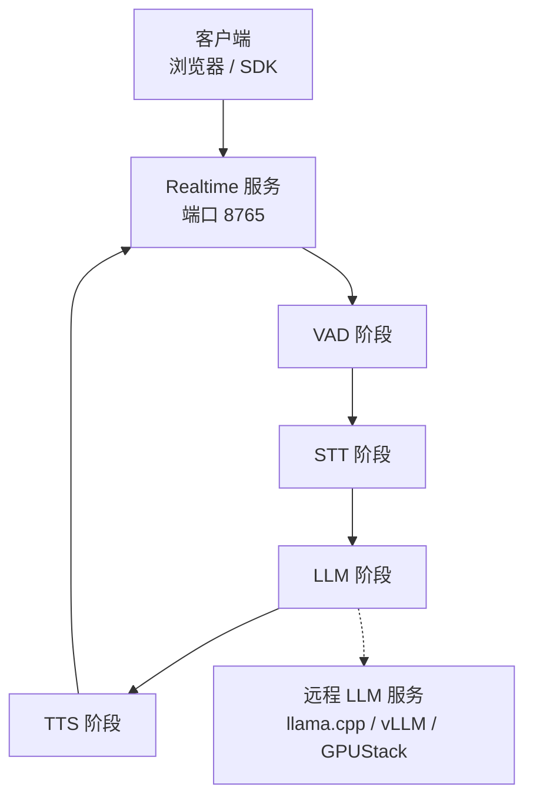
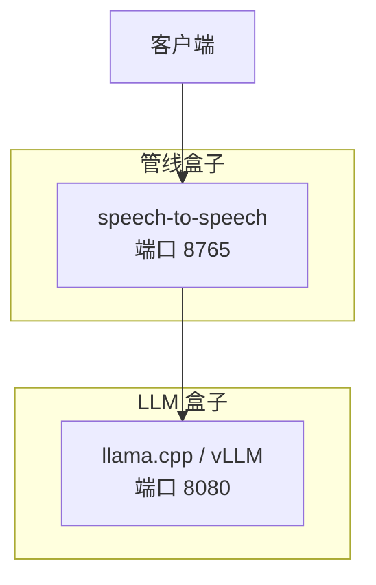
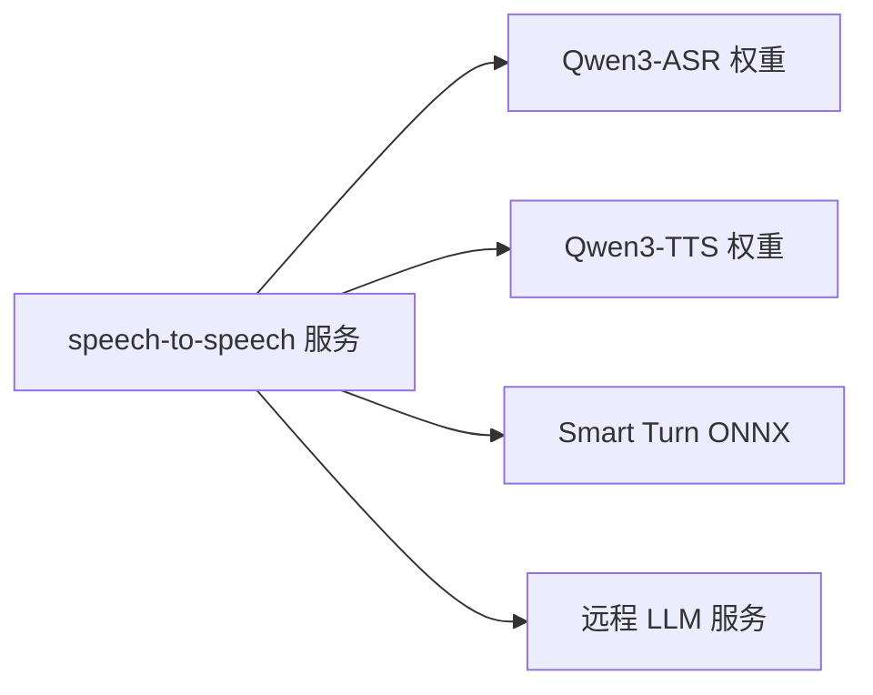
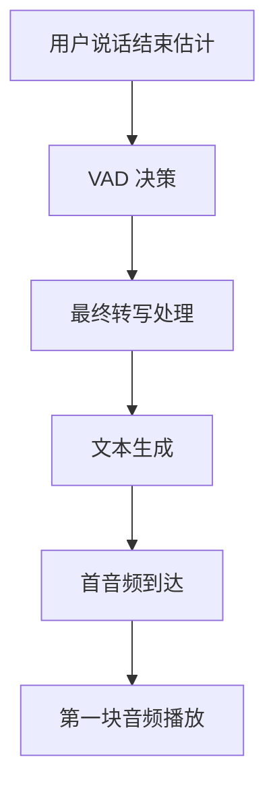

# 部署和运维

<cite>
**本文引用的文件**   
- [README.md](file://README.md)
- [配置说明文档](file://docs/configuration.md)
- [响应延迟日志说明](file://docs/response-latency.md)
- [生产环境 YAML 配置](file://config/prod.yaml)
- [Docker Compose 主编排](file://docker-compose.yml)
- [自包含镜像 B 的 Compose](file://docker-compose.baked.yml)
- [CUDA 13.0 Compose](file://docker-compose.cu130.yml)
- [GPUStack 性能优化 Compose](file://docker-compose.gpustack.yml)
- [LLM 盒子 Compose](file://docs\hardware\docker-compose.llm-box.yml)
- [管线盒子 Compose](file://docs\hardware\docker-compose.pipeline-box.yml)
- [CUDA 13.0 烘焙镜像 Dockerfile](file://Dockerfile.baked.cu130)
</cite>

## 目录
1. [简介](#简介)
2. [项目结构](#项目结构)
3. [核心组件](#核心组件)
4. [架构总览](#架构总览)
5. [详细组件分析](#详细组件分析)
6. [依赖关系分析](#依赖关系分析)
7. [性能与容量规划](#性能与容量规划)
8. [监控、日志与健康检查](#监控日志与健康检查)
9. [故障排查指南](#故障排查指南)
10. [备份、恢复与灾难恢复](#备份恢复与灾难恢复)
11. [安全加固](#安全加固)
12. [结论](#结论)

## 简介
本指南面向生产环境的语音对话服务，围绕 Docker 容器化、Kubernetes 编排思路、生产配置、性能监控、日志收集、健康检查、自动重启、硬件与容量规划、故障排查、备份恢复与安全加固展开。仓库默认提供 OpenAI Realtime 协议服务，支持 WebSocket 与 WebRTC；默认流水线为 VAD → STT → LLM → TTS，各阶段可替换后端。

## 项目结构
从部署视角，关键资产包括：
- 运行入口与命令：`serve`、`local`、`talk`
- 容器镜像与多 Compose 编排：本地、自包含、CUDA 版本、GPUStack 场景
- 生产配置：YAML 参数平台渲染产物 `prod.yaml`
- 硬件分盒方案：LLM 盒子与管线盒子分离
- 延迟与可观测性：响应延迟日志与元数据

**图示来源**
- [README.md:314-355](file://README.md#L314-L355)
- [docker-compose.yml:35-75](file://docker-compose.yml#L35-L75)

**章节来源**
- [README.md:304-313](file://README.md#L304-L313)
- [docker-compose.yml:1-75](file://docker-compose.yml#L1-L75)

## 核心组件
- VAD：Silero VAD 或 FireRed Stream-VAD，负责语音起止与轮次控制。
- STT：Parakeet TDT、Whisper、Paraformer、Qwen3-ASR 等。
- LLM：mlx-lm、Transformers、OpenAI 兼容 Responses/Chat Completions。
- TTS：Qwen3-TTS、CosyVoice、Pocket TTS、OmniVoice 等。
- 运行时：OpenAI Realtime 服务端，暴露 `/v1/realtime`。

这些组件通过 YAML 配置块组合成命名 pipeline，并通过 `num_pipelines` 控制实例数量。

**章节来源**
- [README.md:111-124](file://README.md#L111-L124)
- [配置说明文档:1-68](file://docs/configuration.md#L1-L68)

## 架构总览
生产常见两种形态：
- 单盒形态：LLM 与语音管线同机或同进程（如 llama.cpp + speech-to-speech）。
- 分盒形态：LLM 盒子对外提供 OpenAI 兼容端点，管线盒子只跑 VAD/STT/TTS。

**图示来源**
- [docs/hardware/docker-compose.llm-box.yml:1-46](file://docs/hardware/docker-compose.llm-box.yml#L1-L46)
- [docs/hardware/docker-compose.pipeline-box.yml:1-85](file://docs/hardware/docker-compose.pipeline-box.yml#L1-L85)

**章节来源**
- [README.md:400-428](file://README.md#L400-L428)
- [docs/hardware/docker-compose.llm-box.yml:1-46](file://docs/hardware/docker-compose.llm-box.yml#L1-L46)
- [docs/hardware/docker-compose.pipeline-box.yml:1-85](file://docs/hardware/docker-compose.pipeline-box.yml#L1-L85)

## 详细组件分析

### Docker 容器化部署
- 基础镜像选择：CPU/GPU、CUDA 版本需与 PyTorch 及 TTS/STT 后端匹配。
- 模型预缓存：将 Qwen3-ASR、Qwen3-TTS、Smart Turn ONNX 等放入镜像或挂载卷。
- 离线运行：设置 `HF_HUB_OFFLINE=1`、`TRANSFORMERS_OFFLINE=1`，避免启动时拉取。
- 网络绑定：生产建议 `host=0.0.0.0`，并通过反向代理或网关做鉴权与限流。

参考 Compose 与 Dockerfile：
- 自包含镜像 B：模型已烤入镜像，无需宿主机 cache 与 silero-vad 卷。
- CUDA 13.0 变体：基础镜像切换 cu130，其余步骤一致。
- GPUStack 场景：LLM 走局域网 GPUStack，pipeline 仅做语音处理。

**章节来源**
- [docker-compose.baked.yml:1-81](file://docker-compose.baked.yml#L1-L81)
- [Dockerfile.baked.cu130:1-43](file://Dockerfile.baked.cu130#L1-L43)
- [docker-compose.cu130.yml:1-91](file://docker-compose.cu130.yml#L1-L91)
- [docker-compose.gpustack.yml:1-149](file://docker-compose.gpustack.yml#L1-L149)

### Kubernetes 编排要点
仓库未直接提供 K8s manifests，但可从 Compose 抽象出以下原则：
- Deployment：每个 pipeline 副本数由 `num_pipelines` 决定；如需水平扩展，使用多个 Deployment 或 HPA。
- Service：暴露 8765 端口，供 Ingress/Gateway 接入。
- ConfigMap/Secret：注入 prod.yaml 与 API Key、Base URL 等敏感信息。
- Volume：挂载模型缓存目录，保证冷启动快且离线可用。
- Resource：按 GPU/CPU/内存设定 requests/limits，并预留 GPU device。
- Health：结合 liveness/readiness probe 探测 `/v1/pool` 或业务接口。
- Rolling Update：滚动更新时注意中断进行中的实时会话。

[本节为概念性编排指导，不直接分析具体源码文件]

### 生产环境配置
生产 YAML 示例展示了：
- 明确指定各阶段 backend 与 settings。
- 通过 `{env: ...}` 引用环境变量，避免硬编码密钥。
- 关闭 Smart Turn 与 live transcription，降低重复与抖动。
- 调整 TTS 流式 chunk size 与设备，提升首包速度。
- 服务器监听地址与端口。

建议：
- 将 prod.yaml 作为唯一配置源，Compose 仅传递 `-f` 与 `--name`。
- 所有外部依赖（LLM Base URL、API Key）通过环境变量注入。
- 对 inactive backend 的配置保持最小化，减少误配风险。

**章节来源**
- [配置说明文档:99-134](file://docs/configuration.md#L99-L134)
- [生产环境 YAML 配置:1-75](file://config/prod.yaml#L1-L75)

### 健康检查与自动重启
- Compose 中统一使用 `restart: unless-stopped`，便于运维手动干预。
- 参数平台演示中包含 pool 探针与等待健康逻辑，可作为 readiness 参考。
- 建议在 K8s 中增加：
  - livenessProbe：检测进程存活。
  - readinessProbe：调用 `/v1/pool` 或业务接口，确认 pipeline 就绪。
  - startupProbe：给模型加载留出时间。

**章节来源**
- [docker-compose.baked.yml:69-81](file://docker-compose.baked.yml#L69-L81)
- [docker-compose.cu130.yml:68-91](file://docker-compose.cu130.yml#L68-L91)
- [docker-compose.gpustack.yml:108-131](file://docker-compose.gpustack.yml#L108-L131)

### 自动扩缩容与并发
- `num_pipelines` 控制单个 pipeline 定义下的独立实例数。
- 若需要多 pipeline 并行，可通过多个 Compose 文件或 K8s 多 Deployment 实现。
- 高并发场景下，应分别评估 STT、LLM、TTS 的吞吐与延迟瓶颈，再决定扩容方向。

**章节来源**
- [配置说明文档:47-52](file://docs/configuration.md#L47-L52)
- [README.md:148-152](file://README.md#L148-L152)

## 依赖关系分析
- 服务间依赖：pipeline 服务依赖 LLM 服务（本地或远程）。
- 模型依赖：STT/TTS/Smart Turn 权重需提前缓存到镜像或持久卷。
- 运行时依赖：CUDA/cuDNN、PyTorch、ONNX Runtime、MLX（macOS）等。

**图示来源**
- [docker-compose.gpustack.yml:54-87](file://docker-compose.gpustack.yml#L54-L87)
- [docker-compose.cu130.yml:31-67](file://docker-compose.cu130.yml#L31-L67)

**章节来源**
- [docker-compose.yml:1-75](file://docker-compose.yml#L1-L75)
- [docker-compose.gpustack.yml:1-149](file://docker-compose.gpustack.yml#L1-L149)

## 性能与容量规划

### 端到端延迟构成
响应延迟日志记录每轮 STT、LLM、TTS TTFA、E2E、VAD 决策与 Smart Turn hold 等指标，可用于定位瓶颈。

**图示来源**
- [响应延迟日志说明:1-44](file://docs/response-latency.md#L1-L44)

**章节来源**
- [响应延迟日志说明:46-153](file://docs/response-latency.md#L46-L153)

### 硬件要求与资源规划
- Apple Silicon：统一内存建议 16 GB 起；MLX 路径适合本地推理。
- NVIDIA GPU：显存建议 16–24 GB，用于 STT/TTS/LLM 组合。
- CPU-only：可运行但延迟较高，适合低负载或边缘 PoC。
- 分盒架构：LLM 盒子专注推理，管线盒子专注语音 I/O 与合成。

**章节来源**
- [README.md:67-75](file://README.md#L67-L75)
- [README.md:400-405](file://README.md#L400-L405)
- [docs/hardware/docker-compose.llm-box.yml:1-46](file://docs/hardware/docker-compose.llm-box.yml#L1-L46)
- [docs/hardware/docker-compose.pipeline-box.yml:1-85](file://docs/hardware/docker-compose.pipeline-box.yml#L1-L85)

### 容量规划建议
- 以 RTF、TTFT、TTFA、E2E 为核心指标压测。
- 先压 STT，再压 LLM，最后压 TTS，逐段定位瓶颈。
- 根据峰值并发估算 GPU 显存占用、CPU 线程数、网络带宽。
- 对 TTS 流式 chunk size、LLM stream_batch_sentences 做调参对比。

[本节为通用容量规划指导，不直接分析具体源码文件]

## 监控日志与健康检查

### 日志采集
- 默认日志不含转录内容，避免隐私泄露；调试时可开启完整转录日志。
- 每条 Realtime 响应完成会输出延迟记录，含 stage 耗时与状态。
- 建议接入集中式日志系统，并对敏感字段做脱敏。

**章节来源**
- [README.md:723-758](file://README.md#L723-L758)
- [响应延迟日志说明:1-44](file://docs/response-latency.md#L1-L44)

### 指标与告警
- 指标建议：
  - 请求量、错误率、超时率
  - STT/LLM/TTS 各阶段耗时分布
  - E2E 延迟 P50/P95/P99
  - GPU 利用率、显存占用、温度
  - Pipeline 池大小、活跃连接数
- 告警规则建议：
  - E2E P95 超过阈值
  - TTS TTFA 异常升高
  - LLM 超时或失败率上升
  - GPU 显存接近上限
  - 健康检查失败次数

[本节为通用监控告警指导，不直接分析具体源码文件]

### 健康检查
- 使用 `/v1/pool` 或业务接口作为 readiness 探针。
- 在 Compose/K8s 中配置重试与超时，避免假死。
- 发布流程中可集成健康检查，失败则回滚。

**章节来源**
- [docker-compose.baked.yml:69-81](file://docker-compose.baked.yml#L69-L81)
- [docker-compose.cu130.yml:68-91](file://docker-compose.cu130.yml#L68-L91)
- [docker-compose.gpustack.yml:108-131](file://docker-compose.gpustack.yml#L108-L131)

## 故障排查指南

### 常见问题
- 启动卡住：检查 HF/HuggingFace/ModelScope 网络与离线开关；确保模型权重已缓存。
- 首音慢：检查 TTS 是否启用流式、chunk size 是否过小、LLM 是否过早触发 TTS。
- 重复气泡：关闭 Smart Turn 或 speculative reopen，避免反复重开与重复转写。
- 语言问题：确认 STT 与 TTS 语言支持范围，必要时强制语言或启用语言检测。
- GPU 不可用：核对 CUDA/cuDNN/PyTorch 版本与驱动；确认 Compose 中 device_ids。

**章节来源**
- [docker-compose.gpustack.yml:1-21](file://docker-compose.gpustack.yml#L1-L21)
- [docker-compose.cu130.yml:68-91](file://docker-compose.cu130.yml#L68-L91)
- [README.md:154-175](file://README.md#L154-L175)

### 性能瓶颈识别
- 通过响应延迟日志区分 STT/LLM/TTS/E2E 占比。
- 关注 TTFA 与 E2E 差异：TTFA 低不代表整体快，可能后续合成仍慢。
- 观察 Smart Turn hold 与 vad_settle，判断轮次控制是否引入额外等待。

**章节来源**
- [响应延迟日志说明:46-153](file://docs/response-latency.md#L46-L153)

### 优化建议
- TTS：优先启用流式与合适 chunk size；必要时更换更快后端。
- LLM：关闭不必要的 reasoning，缩短首 token 时间。
- STT：选择更轻量或更快的后端，或改用本地权重。
- 流水线：合理设置 stream_batch_sentences，尽早喂 TTS。
- 系统：调整 torch_num_threads，平衡 Silero 与 STT 的 CPU 竞争。

**章节来源**
- [README.md:744-758](file://README.md#L744-L758)
- [docker-compose.gpustack.yml:1-21](file://docker-compose.gpustack.yml#L1-L21)

## 备份恢复与灾难恢复

### 备份策略
- 模型权重：Qwen3-ASR、Qwen3-TTS、Smart Turn ONNX 等必须纳入备份。
- 配置：prod.yaml、环境变量模板、Composes 与 Dockerfiles。
- 日志与指标：至少保留最近 7–30 天的日志与指标快照。

**章节来源**
- [docker-compose.gpustack.yml:110-120](file://docker-compose.gpustack.yml#L110-L120)
- [docker-compose.cu130.yml:70-81](file://docker-compose.cu130.yml#L70-L81)

### 恢复流程
- 恢复镜像与依赖：CUDA/驱动/PyTorch 版本保持一致。
- 恢复模型与配置：挂载缓存卷，加载 prod.yaml。
- 验证健康：执行健康检查与冒烟测试，确认 STT/LLM/TTS 链路正常。
- 灰度上线：先小流量验证，再逐步放量。

[本节为通用灾备流程指导，不直接分析具体源码文件]

### 灾难恢复
- 多区域部署：LLM 与 pipeline 可跨机房部署，具备故障转移能力。
- 降级策略：LLM 不可用时返回友好提示；TTS 不可用时回退文本播报。
- 数据一致性：会话状态尽量无状态化，避免跨节点强一致依赖。

[本节为通用灾备策略指导，不直接分析具体源码文件]

## 安全加固

### 访问控制
- 不在公网直接暴露 8765；通过网关或反向代理做鉴权与限流。
- LLM Proxy 仅在可信网络启用，或由前置网关控制访问。

**章节来源**
- [README.md:357-377](file://README.md#L357-L377)

### 密钥管理
- 使用 Secret 管理 API Key、Base URL 等敏感信息。
- 环境变量解析严格校验，缺失值直接报错，避免静默回退。

**章节来源**
- [配置说明文档:99-134](file://docs/configuration.md#L99-L134)

### 网络安全
- 内网通信建议使用私有网络与防火墙策略。
- 日志脱敏：默认不记录转录内容，调试模式需谨慎开启。

**章节来源**
- [README.md:723-758](file://README.md#L723-L758)

## 结论
该仓库提供了完整的语音对话服务实现与多种部署形态。生产落地应以 YAML 配置为中心，结合 Compose/K8s 实现容器化与编排；通过延迟日志与指标体系定位瓶颈，采用流式 TTS、合理 LLM 配置与分盒架构提升体验；同时完善健康检查、自动重启、备份恢复与安全加固，保障稳定性与可维护性。