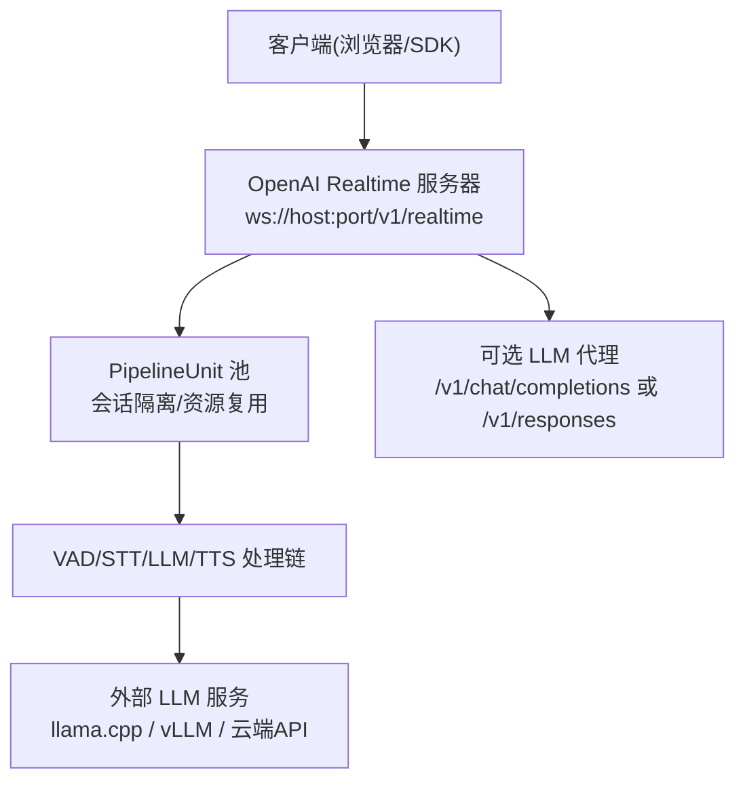
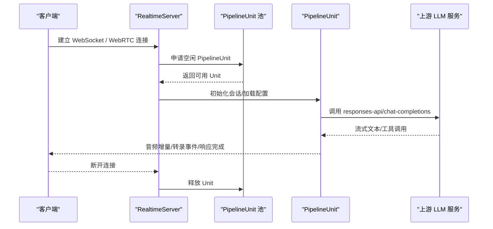
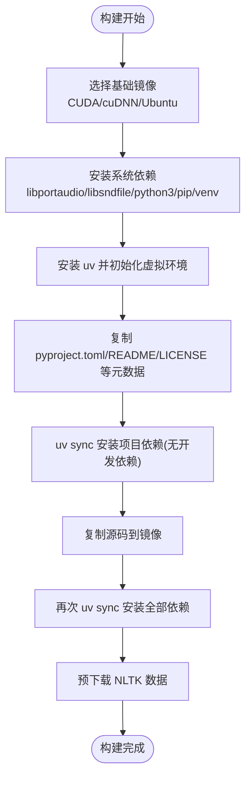
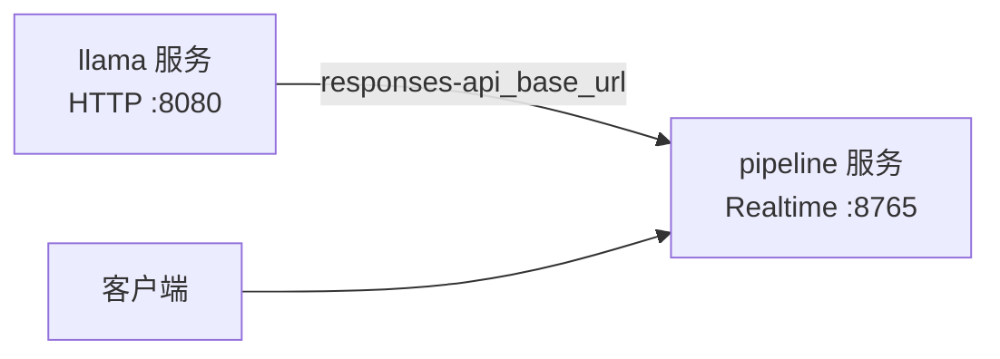
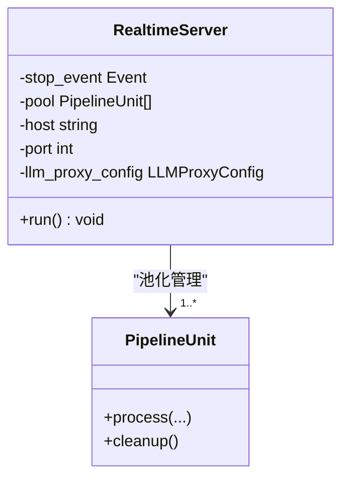
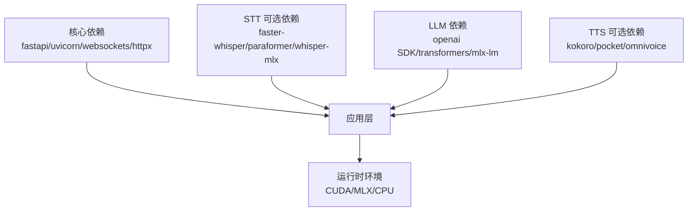
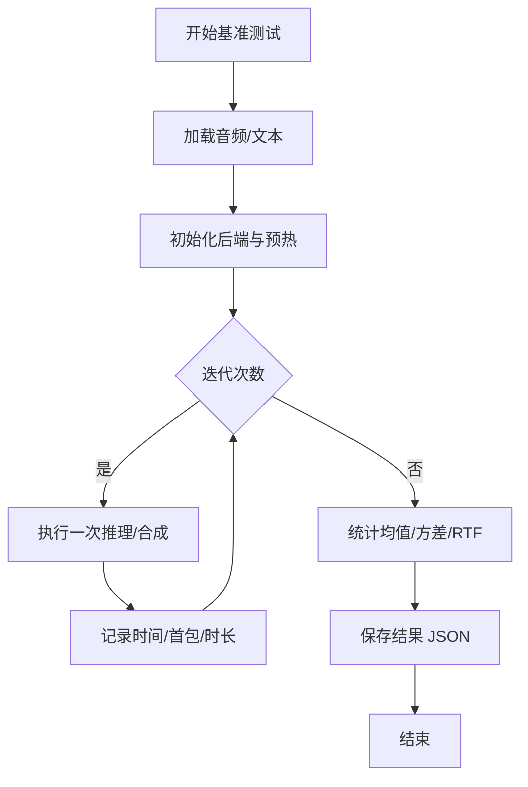

# 部署指南

<cite>
**本文引用的文件**
- [Dockerfile](file://Dockerfile)
- [Dockerfile.arm64](file://Dockerfile.arm64)
- [docker-compose.yml](file://docker-compose.yml)
- [README.md](file://README.md)
- [pyproject.toml](file://pyproject.toml)
- [cli.py](file://src/speech_to_speech/cli.py)
- [server.py](file://src/speech_to_speech/api/openai_realtime/server.py)
- [runtime_config.py](file://src/speech_to_speech/api/openai_realtime/runtime_config.py)
- [benchmark_stt.py](file://scripts/benchmark_stt.py)
- [benchmark_tts.py](file://scripts/benchmark_tts.py)
- [demo/Dockerfile](file://demo/Dockerfile)
</cite>

## 目录
1. [简介](#简介)
2. [项目结构](#项目结构)
3. [核心组件](#核心组件)
4. [架构总览](#架构总览)
5. [详细组件分析](#详细组件分析)
6. [依赖关系分析](#依赖关系分析)
7. [性能考量与基准测试](#性能考量与基准测试)
8. [故障排除指南](#故障排除指南)
9. [结论](#结论)
10. [附录](#附录)

## 简介
本指南面向生产环境，提供语音转语音（STT→LLM→TTS）系统的容器化部署、多容器编排、服务发现、负载均衡、安全配置、网络设置、CI/CD流水线、自动化测试、持续集成、不同环境的最佳实践（云、边缘、本地）、以及监控与排障方案。系统通过 OpenAI Realtime 兼容协议暴露 WebSocket/WebRTC 接口，支持多种 STT/LLM/TTS 后端，并可通过 Docker Compose 快速拉起包含 LLM 推理服务的完整链路。

## 项目结构
仓库采用分层模块化组织：
- 根级提供容器镜像构建定义与多服务编排文件
- src/speech_to_speech 为核心代码，包含 CLI、Realtime 服务端、管道单元、各模块处理器
- scripts 提供 STT/TTS 基准测试工具
- demo 提供前端演示与独立容器镜像
- docs 提供 API 使用文档

图表来源
- [server.py:14-70](file://src/speech_to_speech/api/openai_realtime/server.py#L14-L70)
- [docker-compose.yml:1-70](file://docker-compose.yml#L1-L70)

章节来源
- [README.md:87-96](file://README.md#L87-L96)
- [README.md:286-295](file://README.md#L286-L295)

## 核心组件
- CLI 入口：提供 serve/talk/local 三种命令模式，负责参数解析与启动流程
- Realtime 服务器：基于 FastAPI+uvicorn，维护 PipelineUnit 池，按连接分配单元，连接断开释放
- 运行时配置：管理 session 配置合并与中断响应开关等运行时状态
- 基准测试脚本：分别对 STT/TTS 进行吞吐、延迟、首包时间、RTF 等指标评测

章节来源
- [cli.py:26-95](file://src/speech_to_speech/cli.py#L26-L95)
- [cli.py:98-186](file://src/speech_to_speech/cli.py#L98-L186)
- [server.py:14-70](file://src/speech_to_speech/api/openai_realtime/server.py#L14-L70)
- [runtime_config.py:27-82](file://src/speech_to_speech/api/openai_realtime/runtime_config.py#L27-L82)

## 架构总览
系统以“会话级隔离”的 PipelineUnit 池为核心，每个连接从池中领取一个单元，内部串联 VAD→STT→LLM→TTS 四个阶段，并通过队列与线程解耦。对外暴露 OpenAI Realtime 兼容端点，同时可选择开启 LLM 代理以复用同一上游 LLM 能力。

图表来源
- [server.py:14-70](file://src/speech_to_speech/api/openai_realtime/server.py#L14-L70)
- [docker-compose.yml:32-70](file://docker-compose.yml#L32-L70)

## 详细组件分析

### 容器化与镜像构建
- 基础镜像：NVIDIA CUDA 12.8 + cuDNN + Ubuntu 24.04，启用非交互式安装与 Python 缓冲输出
- 依赖安装：通过 uv 同步 Python 依赖，预下载 NLTK 数据
- ARM64 变体：提供 arm64 专用 Dockerfile，便于在 Apple Silicon 或 ARM 服务器上运行
- Demo 镜像：Node 构建前端静态资源，Python 运行 FastAPI 服务，暴露端口供平台路由

图表来源
- [Dockerfile:1-28](file://Dockerfile#L1-L28)
- [Dockerfile.arm64:1-29](file://Dockerfile.arm64#L1-L29)
- [demo/Dockerfile:1-22](file://demo/Dockerfile#L1-L22)

章节来源
- [Dockerfile:1-28](file://Dockerfile#L1-L28)
- [Dockerfile.arm64:1-29](file://Dockerfile.arm64#L1-L29)
- [demo/Dockerfile:1-22](file://demo/Dockerfile#L1-L22)

### 多容器编排与服务发现
- 使用 docker-compose 编排两个服务：
  - llama：基于官方镜像运行 llama.cpp 推理服务，绑定 GPU 设备，暴露 HTTP 端口
  - pipeline：构建并运行语音转语音服务，依赖 llama 服务，暴露 Realtime 端口
- 服务发现：通过 compose 网络名直接访问（如 http://llama:8080/v1），无需额外注册中心
- 资源预留：为 GPU 设备指定驱动与设备 ID，确保容器内可见 GPU

图表来源
- [docker-compose.yml:4-31](file://docker-compose.yml#L4-L31)
- [docker-compose.yml:32-70](file://docker-compose.yml#L32-L70)

章节来源
- [docker-compose.yml:1-70](file://docker-compose.yml#L1-L70)

### 负载均衡与会话池
- 服务器维护 PipelineUnit 池，每个连接分配一个单元，实现会话级隔离
- 当所有单元被占用时，新连接将被拒绝，避免过载
- 可通过调整池大小与进程数扩展并发能力（结合反向代理与健康检查）

图表来源
- [server.py:14-70](file://src/speech_to_speech/api/openai_realtime/server.py#L14-L70)

章节来源
- [server.py:14-70](file://src/speech_to_speech/api/openai_realtime/server.py#L14-L70)

### 安全配置与访问控制
- 默认不鉴权：建议将服务置于可信网络或网关之后，由网关统一认证与限流
- LLM 代理：可暴露上游 LLM 的 chat/completions 或 responses 端点，需仅在受信任网络启用
- 密钥管理：上游 LLM 的 API Key 由服务器持有，不会透传到客户端；环境变量注入更安全
- 网络暴露：默认监听 0.0.0.0，生产环境应通过反向代理限制来源 IP 与速率

章节来源
- [README.md:334-353](file://README.md#L334-L353)
- [docker-compose.yml:32-70](file://docker-compose.yml#L32-L70)

### 网络设置与端口规划
- 对外端口：
  - 8765：OpenAI Realtime WebSocket/WebRTC 端点
  - 8080：上游 LLM 服务（可选，compose 中已内置）
- 内网通信：通过 compose 服务名解析（如 llama:8080）
- 反向代理：推荐 Nginx/Traefik 做 TLS 终止、路径转发、限流与鉴权

章节来源
- [docker-compose.yml:20-22](file://docker-compose.yml#L20-L22)
- [docker-compose.yml:57-60](file://docker-compose.yml#L57-L60)
- [README.md:296-332](file://README.md#L296-L332)

### CI/CD 流水线与自动化测试
- 依赖管理：使用 uv 同步依赖，提升构建与安装速度
- 测试框架：pytest 自动异步模式，便于测试异步组件
- 质量工具：ruff 代码检查，mypy 类型检查
- 建议流水线步骤：
  - 拉取代码 → 安装依赖 → 单元测试 → 集成测试（Realtime 端到端）→ 构建镜像 → 推送镜像 → 部署

章节来源
- [pyproject.toml:111-148](file://pyproject.toml#L111-L148)
- [README.md:682-693](file://README.md#L682-L693)

### 不同部署环境的最佳实践
- 云部署：
  - 使用容器编排（Kubernetes/Docker Swarm），通过 Service/Ingress 暴露 8765
  - 配置健康检查与自动扩缩容，结合 HPA 基于 CPU/GPU 利用率
  - 使用 Secret 管理 API Key，环境变量注入
- 边缘计算：
  - 优先选择轻量模型与量化版本（如 MLX/ONNX/GGML）
  - 关闭不必要的日志与调试，减少 I/O
  - 使用离线模式缓存模型与依赖，降低网络抖动影响
- 本地部署：
  - 使用 local 命令一键启动服务与内置客户端
  - 通过 --mac-optimal-settings 优化 macOS 默认设备与后端
  - 合理设置播放缓冲与采样率，平衡延迟与稳定性

章节来源
- [README.md:223-250](file://README.md#L223-L250)
- [README.md:252-284](file://README.md#L252-L284)
- [README.md:511-534](file://README.md#L511-L534)

## 依赖关系分析
- 运行时依赖：FastAPI、uvicorn、websockets、httpx、openai SDK、transformers、onnxruntime 等
- 可选依赖：通过 extras 按需安装（如 faster-whisper、pocket、omnivoice、paraformer 等）
- 平台差异：macOS 与非 macOS 平台依赖存在条件分支，注意构建环境一致性

图表来源
- [pyproject.toml:27-66](file://pyproject.toml#L27-L66)
- [pyproject.toml:68-101](file://pyproject.toml#L68-L101)

章节来源
- [pyproject.toml:27-66](file://pyproject.toml#L27-L66)
- [pyproject.toml:68-101](file://pyproject.toml#L68-L101)

## 性能考量与基准测试
- 关键指标：
  - 首包时间（TTFT/TTFC）：影响交互感知延迟
  - 平均推理时间与标准差：衡量稳定性
  - RTF（实时因子）：评估合成速度与实时性
- 工具与用法：
  - STT 基准：scripts/benchmark_stt.py，支持多种 STT 后端对比
  - TTS 基准：scripts/benchmark_tts.py，支持多种 TTS 后端与量化策略对比
- 优化建议：
  - 选择合适的 STT/TTS 后端与量化级别（如 Qwen3-TTS MLX 量化）
  - 调整 VAD 阈值与最小语音时长，减少误触发与碎片化
  - 使用流式传输与增量输出，降低端到端延迟
  - 合理设置播放缓冲，平衡卡顿与首包延迟

图表来源
- [benchmark_stt.py:110-263](file://scripts/benchmark_stt.py#L110-L263)
- [benchmark_tts.py:91-219](file://scripts/benchmark_tts.py#L91-L219)

章节来源
- [benchmark_stt.py:1-386](file://scripts/benchmark_stt.py#L1-L386)
- [benchmark_tts.py:1-406](file://scripts/benchmark_tts.py#L1-L406)

## 故障排除指南
- 常见启动问题：
  - 端口冲突：确认 8765/8080 未被占用，必要时修改端口映射
  - GPU 不可用：检查 NVIDIA Container Toolkit 与设备权限
  - 依赖缺失：使用 uv sync 重新安装，确保平台匹配
- 连接与鉴权：
  - 无法连接：检查防火墙与反向代理规则，确认域名/证书有效
  - 鉴权失败：确认网关是否要求 API Key，或在服务器侧启用代理并在可信网络使用
- 性能与延迟：
  - 高延迟：尝试更轻量的 STT/TTS 后端，或启用流式输出
  - 卡顿：适当增大播放缓冲，或优化网络抖动
- 日志与诊断：
  - 启用转录日志：便于定位 STT/LLM/TTS 异常
  - 查看服务器日志：关注连接池状态与错误堆栈

章节来源
- [README.md:334-353](file://README.md#L334-L353)
- [README.md:286-295](file://README.md#L286-L295)
- [cli.py:147-154](file://src/speech_to_speech/cli.py#L147-L154)

## 结论
本指南提供了从容器化构建、多服务编排、负载均衡、安全与网络配置，到性能基准、CI/CD 与运维监控的全链路部署方案。通过合理的后端选择、参数调优与基础设施配置，可在云、边缘与本地环境中稳定交付低延迟的语音转语音服务。

## 附录
- 快速启动：
  - 使用 docker compose up 一键拉起完整链路
  - 通过浏览器或 SDK 连接 ws://host:8765/v1/realtime
- 参考命令：
  - 本地模式：speech-to-speech local
  - 服务模式：speech-to-speech serve
  - 客户端模式：speech-to-speech talk --url ...

章节来源
- [README.md:31-68](file://README.md#L31-L68)
- [README.md:198-217](file://README.md#L198-L217)
- [docker-compose.yml:1-70](file://docker-compose.yml#L1-L70)