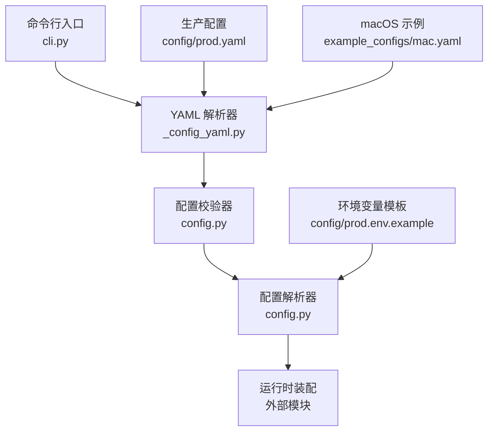
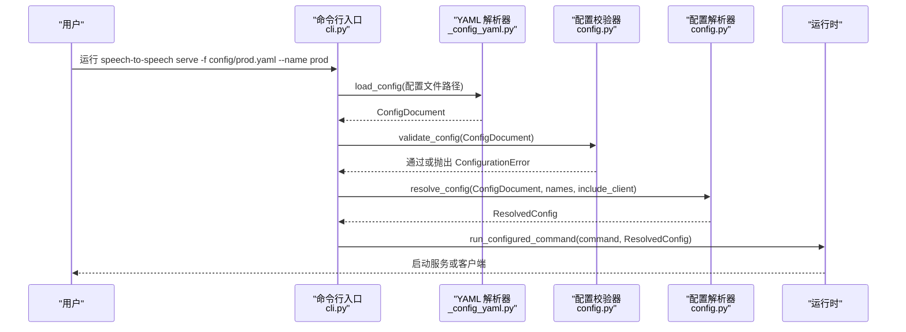
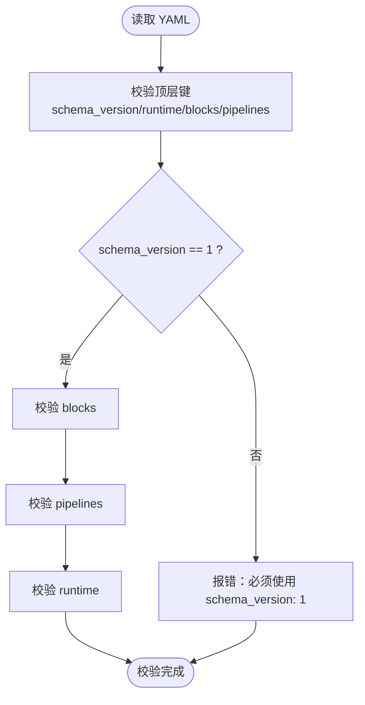
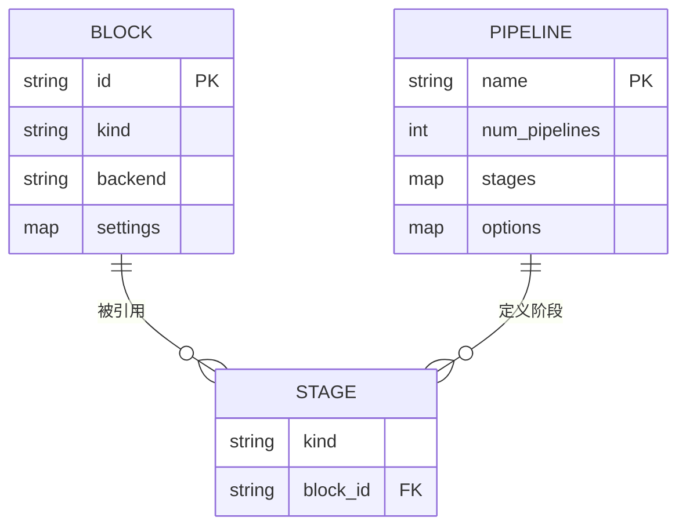
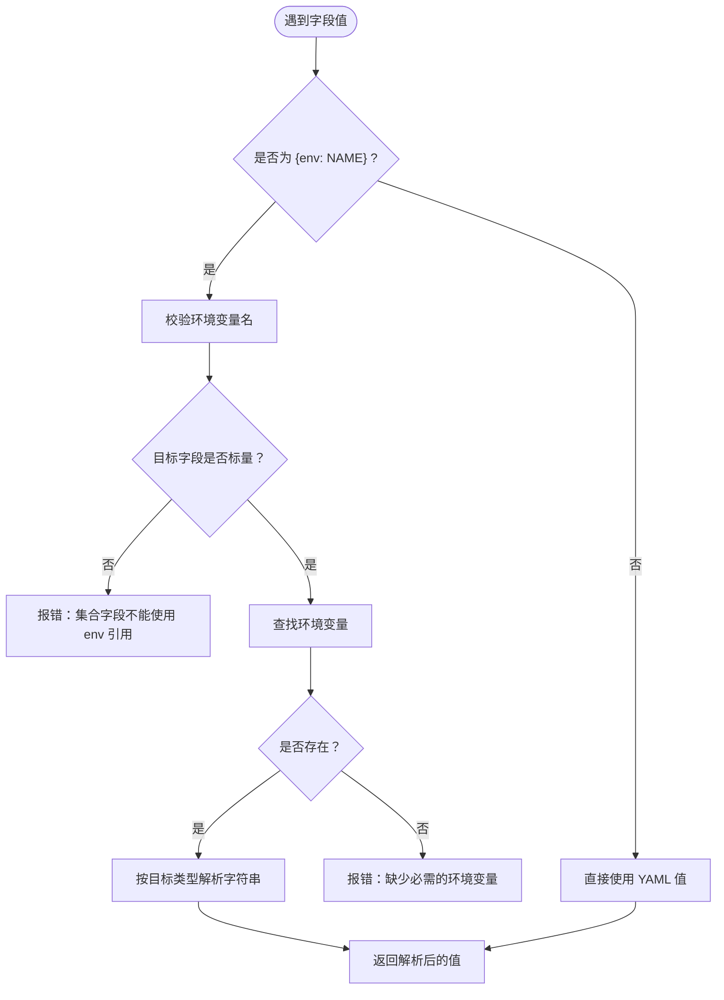
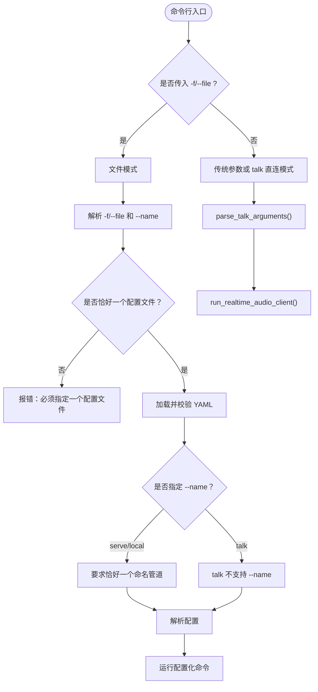
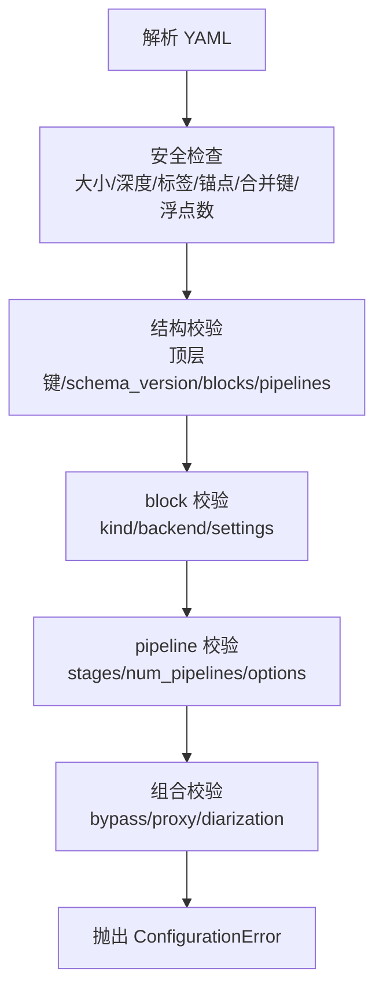
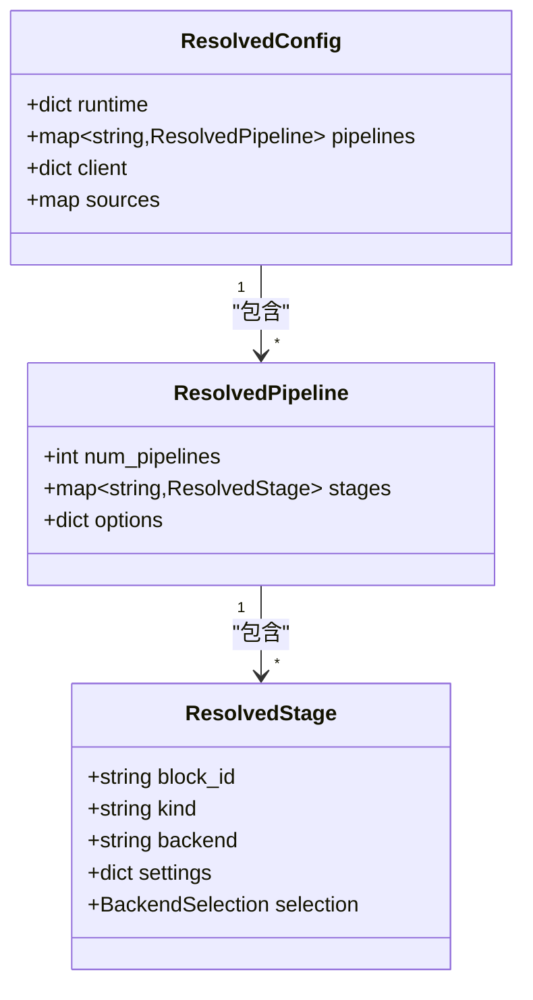
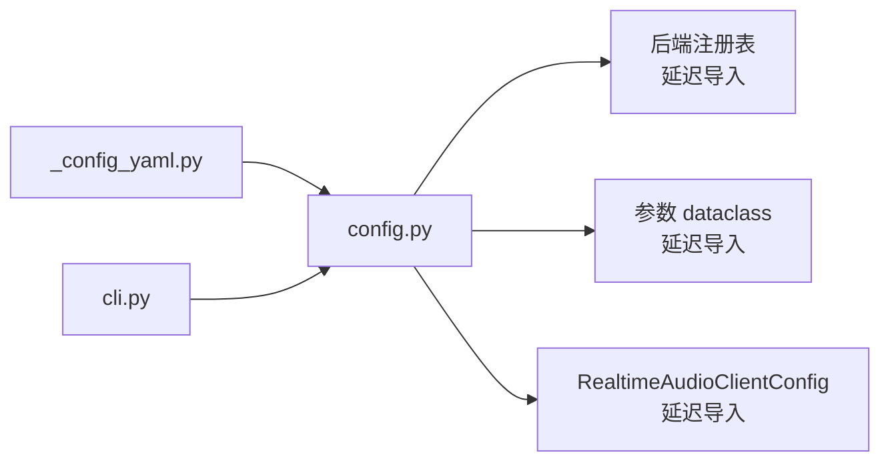

# 配置管理

<cite>
**本文引用的文件**   
- [src/speech_to_speech/_config_yaml.py](file://src/speech_to_speech/_config_yaml.py)
- [src/speech_to_speech/config.py](file://src/speech_to_speech/config.py)
- [src/speech_to_speech/cli.py](file://src/speech_to_speech/cli.py)
- [config/prod.yaml](file://config/prod.yaml)
- [config/prod.env.example](file://config/prod.env.example)
- [example_configs/mac.yaml](file://example_configs/mac.yaml)
</cite>

## 目录
1. [简介](#简介)
2. [项目结构](#项目结构)
3. [核心组件](#核心组件)
4. [架构总览](#架构总览)
5. [详细组件分析](#详细组件分析)
6. [依赖关系分析](#依赖关系分析)
7. [性能与资源特性](#性能与资源特性)
8. [故障排查指南](#故障排查指南)
9. [结论](#结论)
10. [附录：配置模板与最佳实践](#附录配置模板与最佳实践)

## 简介
本文件面向语音到语音（Speech-to-Speech）服务的配置系统，系统性说明 YAML 配置文件语法、结构、继承机制、环境变量引用、配置块复用、命名管道定义、命令行参数优先级、默认值、验证规则，并提供部署场景模板、迁移指南、版本兼容性说明和调试技巧。

该配置系统采用“严格子集 YAML + 强类型校验”的设计：
- 只允许 JSON 兼容的标量、映射和序列；禁止锚点/别名、显式标签、合并键、非有限浮点数。
- 顶层文档必须是单个映射，且必须声明 `schema_version: 1`。
- 通过 dataclass 驱动的字段校验、选择集校验、路径展开、环境引用解析，实现可诊断的配置加载。

## 项目结构
与配置直接相关的代码和示例如下：
- 配置解析器：`src/speech_to_speech/_config_yaml.py`
- 配置模型、校验与解析：`src/speech_to_speech/config.py`
- 命令行入口与文件模式：`src/speech_to_speech/cli.py`
- 生产配置示例：`config/prod.yaml`
- 环境变量模板：`config/prod.env.example`
- macOS 本地示例：`example_configs/mac.yaml`

**图表来源**
- [src/speech_to_speech/cli.py:190-228](file://src/speech_to_speech/cli.py#L190-L228)
- [src/speech_to_speech/_config_yaml.py:17-112](file://src/speech_to_speech/_config_yaml.py#L17-L112)
- [src/speech_to_speech/config.py:106-125](file://src/speech_to_speech/config.py#L106-L125)
- [src/speech_to_speech/config.py:371-438](file://src/speech_to_speech/config.py#L371-L438)
- [src/speech_to_speech/config.py:441-538](file://src/speech_to_speech/config.py#L441-L538)

**章节来源**
- [src/speech_to_speech/cli.py:190-228](file://src/speech_to_speech/cli.py#L190-L228)
- [src/speech_to_speech/_config_yaml.py:17-112](file://src/speech_to_speech/_config_yaml.py#L17-L112)
- [src/speech_to_speech/config.py:106-125](file://src/speech_to_speech/config.py#L106-L125)
- [src/speech_to_speech/config.py:371-438](file://src/speech_to_speech/config.py#L371-L438)
- [src/speech_to_speech/config.py:441-538](file://src/speech_to_speech/config.py#L441-L538)

## 核心组件
- **受限 YAML 解析器**：限制文件大小、嵌套深度、禁用不安全特性，并记录每个节点在源文件中的行列位置，用于生成精确错误信息。
- **配置文档对象**：保存原始数据、文件路径和位置映射，避免在日志中泄露敏感值。
- **配置校验器**：检查顶层键、`schema_version`、`blocks`、`pipelines`、`runtime` 的结构与字段合法性。
- **配置解析器**：将 YAML 映射为运行时可用的结构化配置，支持环境变量引用、路径展开、后端选择、实例数量等。
- **命令行接口**：提供 `-f/--file` 指定配置文件、`--name` 选择命名管道，并在 `serve/local/talk` 命令下执行不同流程。

**章节来源**
- [src/speech_to_speech/_config_yaml.py:17-112](file://src/speech_to_speech/_config_yaml.py#L17-L112)
- [src/speech_to_speech/config.py:63-94](file://src/speech_to_speech/config.py#L63-L94)
- [src/speech_to_speech/config.py:371-438](file://src/speech_to_speech/config.py#L371-L438)
- [src/speech_to_speech/config.py:441-538](file://src/speech_to_speech/config.py#L441-L538)
- [src/speech_to_speech/cli.py:190-228](file://src/speech_to_speech/cli.py#L190-L228)

## 架构总览
配置加载与解析的整体流程如下：

**图表来源**
- [src/speech_to_speech/cli.py:190-228](file://src/speech_to_speech/cli.py#L190-L228)
- [src/speech_to_speech/_config_yaml.py:17-112](file://src/speech_to_speech/_config_yaml.py#L17-L112)
- [src/speech_to_speech/config.py:371-438](file://src/speech_to_speech/config.py#L371-L438)
- [src/speech_to_speech/config.py:441-538](file://src/speech_to_speech/config.py#L441-L538)

## 详细组件分析

### YAML 语法与结构
- **顶层键**：仅允许 `schema_version`、`runtime`、`blocks`、`pipelines`。
- **schema_version**：当前仅支持整数 `1`。
- **blocks**：定义可复用的处理单元，每个 block 包含 `kind`、`backend`、`settings`。
- **pipelines**：定义命名管道，每个 pipeline 包含 `stages`、`num_pipelines`、`options`。
- **runtime**：包含进程级设置、服务器设置、可选客户端设置。

**图表来源**
- [src/speech_to_speech/config.py:371-392](file://src/speech_to_speech/config.py#L371-L392)

**章节来源**
- [src/speech_to_speech/config.py:371-392](file://src/speech_to_speech/config.py#L371-L392)

### 配置块复用与命名管道
- **配置块复用**：`blocks` 中定义的 VAD、STT、LLM、TTS 单元可在多个 pipeline 中被引用，避免重复配置。
- **命名管道**：`pipelines` 中的每个条目是一个独立运行实例集合，通过 `stages` 引用已定义的 block，并通过 `num_pipelines` 控制实例数量。
- **阶段要求**：每个 pipeline 必须包含 `vad`、`stt`、`llm`、`tts` 四个阶段，且引用的 block 必须匹配对应 `kind`。

**图表来源**
- [src/speech_to_speech/config.py:393-438](file://src/speech_to_speech/config.py#L393-L438)

**章节来源**
- [src/speech_to_speech/config.py:393-438](file://src/speech_to_speech/config.py#L393-L438)

### 环境变量引用
- **引用语法**：使用 `{env: NAME}` 引用环境变量，其中 `NAME` 必须符合标识符规则。
- **类型约束**：环境变量只能用于标量字段（字符串、布尔、整数、浮点数），集合必须使用 YAML 原生结构。
- **缺失行为**：如果环境变量未设置，解析阶段会抛出明确的配置错误，不会回退到默认值。
- **路径字段**：部分路径字段会在解析时进行 `expanduser()` 和相对路径展开，最终转为绝对路径。

**图表来源**
- [src/speech_to_speech/config.py:158-256](file://src/speech_to_speech/config.py#L158-L256)
- [src/speech_to_speech/config.py:259-313](file://src/speech_to_speech/config.py#L259-L313)

**章节来源**
- [src/speech_to_speech/config.py:158-256](file://src/speech_to_speech/config.py#L158-L256)
- [src/speech_to_speech/config.py:259-313](file://src/speech_to_speech/config.py#L259-L313)

### 命令行参数优先级与默认值
- **文件模式**：当传入 `-f/--file` 时，CLI 进入“文件模式”，只接受 `-f/--file` 和 `--name`。
- **配置文件唯一性**：文件模式要求恰好一个配置文件。
- **命名管道选择**：`--name` 用于从配置文件中选择一个或多个命名管道；`serve` 和 `local` 命令要求恰好一个选中的定义。
- **talk 命令**：`talk` 不接收 `--name`，它使用独立的轻量客户端参数解析逻辑。
- **默认值来源**：
  - YAML 配置中的默认值由 dataclass 字段默认值或默认工厂提供。
  - 某些运行时字段（如 `torch_num_threads`）有额外正整数校验。
  - 客户端相关字段（如 `playback_buffer_ms`）在非负数范围内校验。

**图表来源**
- [src/speech_to_speech/cli.py:67-95](file://src/speech_to_speech/cli.py#L67-L95)
- [src/speech_to_speech/cli.py:98-187](file://src/speech_to_speech/cli.py#L98-L187)
- [src/speech_to_speech/cli.py:190-228](file://src/speech_to_speech/cli.py#L190-L228)

**章节来源**
- [src/speech_to_speech/cli.py:67-95](file://src/speech_to_speech/cli.py#L67-L95)
- [src/speech_to_speech/cli.py:98-187](file://src/speech_to_speech/cli.py#L98-L187)
- [src/speech_to_speech/cli.py:190-228](file://src/speech_to_speech/cli.py#L190-L228)

### 验证规则与错误处理
- **YAML 安全限制**：
  - 最大文件大小 1 MiB。
  - 最大嵌套深度 32。
  - 禁止锚点、别名、显式标签、合并键。
  - 禁止非有限浮点数。
  - 映射键必须为字符串，且不允许重复键。
- **配置结构校验**：
  - 顶层键必须为 `schema_version`、`runtime`、`blocks`、`pipelines`。
  - `schema_version` 必须为整数 `1`。
  - `blocks` 和 `pipelines` 必须为非空映射。
  - block ID 和 pipeline 名称必须符合标识符规则。
  - stage 引用必须存在且 `kind` 匹配。
  - `num_pipelines` 必须为正整数。
  - 组合校验：例如 STT bypass 需要支持音频输入的 LLM；说话人分离阈值必须在 `(0, 1)`；LLM proxy 需要后端支持。
- **错误输出**：所有错误统一通过 `ConfigurationError` 抛出，错误消息不包含敏感值，但会包含文件名、行号、列号和安全的字段路径。

**图表来源**
- [src/speech_to_speech/_config_yaml.py:17-112](file://src/speech_to_speech/_config_yaml.py#L17-L112)
- [src/speech_to_speech/config.py:96-104](file://src/speech_to_speech/config.py#L96-L104)
- [src/speech_to_speech/config.py:371-438](file://src/speech_to_speech/config.py#L371-L438)

**章节来源**
- [src/speech_to_speech/_config_yaml.py:17-112](file://src/speech_to_speech/_config_yaml.py#L17-L112)
- [src/speech_to_speech/config.py:96-104](file://src/speech_to_speech/config.py#L96-L104)
- [src/speech_to_speech/config.py:371-438](file://src/speech_to_speech/config.py#L371-L438)

### 配置块与运行时数据结构
配置解析后形成以下核心数据结构：
- `ResolvedStage`：表示某个阶段的已解析配置，包括 block ID、kind、backend、settings 和后端选择。
- `ResolvedPipeline`：表示某个命名管道的已解析配置，包括实例数量、阶段映射和选项。
- `ResolvedConfig`：表示整体已解析配置，包括运行时设置、管道映射、可选客户端设置和来源追踪。

**图表来源**
- [src/speech_to_speech/config.py:72-94](file://src/speech_to_speech/config.py#L72-L94)
- [src/speech_to_speech/config.py:514-538](file://src/speech_to_speech/config.py#L514-L538)

**章节来源**
- [src/speech_to_speech/config.py:72-94](file://src/speech_to_speech/config.py#L72-L94)
- [src/speech_to_speech/config.py:514-538](file://src/speech_to_speech/config.py#L514-L538)

## 依赖关系分析
- `_config_yaml.py` 仅依赖 `yaml.SafeLoader` 和 `speech_to_speech.config.ConfigurationError`，保持解析层轻量。
- `config.py` 在元数据获取时延迟导入后端注册表、dataclass 参数模型和客户端配置类，避免启动时强耦合。
- `cli.py` 在文件模式下才导入配置模块，进一步降低冷启动开销。

**图表来源**
- [src/speech_to_speech/_config_yaml.py:11-12](file://src/speech_to_speech/_config_yaml.py#L11-L12)
- [src/speech_to_speech/config.py:128-145](file://src/speech_to_speech/config.py#L128-L145)
- [src/speech_to_speech/cli.py:190-228](file://src/speech_to_speech/cli.py#L190-L228)

**章节来源**
- [src/speech_to_speech/_config_yaml.py:11-12](file://src/speech_to_speech/_config_yaml.py#L11-L12)
- [src/speech_to_speech/config.py:128-145](file://src/speech_to_speech/config.py#L128-L145)
- [src/speech_to_speech/cli.py:190-228](file://src/speech_to_speech/cli.py#L190-L228)

## 性能与资源特性
- **线程数控制**：`torch_num_threads` 在 YAML 和 CLI 中均要求正整数，错误值会被拒绝。
- **回放缓冲**：客户端 `playback_buffer_ms` 必须为非负数。
- **离线模式**：环境变量模板建议开启 HuggingFace 和 Transformers 离线模式，避免权重下载重试导致容器启动卡顿。
- **设备与模型路径**：路径字段支持相对路径展开，最终转为绝对路径，便于容器内固定缓存目录。

**章节来源**
- [tests/test_torch_num_threads.py:108-156](file://tests/test_torch_num_threads.py#L108-L156)
- [src/speech_to_speech/config.py:333-337](file://src/speech_to_speech/config.py#L333-L337)
- [config/prod.env.example:13-18](file://config/prod.env.example#L13-L18)

## 故障排查指南
- **YAML 解析错误**：检查是否使用了锚点、别名、显式标签、合并键或非有限浮点数；确认文件不超过 1 MiB 且嵌套不超过 32 层。
- **schema_version 错误**：确保顶层 `schema_version` 为整数 `1`。
- **缺少 blocks 或 pipelines**：两者都必须是非空映射。
- **block ID 或 pipeline 名称非法**：必须是以字母开头、长度 1-64、仅含字母数字、下划线和连字符的标识符。
- **stage 引用错误**：引用的 block 必须存在且 `kind` 匹配。
- **num_pipelines 无效**：必须为正整数。
- **环境变量缺失**：`{env: NAME}` 对应的环境变量必须存在，否则会报硬错误。
- **路径展开失败**：如果无法展开家目录，需提供绝对路径。
- **组合校验失败**：
  - STT bypass 需要支持音频输入的 LLM。
  - 说话人分离启用时需要 STT 后端，且阈值在 `(0, 1)`。
  - LLM proxy 需要后端支持。

**章节来源**
- [src/speech_to_speech/_config_yaml.py:17-112](file://src/speech_to_speech/_config_yaml.py#L17-L112)
- [src/speech_to_speech/config.py:371-438](file://src/speech_to_speech/config.py#L371-L438)
- [src/speech_to_speech/config.py:441-538](file://src/speech_to_speech/config.py#L441-L538)

## 结论
该配置系统以“安全 YAML + 强类型校验 + 明确错误定位”为核心，适合生产环境的可审计、可迁移、可调试配置管理。通过 `blocks` 复用和 `pipelines` 命名，既能抽象组件又能灵活编排；通过 `{env: NAME}` 注入敏感信息，既安全又清晰；通过严格的验证规则和来源追踪，便于运维排障和合规审计。

## 附录：配置模板与最佳实践

### 生产配置模板
参考 `config/prod.yaml`，典型结构包括：
- `schema_version: 1`
- `blocks`：定义 VAD、STT、LLM、TTS 四个阶段的可复用单元。
- `pipelines`：定义命名管道，引用上述 block，并设置 `num_pipelines` 和 `options`。
- `runtime.server`：设置监听地址和端口。

**章节来源**
- [config/prod.yaml:1-75](file://config/prod.yaml#L1-L75)

### macOS 本地配置模板
参考 `example_configs/mac.yaml`，典型结构包括：
- `schema_version: 1`
- `blocks`：使用本地 MLX LLM 和 Parakeet STT。
- `pipelines`：启用 `mac_optimal_settings` 优化本地体验。

**章节来源**
- [example_configs/mac.yaml:1-18](file://example_configs/mac.yaml#L1-L18)

### 环境变量模板
参考 `config/prod.env.example`，典型内容：
- `GPUSTACK_API_KEY`：供 LLM 后端使用的 API Key。
- `HF_HUB_OFFLINE=1`、`TRANSFORMERS_OFFLINE=1`：离线模式，避免权重下载重试。
- `TOKENIZERS_PARALLELISM=false`：减少并行开销。
- `S2S_ADMIN_TOKEN`：控制台与管理端通信令牌。

**章节来源**
- [config/prod.env.example:1-26](file://config/prod.env.example#L1-L26)

### 配置迁移指南
- **旧版 CLI 标志迁移**：生产配置注释说明该文件是从 docker-compose 中的 40+ CLI 标志迁移而来，因此应将不再需要的标志写入 YAML 而非命令行。
- **schema_version 升级**：当前仅支持 `schema_version: 1`；未来若引入新版本，需遵循向后兼容策略，并在解析器中增加版本分支。
- **JSON 兼容值**：所有配置值必须是 JSON 兼容的标量、映射或序列；不要使用 YAML 高级特性。

**章节来源**
- [config/prod.yaml:1-5](file://config/prod.yaml#L1-L5)
- [src/speech_to_speech/config.py:374-376](file://src/speech_to_speech/config.py#L374-L376)

### 常见配置模式
- **VAD 纯静音检测**：关闭 Smart Turn，保留模型路径以避免启动时下载。
- **STT 使用 Qwen3 ASR**：指定模型目录、设备和自动语言识别。
- **LLM 使用 Chat Completions**：指定模型名、Base URL、流式响应、推理强度为空字符串表示不发送。
- **TTS 使用 Qwen3**：指定模型目录、后端、设备、流式分片大小。
- **Pipeline 单实例**：`num_pipelines: 1`，适合单机演示或小规模部署。

**章节来源**
- [config/prod.yaml:8-67](file://config/prod.yaml#L8-L67)

### 调试技巧
- **查看错误位置**：ConfigurationError 会包含文件名、行号、列号和安全的字段路径。
- **检查环境变量**：确认 `{env: NAME}` 对应的环境变量已正确设置。
- **隔离测试**：使用最小 YAML 文件逐步添加字段，定位问题。
- **禁用流式或代理**：先关闭 `responses_api_stream` 或 `enable_llm_proxy`，排除网络或后端能力问题。
- **使用 talk 命令**：通过 `speech-to-speech talk` 快速验证客户端连接，不依赖完整服务端配置。

**章节来源**
- [src/speech_to_speech/config.py:96-104](file://src/speech_to_speech/config.py#L96-L104)
- [src/speech_to_speech/cli.py:98-187](file://src/speech_to_speech/cli.py#L98-L187)