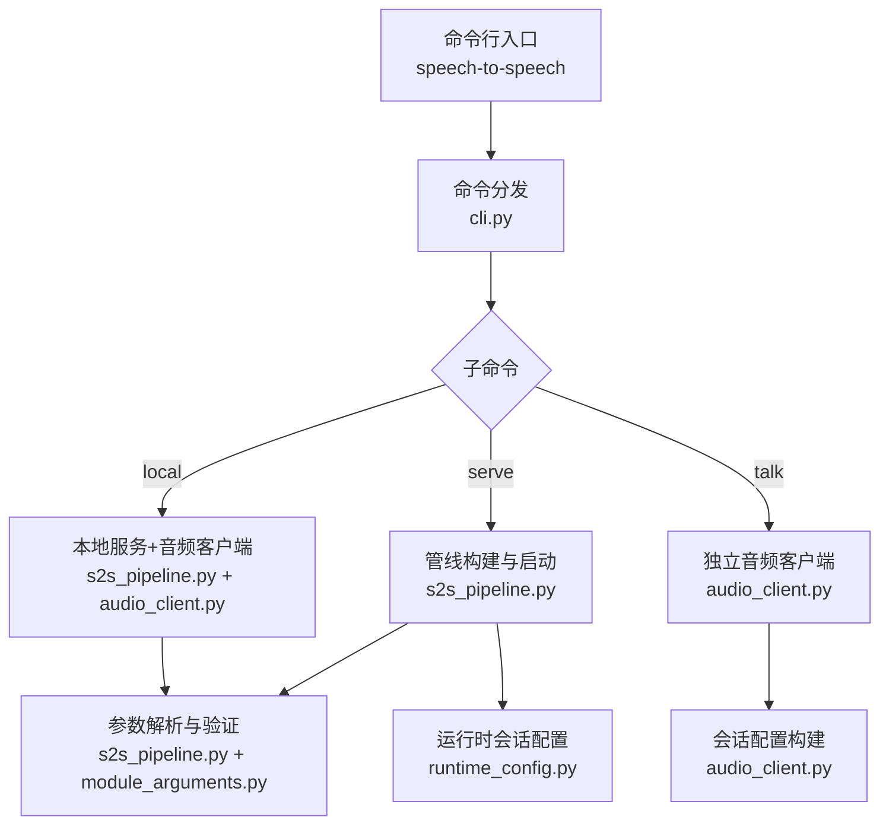
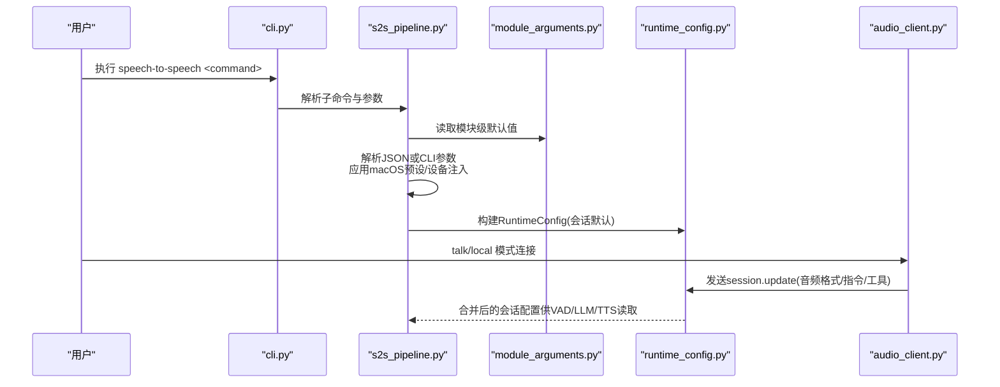
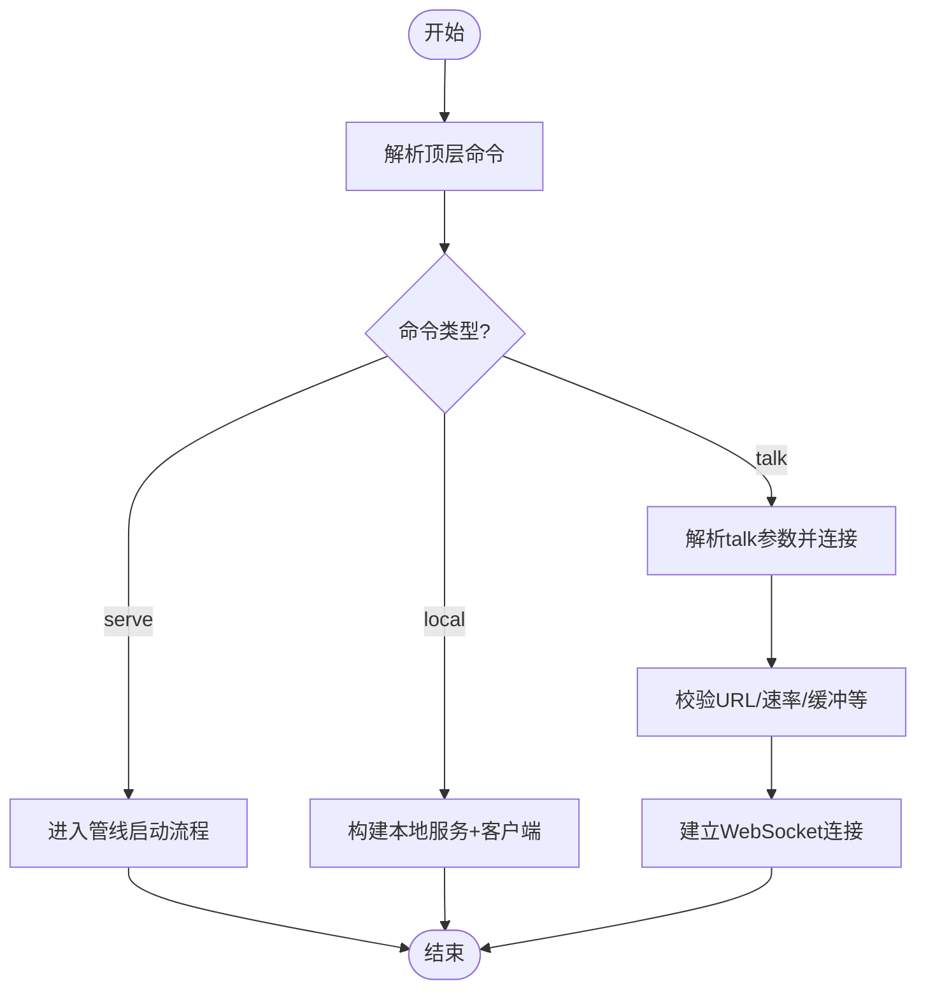
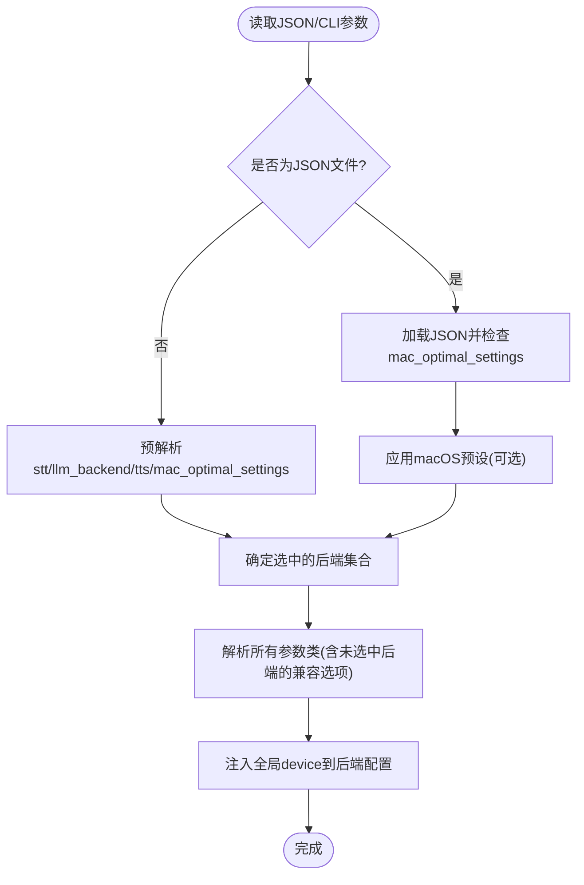
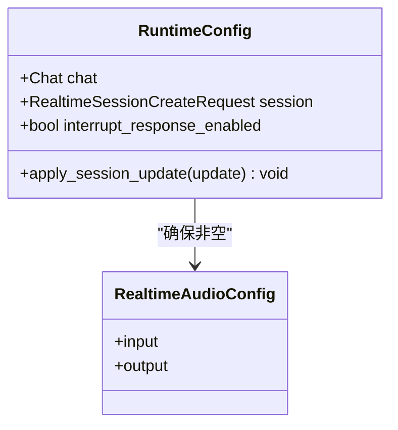
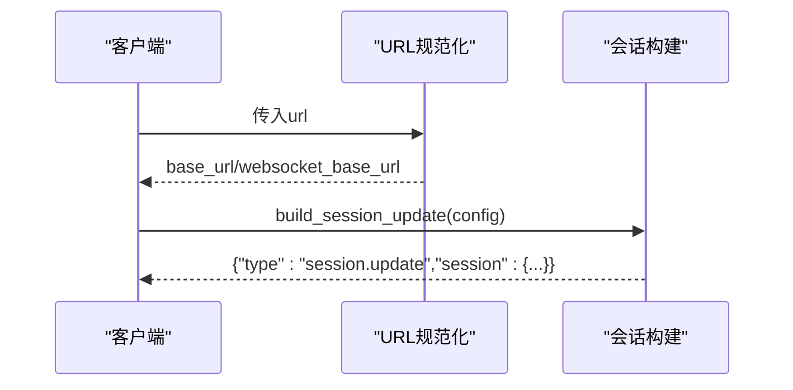
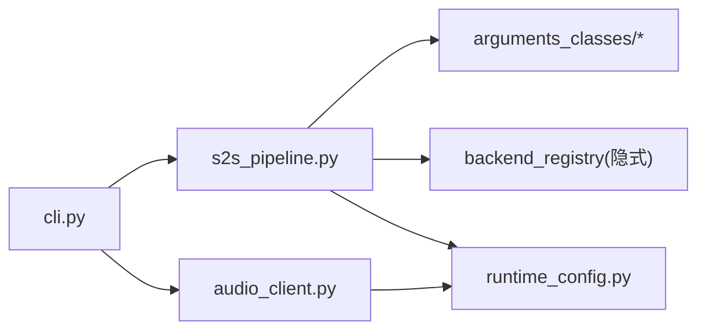

# 配置系统

<cite>
**本文引用的文件**
- [cli.py](file://src/speech_to_speech/cli.py)
- [s2s_pipeline.py](file://src/speech_to_speech/s2s_pipeline.py)
- [module_arguments.py](file://src/speech_to_speech/arguments_classes/module_arguments.py)
- [runtime_config.py](file://src/speech_to_speech/api/openai_realtime/runtime_config.py)
- [audio_client.py](file://src/speech_to_speech/api/openai_realtime/audio_client.py)
- [pyproject.toml](file://pyproject.toml)
</cite>

## 目录
1. [简介](#简介)
2. [项目结构](#项目结构)
3. [核心组件](#核心组件)
4. [架构总览](#架构总览)
5. [详细组件分析](#详细组件分析)
6. [依赖关系分析](#依赖关系分析)
7. [性能与硬件适配](#性能与硬件适配)
8. [故障排查指南](#故障排查指南)
9. [结论](#结论)
10. [附录：参数参考与模板](#附录参数参考与模板)

## 简介
本配置系统围绕“命令行参数、JSON 配置文件、运行时会话配置”三层展开，覆盖模块级全局参数、各组件（STT/LLM/TTS/VAD）特定参数以及实时会话的动态配置。系统通过统一的解析流程将 CLI、JSON 与运行时更新合并为最终配置，并在启动前进行校验与设备注入，确保在不同平台（含 macOS）和不同后端组合下的稳定运行。

## 项目结构
- 入口与命令分发：CLI 提供 serve/talk/local 三种模式；talk 使用轻量音频客户端；serve/local 进入完整管线。
- 参数解析与验证：基于 HfArgumentParser 的 dataclass 参数体系，支持 JSON 文件加载、macOS 预设、未选中后端的兼容忽略。
- 运行时配置：Realtime 会话配置在运行时可被客户端动态更新，并安全地合并到共享状态中。
- 本地音频客户端：talk/local 模式下的麦克风/扬声器采集与播放缓冲、工具调用编排等。

**图示来源**
- [cli.py:26-95](file://src/speech_to_speech/cli.py#L26-L95)
- [s2s_pipeline.py:175-285](file://src/speech_to_speech/s2s_pipeline.py#L175-L285)
- [audio_client.py:48-74](file://src/speech_to_speech/api/openai_realtime/audio_client.py#L48-L74)
- [runtime_config.py:27-82](file://src/speech_to_speech/api/openai_realtime/runtime_config.py#L27-L82)

**章节来源**
- [cli.py:26-95](file://src/speech_to_speech/cli.py#L26-L95)
- [s2s_pipeline.py:175-285](file://src/speech_to_speech/s2s_pipeline.py#L175-L285)
- [audio_client.py:48-74](file://src/speech_to_speech/api/openai_realtime/audio_client.py#L48-L74)
- [runtime_config.py:27-82](file://src/speech_to_speech/api/openai_realtime/runtime_config.py#L27-L82)

## 核心组件
- 模块级全局参数（ModuleArguments）：控制设备、日志级别、是否启用实时转写、LLM 代理、并发管线数、默认 STT/LLM/TTS 选择等。
- 服务器/本地参数：监听地址、端口、本地模式额外参数（如回放缓冲、输入输出设备、工具模块）。
- VAD 参数：采样率、实时转写开关与间隔等。
- 各后端参数：由后端注册表决定，解析时仅对选中的 STT/LLM/TTS 生效，未选中后端的选项会被忽略但允许传入以兼容历史用法。
- 运行时会话配置：OpenAI Realtime 会话对象，包含音频输入/输出、中断策略等，可在会话期间增量更新。

**章节来源**
- [module_arguments.py:12-105](file://src/speech_to_speech/arguments_classes/module_arguments.py#L12-L105)
- [s2s_pipeline.py:175-285](file://src/speech_to_speech/s2s_pipeline.py#L175-L285)
- [runtime_config.py:27-82](file://src/speech_to_speech/api/openai_realtime/runtime_config.py#L27-L82)

## 架构总览
配置从三个来源汇聚：
- 命令行参数：顶层命令与子命令参数。
- JSON 配置文件：支持 mac_optimal_settings 预设与按键覆盖。
- 运行时更新：客户端通过 session.update 推送增量配置，服务端合并到共享 RuntimeConfig。

**图示来源**
- [cli.py:67-95](file://src/speech_to_speech/cli.py#L67-L95)
- [s2s_pipeline.py:175-285](file://src/speech_to_speech/s2s_pipeline.py#L175-L285)
- [runtime_config.py:27-82](file://src/speech_to_speech/api/openai_realtime/runtime_config.py#L27-L82)
- [audio_client.py:164-207](file://src/speech_to_speech/api/openai_realtime/audio_client.py#L164-L207)

## 详细组件分析

### 命令行参数与子命令
- 顶层命令：serve（运行实时服务）、talk（连接远程/本地 Realtime 端点）、local（本地回环同时运行服务与客户端）。
- talk 子命令参数：url、model、api_key、send_rate、recv_rate、playback_buffer_ms、chunk_size、input_device、output_device、instructions、voice、print_json、block_mic_during_playback、log_transcripts、connection_retry_timeout_s、tool_module。
- 兼容性：保留 --mode 旧式参数映射至新命令，并给出弃用提示。

**图示来源**
- [cli.py:26-95](file://src/speech_to_speech/cli.py#L26-L95)
- [cli.py:98-186](file://src/speech_to_speech/cli.py#L98-L186)
- [audio_client.py:122-140](file://src/speech_to_speech/api/openai_realtime/audio_client.py#L122-L140)

**章节来源**
- [cli.py:26-95](file://src/speech_to_speech/cli.py#L26-L95)
- [cli.py:98-186](file://src/speech_to_speech/cli.py#L98-L186)

### JSON 配置文件与解析流程
- 支持以单个 JSON 文件作为参数传入，自动识别并以字典方式解析。
- 支持 mac_optimal_settings 预设，自动填充 STT/LLM/TTS 及 MPS 设备等。
- 解析顺序：先预解析选择项（stt/llm_backend/tts），再根据选择加载对应后端参数类；未选中后端的选项会记录警告并被忽略。
- 设备注入：若设置了全局 device，则应用到各后端配置中（若其包含 device 字段）。

**图示来源**
- [s2s_pipeline.py:175-285](file://src/speech_to_speech/s2s_pipeline.py#L175-L285)
- [s2s_pipeline.py:324-351](file://src/speech_to_speech/s2s_pipeline.py#L324-L351)

**章节来源**
- [s2s_pipeline.py:175-285](file://src/speech_to_speech/s2s_pipeline.py#L175-L285)
- [s2s_pipeline.py:324-351](file://src/speech_to_speech/s2s_pipeline.py#L324-L351)

### 模块级参数（全局）
- device：统一设备覆盖（如 cpu/cuda/mps），仅在目标后端配置存在 device 字段时生效。
- stt/llm_backend/tts：选择具体后端；stt=none 需配合具备音频输入的 LLM 后端。
- log_level/log_transcripts：日志级别与是否记录完整转录文本（生产环境建议关闭）。
- enable_live_transcription/live_transcription_update_interval/live_transcription_min_silence_ms：实时转写显示与阈值。
- enable_llm_proxy/llm_proxy_connect_timeout_s：是否暴露 LLM 代理端点及连接超时。
- num_pipelines：并发管线池大小，限制最大并发会话数。

**章节来源**
- [module_arguments.py:12-105](file://src/speech_to_speech/arguments_classes/module_arguments.py#L12-L105)
- [s2s_pipeline.py:324-351](file://src/speech_to_speech/s2s_pipeline.py#L324-L351)

### 各组件特定参数
- STT：由所选后端定义（如 parakeet-tdt、faster-whisper、openai 等），通过后端注册表注入参数类参与解析。
- LLM：responses-api/chat-completions/mlx-lm 等，支持代理能力与模型名、base_url、api_key 等。
- TTS：qwen3/pocket/kokoro/omnivoice 等，涉及设备、语音、缓冲等。
- VAD：采样率、实时转写开关与处理间隔。

注意：未选中后端的参数即使传入也会被忽略，并输出警告信息，避免误配。

**章节来源**
- [s2s_pipeline.py:135-172](file://src/speech_to_speech/s2s_pipeline.py#L135-L172)
- [s2s_pipeline.py:230-243](file://src/speech_to_speech/s2s_pipeline.py#L230-L243)

### 运行时会话配置（Realtime）
- RuntimeConfig 维护当前会话对象，保证 audio.input/audio.output 非空。
- 支持增量更新：客户端发送 session.update，服务端合并非空且显式设置的字段，不覆盖未发送字段。
- interrupt_response_enabled：根据 turn_detection.interrupt_response 计算是否允许打断响应。

**图示来源**
- [runtime_config.py:27-82](file://src/speech_to_speech/api/openai_realtime/runtime_config.py#L27-L82)

**章节来源**
- [runtime_config.py:27-82](file://src/speech_to_speech/api/openai_realtime/runtime_config.py#L27-L82)

### 本地音频客户端配置（talk/local）
- RealtimeAudioClientConfig：url、model、api_key、send_rate、recv_rate、playback_buffer_ms、chunk_size、input_device、output_device、instructions、voice、print_json、block_mic_during_playback、log_transcripts、connection_retry_timeout_s、tools/tool_executor/tool_response_create。
- URL 规范化：必须为 ws/wss/http/https 绝对地址，路径必须以 /realtime 结尾，不允许查询串或片段。
- 会话构建：根据 send_rate/recv_rate 设置 PCM 格式（16k/24k），voice/instructions/tools 等。

**图示来源**
- [audio_client.py:48-74](file://src/speech_to_speech/api/openai_realtime/audio_client.py#L48-L74)
- [audio_client.py:122-140](file://src/speech_to_speech/api/openai_realtime/audio_client.py#L122-L140)
- [audio_client.py:164-207](file://src/speech_to_speech/api/openai_realtime/audio_client.py#L164-L207)

**章节来源**
- [audio_client.py:48-74](file://src/speech_to_speech/api/openai_realtime/audio_client.py#L48-L74)
- [audio_client.py:122-140](file://src/speech_to_speech/api/openai_realtime/audio_client.py#L122-L140)
- [audio_client.py:164-207](file://src/speech_to_speech/api/openai_realtime/audio_client.py#L164-L207)

## 依赖关系分析
- CLI 依赖 s2s_pipeline 的命令入口与 talk 子命令的参数解析。
- s2s_pipeline 依赖 arguments_classes 中的 ModuleArguments、VADHandlerArguments、RealtimeServerArguments 等，并通过后端注册表选择 STT/LLM/TTS 的具体参数类。
- runtime_config 依赖 OpenAI Realtime 类型，提供会话配置的合并与校验。
- audio_client 依赖 OpenAI SDK 与 sounddevice（talk/local），负责音频采集/播放与工具调用协调。

**图示来源**
- [cli.py:67-95](file://src/speech_to_speech/cli.py#L67-L95)
- [s2s_pipeline.py:175-285](file://src/speech_to_speech/s2s_pipeline.py#L175-L285)
- [runtime_config.py:27-82](file://src/speech_to_speech/api/openai_realtime/runtime_config.py#L27-L82)
- [audio_client.py:48-74](file://src/speech_to_speech/api/openai_realtime/audio_client.py#L48-L74)

**章节来源**
- [cli.py:67-95](file://src/speech_to_speech/cli.py#L67-L95)
- [s2s_pipeline.py:175-285](file://src/speech_to_speech/s2s_pipeline.py#L175-L285)
- [runtime_config.py:27-82](file://src/speech_to_speech/api/openai_realtime/runtime_config.py#L27-L82)
- [audio_client.py:48-74](file://src/speech_to_speech/api/openai_realtime/audio_client.py#L48-L74)

## 性能与硬件适配
- macOS 优化：mac_optimal_settings 自动选择 Parakeet TDT、MLX LM、Qwen3-TTS，并将相关设备设为 mps；禁止在 macOS 上使用 cuda。
- 并发与锁：Apple Silicon 上 MLX 推理串行化，多管线下会禁用实时转写以减少竞争与告警风暴。
- 回放缓冲：OpenAI TTS 默认回放缓冲约 196ms；可通过 local_audio_playback_buffer_ms 调整。
- 日志级别：debug 会开启 torch compile 的详细日志，适合性能分析但不建议生产开启。
- 设备注入：通过全局 device 统一覆盖各后端设备，减少分散配置。

**章节来源**
- [s2s_pipeline.py:81-97](file://src/speech_to_speech/s2s_pipeline.py#L81-L97)
- [s2s_pipeline.py:309-338](file://src/speech_to_speech/s2s_pipeline.py#L309-L338)
- [s2s_pipeline.py:648-654](file://src/speech_to_speech/s2s_pipeline.py#L648-L654)
- [s2s_pipeline.py:77-78](file://src/speech_to_speech/s2s_pipeline.py#L77-L78)
- [s2s_pipeline.py:288-307](file://src/speech_to_speech/s2s_pipeline.py#L288-L307)

## 故障排查指南
- 不支持的后端选择：当选择的后端不在注册表中时会抛出错误，列出可用后端。
- stt=none 与 LLM 能力：需要选择支持音频输入的 LLM 后端，否则会报错并提示可选列表。
- LLM 代理能力：启用代理时必须选择支持代理能力的后端，否则报错并提示可选列表。
- macOS 设备限制：macOS 上不能使用 cuda，需改为 cpu 或 mps；建议使用 mlx-lm。
- 工具模块校验：tool_module 必须导出 TOOLS 与 execute_tool，CREATE_RESPONSE 必须为布尔；参数 schema 必须合法。
- URL 校验：talk 模式的 url 必须是绝对地址且以 /realtime 结尾，不能带查询串或片段。
- 回放缓冲范围：playback_buffer_ms 必须为非负有限数。

**章节来源**
- [s2s_pipeline.py:211-221](file://src/speech_to_speech/s2s_pipeline.py#L211-L221)
- [s2s_pipeline.py:324-338](file://src/speech_to_speech/s2s_pipeline.py#L324-L338)
- [s2s_pipeline.py:309-317](file://src/speech_to_speech/s2s_pipeline.py#L309-L317)
- [audio_client.py:76-93](file://src/speech_to_speech/api/openai_realtime/audio_client.py#L76-L93)
- [audio_client.py:96-119](file://src/speech_to_speech/api/openai_realtime/audio_client.py#L96-L119)
- [audio_client.py:122-140](file://src/speech_to_speech/api/openai_realtime/audio_client.py#L122-L140)
- [audio_client.py:71-74](file://src/speech_to_speech/api/openai_realtime/audio_client.py#L71-L74)

## 结论
该配置系统通过分层设计实现了灵活的参数来源与严格的校验机制：CLI 与 JSON 提供静态配置，运行时会话实现动态调优；模块级参数统一管控设备与行为，各后端参数按需解析；结合平台预设与并发控制，兼顾易用性与稳定性。生产部署建议关闭转录日志、合理设置并发与缓冲，并根据硬件选择合适的后端与设备。

## 附录：参数参考与模板

### 命令行参数参考（talk）
- 必填/常用：--url、--model、--api-key、--send-rate、--recv-rate、--playback-buffer-ms、--chunk-size、--input-device、--output-device、--instructions、--voice、--print-json、--block-mic-during-playback、--log-transcripts、--connection-retry-timeout、--tool-module。
- 取值范围与约束：
  - playback_buffer_ms：非负有限数。
  - send_rate/recv_rate：推荐 16000 或 24000（SDK 仅对 24k 做显式 PCM 校验）。
  - url：ws/wss/http/https 绝对地址，路径必须以 /realtime 结尾，无查询串/片段。
  - tool_module：必须导出 TOOLS、execute_tool，CREATE_RESPONSE 为布尔。

**章节来源**
- [cli.py:98-186](file://src/speech_to_speech/cli.py#L98-L186)
- [audio_client.py:71-74](file://src/speech_to_speech/api/openai_realtime/audio_client.py#L71-L74)
- [audio_client.py:122-140](file://src/speech_to_speech/api/openai_realtime/audio_client.py#L122-L140)
- [audio_client.py:164-207](file://src/speech_to_speech/api/openai_realtime/audio_client.py#L164-L207)

### JSON 配置文件参考
- 关键字段：stt、llm_backend、tts、mac_optimal_settings、各后端特有参数（如 model_name、device、base_url、api_key 等）。
- 行为说明：
  - mac_optimal_settings 为真时，自动填充 STT/LLM/TTS 与 MPS 设备。
  - 未选中后端的参数会被忽略并记录警告。
  - 全局 device 会注入到各后端配置（若包含 device 字段）。

**章节来源**
- [s2s_pipeline.py:175-285](file://src/speech_to_speech/s2s_pipeline.py#L175-L285)
- [s2s_pipeline.py:324-351](file://src/speech_to_speech/s2s_pipeline.py#L324-L351)

### 运行时会话配置参考
- 字段：audio.input、audio.output、turn_detection.interrupt_response、instructions、tools、tool_choice。
- 行为：
  - 增量更新：仅合并显式设置且非空的字段。
  - 中断策略：interrupt_response_enabled 默认 True，可从 session 配置读取。

**章节来源**
- [runtime_config.py:27-82](file://src/speech_to_speech/api/openai_realtime/runtime_config.py#L27-L82)
- [audio_client.py:164-207](file://src/speech_to_speech/api/openai_realtime/audio_client.py#L164-L207)

### 推荐配置模板（场景化）
- 本地开发（macOS）：启用 mac_optimal_settings，使用 qwen3 tts、mlx-lm llm、parakeet-tdt stt，设备 mps；如需调试，开启 log_level=debug。
- 生产服务（Linux）：选择 faster-whisper stt、responses-api 或 chat-completions llm、qwen3/pocket tts；num_pipelines 根据 CPU/GPU 资源设定；关闭 log_transcripts；合理设置 playback_buffer_ms。
- 低延迟对话：降低 live_transcription_update_interval，适当减小 playback_buffer_ms；确保 send_rate=16000 以获得最佳兼容。

[本节为概念性内容，无需源码引用]

### 环境变量与依赖
- 环境变量：OPENAI_API_KEY（用于非本地端点的认证，talk 客户端在非 loopback 时若未显式设置 api_key 会使用此变量）。
- 依赖：fastapi、uvicorn、websockets、openai、jsonschema、sounddevice 等（详见 pyproject.toml）。

**章节来源**
- [audio_client.py:143-161](file://src/speech_to_speech/api/openai_realtime/audio_client.py#L143-L161)
- [pyproject.toml:27-66](file://pyproject.toml#L27-L66)
- [pyproject.toml:68-101](file://pyproject.toml#L68-L101)