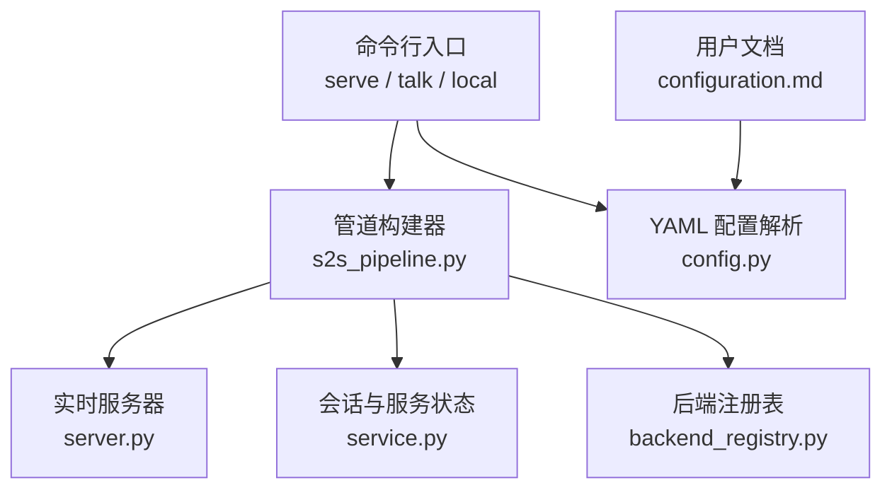
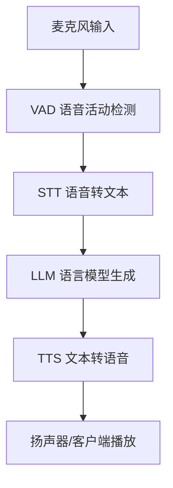
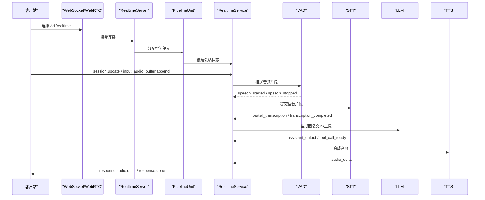
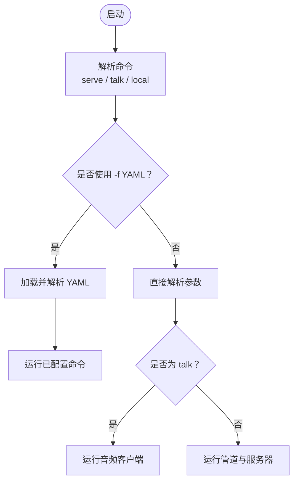
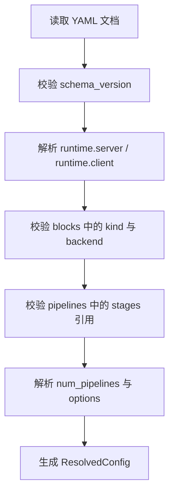
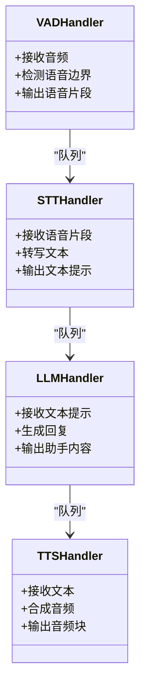
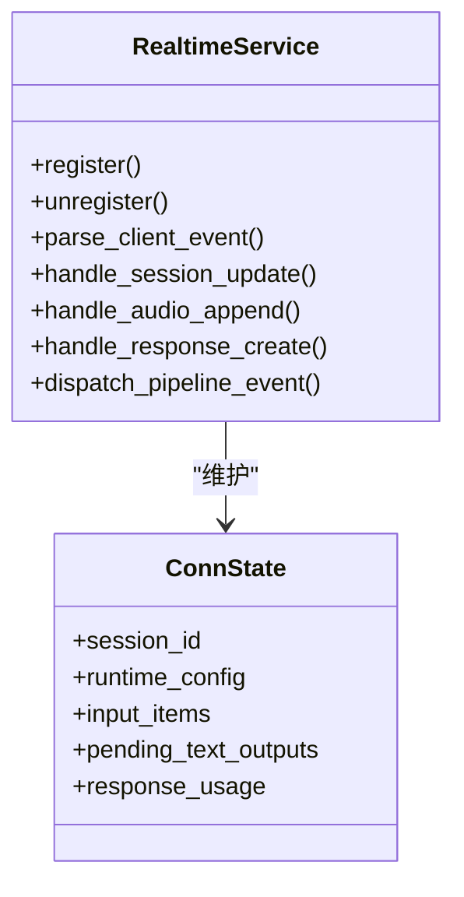
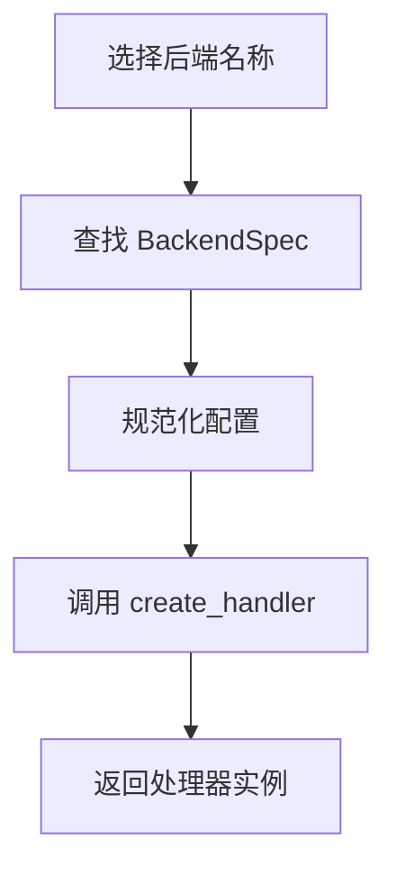
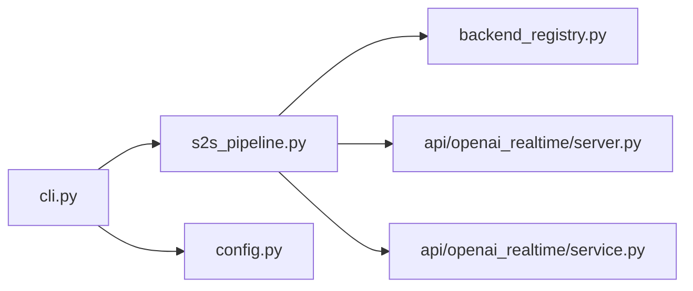

# 项目概览

<cite>
**本文引用的文件**   
- [README.md](file://README.md)
- [README-CN.md](file://README-CN.md)
- [cli.py](file://src/speech_to_speech/cli.py)
- [config.py](file://src/speech_to_speech/config.py)
- [s2s_pipeline.py](file://src/speech_to_speech/s2s_pipeline.py)
- [server.py](file://src/speech_to_speech/api/openai_realtime/server.py)
- [service.py](file://src/speech_to_speech/api/openai_realtime/service.py)
- [backend_registry.py](file://src/speech_to_speech/backend_registry.py)
- [configuration.md](file://docs/configuration.md)
</cite>

## 目录
1. [引言](#引言)
2. [项目结构](#项目结构)
3. [核心组件](#核心组件)
4. [架构总览](#架构总览)
5. [详细组件分析](#详细组件分析)
6. [依赖关系分析](#依赖关系分析)
7. [性能与延迟特性](#性能与延迟特性)
8. [快速开始指南](#快速开始指南)
9. [支持的组件与平台兼容性](#支持的组件与平台兼容性)
10. [故障排查](#故障排查)
11. [结论](#结论)

## 引言
本项目是一个完全在本地运行的低延迟语音代理系统，默认流水线为 VAD → STT → LLM → TTS，并通过 OpenAI Realtime 协议对外暴露 WebSocket 和 WebRTC 能力。其价值主张是：无需 API 密钥、无需云服务、完全本地运行；同时保留与 OpenAI Realtime 客户端的兼容性，使现有应用可以无缝指向自托管服务器。

该流水线已在数千台机器人上投入生产使用，并支持多种可替换的后端实现，便于在不同硬件与语言需求下灵活组合。

**章节来源**
- [README.md:19-23](file://README.md#L19-L23)
- [README-CN.md:7-21](file://README-CN.md#L7-L21)

## 项目结构
仓库采用“功能域 + 运行时”的组织方式：
- src/speech_to_speech：核心代码，包含 VAD、STT、LLM、TTS、Realtime API、配置解析、CLI、管道编排等。
- docs：用户文档，包括 YAML 配置说明、响应延迟说明、OpenAI 兼容 STT/TTS 说明等。
- demo：浏览器演示、LiveKit 集成示例、测试脚本等。
- scripts：基准测试、评估工具、合成对话客户端等。
- example_configs：示例配置文件（例如 macOS 全本地配置）。
- tests：单元测试与集成测试。

**图表来源**
- [cli.py:26-35](file://src/speech_to_speech/cli.py#L26-L35)
- [s2s_pipeline.py:710-747](file://src/speech_to_speech/s2s_pipeline.py#L710-L747)
- [server.py:14-41](file://src/speech_to_speech/api/openai_realtime/server.py#L14-L41)
- [service.py:355-391](file://src/speech_to_speech/api/openai_realtime/service.py#L355-L391)
- [backend_registry.py:172-182](file://src/speech_to_speech/backend_registry.py#L172-L182)
- [configuration.md:1-12](file://docs/configuration.md#L1-L12)

**章节来源**
- [README.md:92-124](file://README.md#L92-L124)
- [configuration.md:1-12](file://docs/configuration.md#L1-L12)

## 核心组件
项目的核心数据流由四个阶段组成：
- VAD：检测语音边界与轮次切换，支持 Silero VAD v5 与 FireRed Stream-VAD。
- STT：将语音转写为文本，支持 Parakeet TDT、Whisper、Paraformer、Qwen3-ASR 等。
- LLM：生成回复文本与工具调用，支持本地 transformers/mlx-lm 与远程 responses-api/chat-completions。
- TTS：将文本转为音频并流式播放，支持 Qwen3-TTS、Kokoro、Pocket TTS、OmniVoice、ChatTTS、MMS 等。

每个阶段都有多个可替换后端，通过 CLI 或 YAML 选择。VAD 输出进入 STT，STT 输出进入 LLM，LLM 输出进入 TTS，TTS 音频最终回传给客户端。

**图表来源**
- [README.md:111-124](file://README.md#L111-L124)
- [s2s_pipeline.py:382-574](file://src/speech_to_speech/s2s_pipeline.py#L382-L574)

**章节来源**
- [README.md:111-124](file://README.md#L111-L124)
- [backend_registry.py:350-693](file://src/speech_to_speech/backend_registry.py#L350-L693)

## 架构总览
从外部看，服务以 OpenAI Realtime 协议暴露；从内部看，服务维护一个 PipelineUnit 池，每个单元包含独立的 VAD、STT、LLM、TTS 处理器与队列。连接建立后，WebSocket/WebRTC 事件被转换为内部管线事件，再由服务层协调历史、会话、音频、响应与对话对象。

**图表来源**
- [server.py:14-41](file://src/speech_to_speech/api/openai_realtime/server.py#L14-L41)
- [service.py:355-391](file://src/speech_to_speech/api/openai_realtime/service.py#L355-L391)
- [service.py:477-517](file://src/speech_to_speech/api/openai_realtime/service.py#L477-L517)
- [service.py:798-800](file://src/speech_to_speech/api/openai_realtime/service.py#L798-L800)
- [s2s_pipeline.py:594-707](file://src/speech_to_speech/s2s_pipeline.py#L594-L707)

**章节来源**
- [README.md:314-355](file://README.md#L314-L355)
- [server.py:14-41](file://src/speech_to_speech/api/openai_realtime/server.py#L14-L41)
- [service.py:355-391](file://src/speech_to_speech/api/openai_realtime/service.py#L355-L391)

## 详细组件分析

### 命令行与启动流程
CLI 提供三个命令：
- serve：仅启动 Realtime 服务器。
- talk：连接已有 Realtime 服务器的麦克风/扬声器客户端。
- local：进程内组合 serve 与 talk，通过回环地址通信。

CLI 还支持基于 YAML 的配置模式，允许定义 blocks 与 pipelines，并在启动时解析。

**图表来源**
- [cli.py:26-35](file://src/speech_to_speech/cli.py#L26-L35)
- [cli.py:67-95](file://src/speech_to_speech/cli.py#L67-L95)
- [cli.py:98-187](file://src/speech_to_speech/cli.py#L98-L187)
- [cli.py:190-228](file://src/speech_to_speech/cli.py#L190-L228)
- [cli.py:231-249](file://src/speech_to_speech/cli.py#L231-L249)

**章节来源**
- [cli.py:26-35](file://src/speech_to_speech/cli.py#L26-L35)
- [cli.py:67-95](file://src/speech_to_speech/cli.py#L67-L95)
- [cli.py:98-187](file://src/speech_to_speech/cli.py#L98-L187)
- [cli.py:190-228](file://src/speech_to_speech/cli.py#L190-L228)
- [cli.py:231-249](file://src/speech_to_speech/cli.py#L231-L249)

### YAML 配置与校验
YAML 配置用于定义可复用的 blocks 与 pipelines，并支持环境变量引用、路径展开、严格类型校验与错误定位。配置分为 schema_version、runtime、blocks、pipelines 四部分。

**图表来源**
- [config.py:106-125](file://src/speech_to_speech/config.py#L106-L125)
- [config.py:371-438](file://src/speech_to_speech/config.py#L371-L438)
- [config.py:441-538](file://src/speech_to_speech/config.py#L441-L538)

**章节来源**
- [configuration.md:1-12](file://docs/configuration.md#L1-L12)
- [configuration.md:39-73](file://docs/configuration.md#L39-L73)
- [configuration.md:99-134](file://docs/configuration.md#L99-L134)
- [config.py:371-438](file://src/speech_to_speech/config.py#L371-L438)
- [config.py:441-538](file://src/speech_to_speech/config.py#L441-L538)

### 管道构建与处理器链
管道构建器负责根据所选后端创建处理器链：VAD → STT/AudioInput → LLM → TTS，并通过队列传递数据。可选的说话人分离与会话级推测轮次跟踪也在此阶段装配。

**图表来源**
- [s2s_pipeline.py:382-574](file://src/speech_to_speech/s2s_pipeline.py#L382-L574)

**章节来源**
- [s2s_pipeline.py:382-574](file://src/speech_to_speech/s2s_pipeline.py#L382-L574)

### 实时服务与会话状态
RealtimeService 负责将 OpenAI Realtime 协议事件映射到内部管线事件，管理会话状态、历史、音频缓冲、响应生命周期与工具调用顺序。它维护 ConnState 记录每连接的状态，并通过 handlers 处理 session、audio、conversation、response 等子模块。

**图表来源**
- [service.py:355-391](file://src/speech_to_speech/api/openai_realtime/service.py#L355-L391)
- [service.py:228-327](file://src/speech_to_speech/api/openai_realtime/service.py#L228-L327)

**章节来源**
- [service.py:355-391](file://src/speech_to_speech/api/openai_realtime/service.py#L355-L391)
- [service.py:228-327](file://src/speech_to_speech/api/openai_realtime/service.py#L228-L327)

### 后端注册与工厂
后端注册表集中声明 STT、LLM、TTS 的所有内置后端，并提供统一的创建工厂。每个 BackendSpec 描述名称、配置类型、工厂函数、可选额外依赖与能力标志。create_backend_handler 负责懒加载模块并将 ImportError 转化为更友好的安装指引。

**图表来源**
- [backend_registry.py:102-122](file://src/speech_to_speech/backend_registry.py#L102-L122)
- [backend_registry.py:196-205](file://src/speech_to_speech/backend_registry.py#L196-L205)
- [backend_registry.py:350-693](file://src/speech_to_speech/backend_registry.py#L350-L693)

**章节来源**
- [backend_registry.py:102-122](file://src/speech_to_speech/backend_registry.py#L102-L122)
- [backend_registry.py:196-205](file://src/speech_to_speech/backend_registry.py#L196-L205)
- [backend_registry.py:350-693](file://src/speech_to_speech/backend_registry.py#L350-L693)

## 依赖关系分析
- CLI 依赖 s2s_pipeline 与 config，talk 分支依赖 RealtimeAudioClient。
- s2s_pipeline 依赖 backend_registry、pipeline 工具类、VAD/STT/LLM/TTS 处理器与 RealtimeServer。
- server 依赖 uvicorn 与 websocket_router，维护 PipelineUnit 池。
- service 依赖 openai.types.realtime 模型与 pipeline events/messages。
- backend_registry 集中管理所有后端实现与能力。

**图表来源**
- [cli.py:231-249](file://src/speech_to_speech/cli.py#L231-L249)
- [s2s_pipeline.py:710-747](file://src/speech_to_speech/s2s_pipeline.py#L710-L747)
- [server.py:14-41](file://src/speech_to_speech/api/openai_realtime/server.py#L14-L41)
- [service.py:355-391](file://src/speech_to_speech/api/openai_realtime/service.py#L355-L391)
- [backend_registry.py:172-182](file://src/speech_to_speech/backend_registry.py#L172-L182)

**章节来源**
- [cli.py:231-249](file://src/speech_to_speech/cli.py#L231-L249)
- [s2s_pipeline.py:710-747](file://src/speech_to_speech/s2s_pipeline.py#L710-L747)
- [server.py:14-41](file://src/speech_to_speech/api/openai_realtime/server.py#L14-L41)
- [service.py:355-391](file://src/speech_to_speech/api/openai_realtime/service.py#L355-L391)
- [backend_registry.py:172-182](file://src/speech_to_speech/backend_registry.py#L172-L182)

## 性能与延迟特性
- 默认流水线强调低延迟：VAD 检测语音边界，STT 支持流式转写，LLM 支持流式文本与工具调用，TTS 支持流式音频输出。
- 服务器对每次响应记录 STT、LLM、首段 TTS 音频与端到端时长，详见响应延迟文档。
- 打包的 local 客户端在使用 OpenAI 兼容 TTS 后端时会缓冲一定时长音频以吸收 HTTP 推理抖动；可通过 --playback-buffer-ms 调整。
- PyTorch CPU 线程数可通过 --torch_num_threads 设置，但需注意 Silero VAD 会初始化单线程行为，需整体测量流水线延迟。

**章节来源**
- [README.md:314-319](file://README.md#L314-L319)
- [README.md:274-281](file://README.md#L274-L281)
- [README.md:744-758](file://README.md#L744-L758)

## 快速开始指南
以下示例面向初学者，帮助你在本地快速体验语音到语音对话。

- 基础安装与运行
  - 使用 Python 3.11–3.14，推荐 3.11。
  - 安装包后运行 local，首次运行会下载模型，等待几分钟。
  - 建议使用耳机避免回声；Windows 激活环境时使用对应脚本。

- 仅启动服务器
  - 运行 serve，默认监听 ws://127.0.0.1:8765/v1/realtime。
  - 可使用打包客户端 talk 或浏览器 demo 连接。

- 完全本地配置
  - 使用 YAML 示例 mac.yaml，在 Apple Silicon 上全本地运行。
  - Linux/Windows 可将 LLM 改为 transformers 并使用本地模型 ID。

- 离线运行
  - 首次在线启动一次以缓存依赖与模型资源。
  - 设置 HF_HUB_OFFLINE=1 后再次运行即可离线工作。

**章节来源**
- [README.md:33-47](file://README.md#L33-L47)
- [README.md:77-90](file://README.md#L77-L90)
- [README.md:143-152](file://README.md#L143-L152)
- [README.md:551-577](file://README.md#L551-L577)
- [configuration.md:8-37](file://docs/configuration.md#L8-L37)

## 支持的组件与平台兼容性
以下为默认与常用后端的选择建议与平台信息。

| 组件 | 后端 | 平台 | 安装方式 |
|---|---|---|---|
| VAD | Silero VAD v5 | 全部 | 内置 |
| VAD | FireRed Stream-VAD | CUDA / CPU | fireredvad |
| STT | Parakeet TDT | CUDA / CPU，Apple Silicon | 内置 |
| STT | Whisper | CUDA / CPU | 内置 |
| STT | Faster Whisper | CUDA / CPU | faster-whisper |
| STT | Paraformer | CUDA / CPU | paraformer |
| STT | Qwen3-ASR | CUDA / CPU，Apple Silicon | 内置 |
| LLM | transformers | 支持加速器 / CPU | 内置 |
| LLM | mlx-lm | Apple Silicon | 内置于 macOS |
| LLM | responses-api / chat-completions | 托管或自托管 | 内置 |
| TTS | Qwen3-TTS | Linux GGML/CUDA，macOS mlx-audio | 内置 |
| TTS | Kokoro-82M | CUDA / CPU，Apple Silicon | kokoro |
| TTS | Pocket TTS | CPU / CUDA | pocket |
| TTS | ChatTTS | CUDA / CPU | chattts |
| TTS | OmniVoice | CUDA / Intel XPU / Apple Silicon | omnivoice |
| TTS | MMS TTS | CUDA / CPU | 内置 |

平台兼容性方面，Linux 与 Apple Silicon macOS 有 CI 覆盖；Windows 未纳入矩阵。Python 3.10 已不再支持，Python 3.15 尚未在任何平台支持。

**章节来源**
- [README.md:48-65](file://README.md#L48-L65)
- [README.md:211-244](file://README.md#L211-L244)

## 故障排查
- 配置错误
  - YAML 必须包含 schema_version、blocks、pipelines，且 blocks 与 pipelines 非空。
  - blocks 的 kind 必须是 vad/stt/llm/tts，backend 必须在注册表中存在。
  - pipelines 的 stages 必须引用匹配的 block，num_pipelines 必须为正整数。
  - 环境变量引用必须为标量，集合必须使用 YAML。

- 设备与平台问题
  - macOS 不支持 CUDA，应使用 cpu 或 mps。
  - macOS 推荐使用 mlx-lm 作为 LLM 后端，TTS 推荐 qwen3。
  - 若启用 diarization，需要 STT 后端；stt none 模式下必须选择支持音频输入的 LLM 后端。

- 日志与隐私
  - 默认日志不包含转录内容；如需调试可开启 log_transcripts，但会警告可能记录对话内容。

**章节来源**
- [config.py:371-438](file://src/speech_to_speech/config.py#L371-L438)
- [config.py:441-538](file://src/speech_to_speech/config.py#L441-L538)
- [s2s_pipeline.py:321-366](file://src/speech_to_speech/s2s_pipeline.py#L321-L366)
- [cli.py:147-154](file://src/speech_to_speech/cli.py#L147-L154)

## 结论
speech-to-speech 项目提供了一个模块化、可替换、低延迟的本地语音代理流水线，并以 OpenAI Realtime 协议对外暴露，使现有客户端可以直接对接自托管服务。通过 YAML 配置与丰富的后端选择，用户可以在不同平台与硬件条件下构建完全本地的语音对话系统，满足隐私、延迟与成本等多重需求。对于初学者，quickstart 与示例配置足以快速上手；对于有经验开发者，后端注册表、服务状态机与管道构建器提供了足够的扩展点与深度。