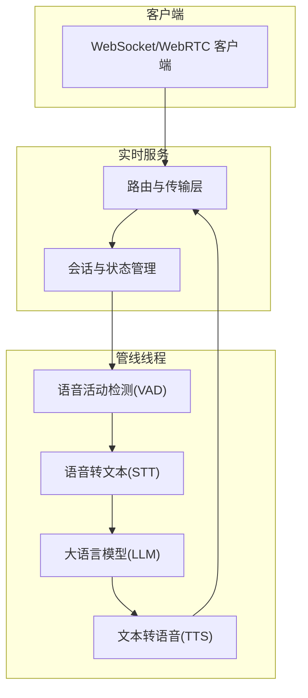
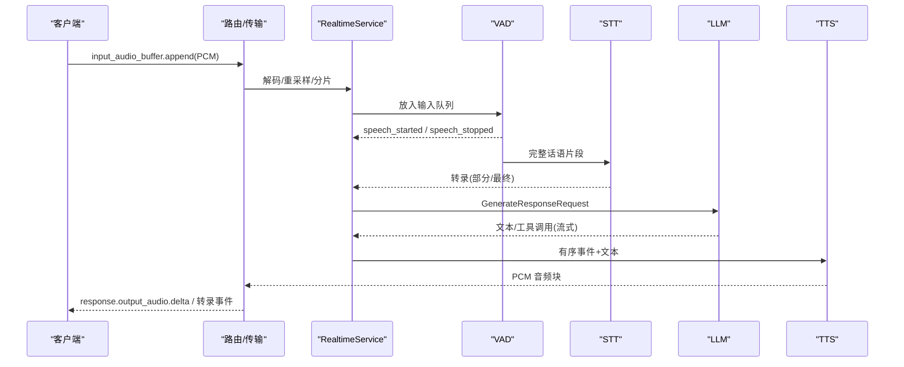
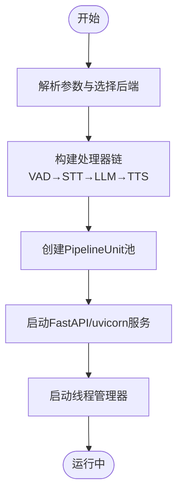
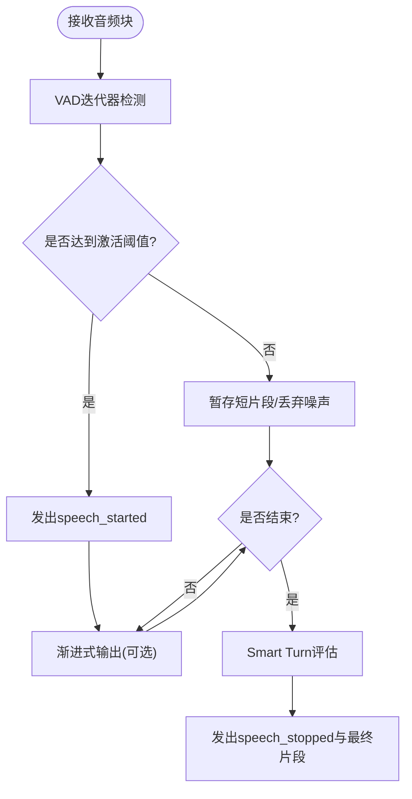
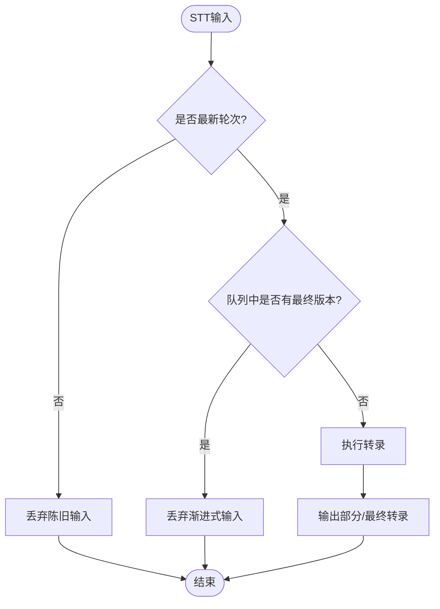
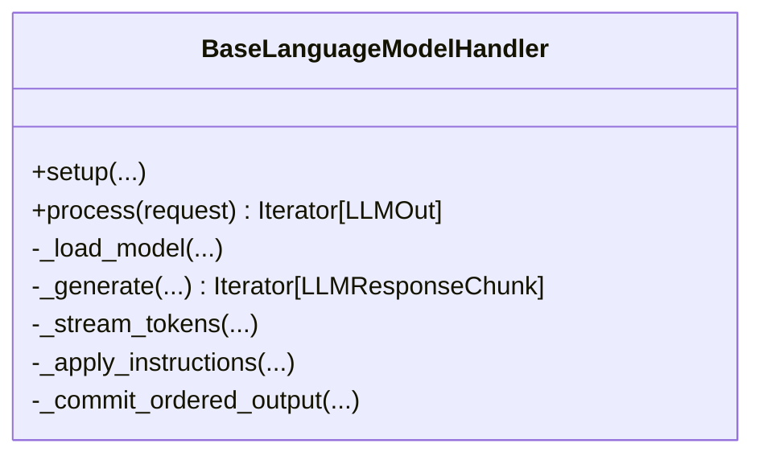
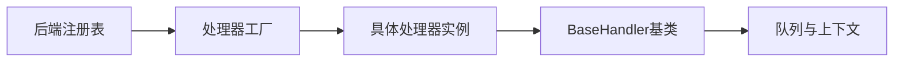

# 项目概述

<cite>
**本文引用的文件**
- [README.md](file://README.md)
- [s2s_pipeline.py](file://src/speech_to_speech/s2s_pipeline.py)
- [backend_registry.py](file://src/speech_to_speech/backend_registry.py)
- [baseHandler.py](file://src/speech_to_speech/baseHandler.py)
- [vad_handler.py](file://src/speech_to_speech/VAD/vad_handler.py)
- [base_stt_handler.py](file://src/speech_to_speech/STT/base_stt_handler.py)
- [language_model.py](file://src/speech_to_speech/LLM/language_model.py)
- [server.py](file://src/speech_to_speech/api/openai_realtime/server.py)
- [openai_realtime_README.md](file://src/speech_to_speech/api/openai_realtime/README.md)
- [cli.py](file://src/speech_to_speech/cli.py)
</cite>

## 目录
1. [简介](#简介)
2. [项目结构](#项目结构)
3. [核心组件](#核心组件)
4. [架构总览](#架构总览)
5. [详细组件分析](#详细组件分析)
6. [依赖关系分析](#依赖关系分析)
7. [性能考量](#性能考量)
8. [故障排查指南](#故障排查指南)
9. [结论](#结论)
10. [附录：快速开始与使用示例](#附录快速开始与使用示例)

## 简介
本项目是一个低延迟、全模块化的语音到语音（Speech-to-Speech）对话管线，采用“VAD→STT→LLM→TTS”的级联处理流程，并通过 OpenAI Realtime GA 协议在 WebSocket 和 WebRTC 上暴露。每个阶段均提供多种可替换后端，LLM 槽位兼容 OpenAI 协议，可指向云端或本地推理服务，实现完全本地化或混合部署。该管线已在生产环境中作为机器人等设备的对话后端运行。

## 项目结构
- 入口与编排
  - CLI 命令：serve/talk/local，统一解析并调度管线与服务
  - 管线构建：按选定的 STT/LLM/TTS 后端组装处理器链，创建线程池与队列
- 实时服务
  - FastAPI/uvicorn 服务器，维护连接路由与会话池
  - 支持 WebSocket 与 WebRTC 两种传输，事件集与 OpenAI Realtime 对齐
- 模块化后端
  - 通过注册表选择并实例化各阶段处理器，支持可选依赖与能力标记
- 数据流
  - 音频片段经 VAD 切分，STT 转文本，LLM 生成文本/工具调用，TTS 合成音频并回推客户端

图表来源
- [openai_realtime_README.md:9-50](file://src/speech_to_speech/api/openai_realtime/README.md#L9-L50)
- [server.py:14-41](file://src/speech_to_speech/api/openai_realtime/server.py#L14-L41)

章节来源
- [README.md:87-96](file://README.md#L87-L96)
- [openai_realtime_README.md:9-50](file://src/speech_to_speech/api/openai_realtime/README.md#L9-L50)

## 核心组件
- 语音活动检测（VAD）
  - 基于 Silero VAD v5，负责说话起止检测、分段合并、智能断句（Smart Turn）、渐进式输出与重开窗口控制
- 语音转文本（STT）
  - 多后端（Parakeet TDT、Whisper、Faster Whisper、Paraformer、OpenAI 兼容转录等），支持部分/最终转录与实时转写事件
- 大语言模型（LLM）
  - 支持本地（Transformers/MLX）与远程（Responses API/Chat Completions），流式输出文本与工具调用，维护对话历史与压缩策略
- 文本转语音（TTS）
  - 多后端（Qwen3-TTS、Kokoro、Pocket TTS、OmniVoice、MMS、OpenAI 兼容合成等），将有序文本/工具事件转换为 PCM 音频块
- 实时服务与传输
  - 基于 FastAPI/uvicorn，维护连接路由、会话配置、取消作用域与发送循环，对接 OpenAI Realtime 事件集

章节来源
- [vad_handler.py:53-149](file://src/speech_to_speech/VAD/vad_handler.py#L53-L149)
- [base_stt_handler.py:16-71](file://src/speech_to_speech/STT/base_stt_handler.py#L16-L71)
- [language_model.py:165-253](file://src/speech_to_speech/LLM/language_model.py#L165-L253)
- [backend_registry.py:309-543](file://src/speech_to_speech/backend_registry.py#L309-L543)
- [server.py:14-41](file://src/speech_to_speech/api/openai_realtime/server.py#L14-L41)

## 架构总览
系统以“会话单元 + 管道线程池”的方式组织：每个连接分配一个 PipelineUnit，内部包含独立的队列与处理器链；服务端维护 uvicorn 应用与路由，将入站音频与事件分发至对应单元，并将出站音频与事件回推客户端。

图表来源
- [openai_realtime_README.md:52-59](file://src/speech_to_speech/api/openai_realtime/README.md#L52-L59)
- [s2s_pipeline.py:354-458](file://src/speech_to_speech/s2s_pipeline.py#L354-L458)

章节来源
- [openai_realtime_README.md:52-59](file://src/speech_to_speech/api/openai_realtime/README.md#L52-L59)
- [s2s_pipeline.py:354-458](file://src/speech_to_speech/s2s_pipeline.py#L354-L458)

## 详细组件分析

### 管线构建与处理器链
- 参数解析与后端选择
  - 解析命令行/JSON，选择 STT/LLM/TTS 后端，归一化配置，校验平台与兼容性
- 处理器链装配
  - 按顺序构建 VAD → STT（可选 TranscriptionNotifier）→ LLM → LMOutputProcessor → TTS
  - 每个处理器持有独立队列与上下文，支持取消作用域与推测性轮次追踪
- 服务与线程管理
  - 构建多个 PipelineUnit 组成池，由 ThreadManager 启动所有处理器线程与服务器

图表来源
- [s2s_pipeline.py:175-285](file://src/speech_to_speech/s2s_pipeline.py#L175-L285)
- [s2s_pipeline.py:354-458](file://src/speech_to_speech/s2s_pipeline.py#L354-L458)
- [s2s_pipeline.py:550-587](file://src/speech_to_speech/s2s_pipeline.py#L550-L587)

章节来源
- [s2s_pipeline.py:175-285](file://src/speech_to_speech/s2s_pipeline.py#L175-L285)
- [s2s_pipeline.py:354-458](file://src/speech_to_speech/s2s_pipeline.py#L354-L458)
- [s2s_pipeline.py:550-587](file://src/speech_to_speech/s2s_pipeline.py#L550-L587)

### VAD 组件
- 功能要点
  - 语音起止检测、短片段合并、渐进式输出、Smart Turn 智能断句、重开窗口与未回答保护
  - 运行时配置动态更新（阈值、静音时长）
- 关键逻辑
  - 根据活跃语音时长与最小阈值决定是否触发 speech_started
  - 对未完成/不完整话语进行等待与延迟，避免过早提交响应
  - 支持音频增强（DeepFilterNet，可选）

图表来源
- [vad_handler.py:548-789](file://src/speech_to_speech/VAD/vad_handler.py#L548-L789)

章节来源
- [vad_handler.py:53-149](file://src/speech_to_speech/VAD/vad_handler.py#L53-L149)
- [vad_handler.py:548-789](file://src/speech_to_speech/VAD/vad_handler.py#L548-L789)

### STT 组件
- 功能要点
  - 多后端接入，支持部分/最终转录与实时转写事件
  - 推测性轮次去重：丢弃过时或已被最终版本覆盖的输入/输出
- 关键逻辑
  - 检查是否为最新轮次、是否已有最终版本排队、是否在稳定性窗口内
  - 清理队列中的陈旧项，减少无效计算

图表来源
- [base_stt_handler.py:24-71](file://src/speech_to_speech/STT/base_stt_handler.py#L24-L71)
- [base_stt_handler.py:104-128](file://src/speech_to_speech/STT/base_stt_handler.py#L104-L128)

章节来源
- [base_stt_handler.py:16-71](file://src/speech_to_speech/STT/base_stt_handler.py#L16-L71)
- [base_stt_handler.py:104-128](file://src/speech_to_speech/STT/base_stt_handler.py#L104-L128)

### LLM 组件
- 功能要点
  - 本地（Transformers/MLX）与远程（Responses API/Chat Completions）双路径
  - 流式生成文本与工具调用，维护对话历史、压缩与图像消息清理
  - 支持自动语言提示、指令注入、工具签名生成与代码块解析
- 关键逻辑
  - 生成前应用系统指令与工具定义，生成过程中分批输出句子/工具调用
  - 输出有序写入对话历史，异常时回滚历史并保证响应终止

图表来源
- [language_model.py:165-253](file://src/speech_to_speech/LLM/language_model.py#L165-L253)
- [language_model.py:580-794](file://src/speech_to_speech/LLM/language_model.py#L580-L794)

章节来源
- [language_model.py:165-253](file://src/speech_to_speech/LLM/language_model.py#L165-L253)
- [language_model.py:580-794](file://src/speech_to_speech/LLM/language_model.py#L580-L794)

### TTS 组件
- 功能要点
  - 多后端接入（Qwen3-TTS、Kokoro、Pocket TTS、OmniVoice、MMS、OpenAI 兼容合成）
  - 将有序文本/工具事件转换为 PCM 音频块，支持播放缓冲与中断处理
- 关键逻辑
  - 通过后端注册表创建处理器，配合取消作用域与推测性轮次追踪，确保输出顺序与一致性

章节来源
- [backend_registry.py:443-543](file://src/speech_to_speech/backend_registry.py#L443-L543)

### 实时服务与传输
- 功能要点
  - 基于 FastAPI/uvicorn 的服务，维护连接路由与会话池
  - 支持 WebSocket 与 WebRTC 传输，事件集与 OpenAI Realtime 对齐
  - 提供 LLM 代理模式，将配置的远程 LLM 暴露为兼容端点
- 关键逻辑
  - 每个连接分配一个 PipelineUnit，入站音频与事件经路由分发，出站音频与事件经发送循环编码并推送

章节来源
- [server.py:14-41](file://src/speech_to_speech/api/openai_realtime/server.py#L14-L41)
- [openai_realtime_README.md:136-161](file://src/speech_to_speech/api/openai_realtime/README.md#L136-L161)

## 依赖关系分析
- 后端注册表
  - 集中声明 STT/LLM/TTS 的后端规格、配置类型、工厂函数与能力标记
  - 支持可选依赖缺失时的友好错误提示
- 处理器基类
  - 统一生命周期：setup/run/process/cleanup，队列消费与输出封装，控制消息与结束信号处理
- 管线编排
  - 通过 s2s_pipeline 组装处理器链，创建队列与上下文，交由 ThreadManager 管理线程

图表来源
- [backend_registry.py:48-144](file://src/speech_to_speech/backend_registry.py#L48-L144)
- [baseHandler.py:25-186](file://src/speech_to_speech/baseHandler.py#L25-L186)

章节来源
- [backend_registry.py:48-144](file://src/speech_to_speech/backend_registry.py#L48-L144)
- [baseHandler.py:25-186](file://src/speech_to_speech/baseHandler.py#L25-L186)

## 性能考量
- 低延迟设计
  - 每阶段独立线程与队列，减少阻塞；渐进式输出与流式生成降低首包延迟
- 资源竞争与锁
  - Apple Silicon 上 MLX 全局锁可能导致并发竞争，多管线时建议关闭实时转写以避免日志风暴
- 回放缓冲
  - 针对 OpenAI 兼容 TTS 的 HTTP 延迟，默认缓冲 196ms 以减少卡顿；可通过参数调整
- 模型选择
  - LLM 为最耗时环节，合理选择本地或远程后端、量化与设备以提升吞吐与降低延迟

章节来源
- [s2s_pipeline.py:643-655](file://src/speech_to_speech/s2s_pipeline.py#L643-L655)
- [README.md:208-215](file://README.md#L208-L215)
- [README.md:355-362](file://README.md#L355-L362)

## 故障排查指南
- 常见错误
  - 缺少可选依赖：后端导入失败时给出安装提示
  - 平台不兼容：macOS 禁用 CUDA，建议使用 MPS 或 CPU
  - 会话限制：连接数超过池大小将被拒绝
- 调试建议
  - 启用日志级别 debug，查看各阶段耗时与队列长度
  - 使用 talk 命令直连测试，确认网络与端口可达
  - 检查 LLM 代理是否开启且上游可达

章节来源
- [backend_registry.py:175-195](file://src/speech_to_speech/backend_registry.py#L175-L195)
- [s2s_pipeline.py:309-338](file://src/speech_to_speech/s2s_pipeline.py#L309-L338)
- [server.py:31-37](file://src/speech_to_speech/api/openai_realtime/server.py#L31-L37)

## 结论
本项目以模块化、可替换的后端设计与 OpenAI Realtime 兼容的事件集，提供了端到端的语音到语音对话能力。其“VAD→STT→LLM→TTS”的流水线在低延迟与高吞吐之间取得平衡，支持本地与云端混合部署，适用于机器人、客服助手、车载交互等多种场景。通过清晰的架构图与数据流图，开发者可以快速理解组件职责与交互关系，并结合快速开始指南上手实践。

## 附录：快速开始与使用示例
- 安装与启动
  - 安装依赖后，设置环境变量并启动服务
  - 使用内置客户端或第三方 SDK 连接实时端点
- 本地模式
  - 一键启动服务与麦克风/扬声器客户端，便于本地调试
- 自定义 LLM
  - 指向本地 llama.cpp 或 vLLM 服务，实现完全本地化推理
- 浏览器演示
  - 启动前端应用，通过 WebSocket 或 WebRTC 与后端交互

章节来源
- [README.md:31-68](file://README.md#L31-L68)
- [README.md:223-250](file://README.md#L223-L250)
- [README.md:485-509](file://README.md#L485-L509)
- [demo_README.md:29-86](file://demo/README.md#L29-L86)