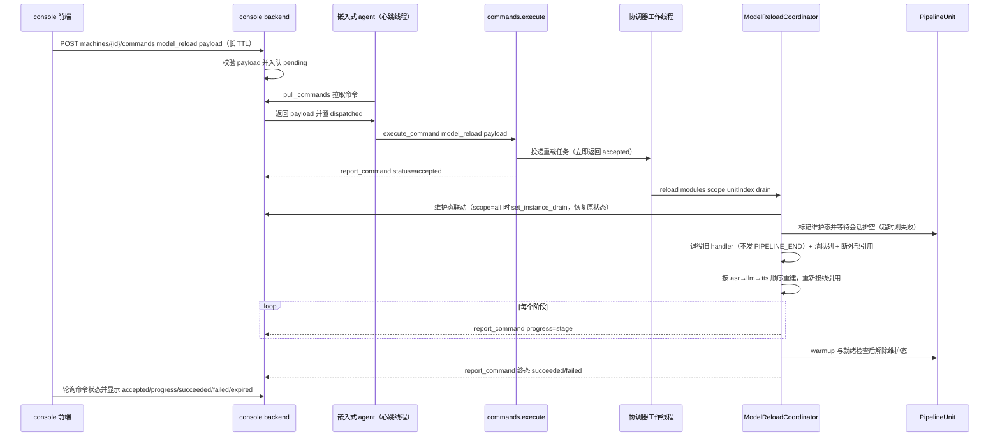

## 产品概述
在现有嵌入式 agent 架构下，由 console 向指定机器下发模型重载命令及参数。agent 收到后**在独立工作线程**内，按参数选择重载 ASR、LLM、TTS 中的单一模块或任意组合，在 pipeline 进程内安全重建对应 handler，并通过命令回执持续上报执行进度、实际重载模块和就绪状态。

**首期范围（已确认的产品边界）**：
- 重载**仅限用当前内存中的配置重建**，用途是恢复卡死或损坏的模型、更换权重文件后不重启。
- **不**用于应用新配置；后端类型不会变化（由配置来源决定），因此不存在"后端类型变化走 handler 重建"的分支。
- `configVersion` 仅作信息性标识，不参与重建决策。
- 独立进程 agent 形态（无 pipeline pool）收到该命令时**降级为 `config_restart` 整体重启**，不做模块级重载。

## 核心功能
- 新增统一的模型重载指令，参数明确指定目标模块：`asr`、`llm`、`tts` 单选或组合。
- 支持按全部 pipeline 实例或指定实例执行重载；重复模块自动去重，非法模块直接失败。
- 重载在 agent **独立工作线程**执行，命令立即回执"已受理"，随后按阶段上报进度与终态，**不阻塞心跳**。
- 重载前将目标实例置维护态并阻止新会话进入，等待在途会话排空（可配置超时，超时即失败，不杀会话）。
- ASR 和 TTS 重建对应模型处理链并重新接线所有外部引用；LLM 受锁重建客户端。
- 维护态必须被 console 分配器感知，避免会话被派发到即将/正在重载的实例。
- 任一模块重建失败后，目标实例保持维护态或未就绪态（fail-closed），不允许继续接会话，回执带失败模块和阶段。
- console 前端提供模型重载动作和模块选择，展示 accepted、progress、succeeded、failed、expired 状态及失败原因。

## 技术栈
- 服务端：Python 3.11+（主包 `requires-python >= 3.11`）、FastAPI、SQLAlchemy、Alembic（本期无需新迁移，`payload` 列已存在）。
- 嵌入式 agent：沿用 `--with-agent` 同进程形态，不引入独立 agent 进程，不调用 supervisor 重启模块级能力。
- pipeline：现有 `PipelineUnit`、`ThreadManager`、`HandlerContext`、`backend_registry` 处理器链。
- 前端：Vue 3.4、TypeScript 5.4、Vite 5、ant-design-vue 4，沿用现有机器命令动作和轮询机制。
- 测试：pytest 覆盖 agent、backend、pipeline 协调器；vitest 覆盖前端命令动作与 payload 构造。
- 验证：AGENTS.md 规定的 `python -m speech_to_speech.evals.tool_conversations`（LLM 改动）与 Big Bench Audio（音频链路改动），对比 `main`。

## 实现方案
新增 `model_reload` 机器命令。console 将 `modules` 等参数写入命令队列，嵌入式 agent 通过既有命令拉取链路取得命令，由 `commands.execute` 分发到注入的重载回调。

**执行模型（已确认）**：`commands.execute` 不直接执行重建，而是把任务投递给 `ModelReloadCoordinator` 的工作线程，同步返回"已受理"。协调器在独立线程里跑完整流程（维护态→排空→清理→重建→就绪检查），每进入一个阶段就 `report_command` 上报进度，结束时上报终态。这样 agent 的心跳线程全程不被占用。

**重载配置来源（已确认）**：重建严格复用 `PipelineUnit` 上保存的当前 stage 选择与上下文，不重新解析配置文件、不应用新配置。因此：
- 后端类型不变，不存在"后端类型变化走 handler 重建"分支。
- `configVersion` 仅信息性。
- `RealtimeService` 上的语言能力等派生属性无需重算（同配置下不变）。

**降级路径（已确认）**：独立进程 agent 没有 pipeline pool，`reload_provider` 为空，收到 `model_reload` 时直接走现有 `config_restart` 链路（带阶段回执），把命令语义转成"整体重启应用新配置"。

**分期（已确认）**：
- 阶段 0（地基）：D1 handler 退役不发哨兵、D2 统一生命周期接口、D3 stage 上下文存储、D4 维护态与 console 路由联动、D5 命令 TTL 与回执健壮性、D6 独立工作线程。
- 阶段 1：单实例（`unitIndex` 必填）单模块 ASR / TTS + 前端。
- 阶段 2：LLM、组合、`scope=all`、独立进程降级、能力协商。

关键决策：
- 不改独立进程架构：嵌入式 agent 无法直接访问 pipeline 实例，因此采用 `build_embedded_agent` 注入回调，避免让 agent 直接依赖全局 pool。
- 不新增进程内热替换以外的重启路径：supervisor 重启无法满足模块级灵活选择，也会中断所有模型。
- 参数采用通用 JSON payload：backend 命令表已有 payload JSON 列，agent 命令请求也已支持 payload，主要补齐 console 入参 schema、校验和前端构造。
- 组合重载采用两阶段策略：先进入维护态并排空会话，再清理所有目标旧模块并依次重建，避免本地模型旧权重新权重同时在显存中导致峰值翻倍。代价是目标实例在重载期间不可用，但避免静默串音和显存溢出。
- 失败要 fail-closed：任一模块重建失败后，目标实例保持维护态或未就绪态，不允许继续接会话，回执中带失败模块和阶段。

## 实现要点（含评审修正项）

### 命令契约
- `kind=model_reload`，payload 至少包含：`modules`、`scope`、`unitIndex`、`drain`、`drainTimeoutMs`、`configVersion`（信息性）、`reason`。
- `modules` 白名单为 `asr/llm/tts`，非空、去重、按 `asr→llm→tts` 规范顺序返回。
- agent 侧 payload 字段统一使用 **snake_case**；console API 入参保持 camelCase，由路由层映射（与现有 `serviceId`→`service_id` 一致）。

### 回执语义（已改为"已受理 + 进度"）
- `commands.execute` 投递任务后立即返回 `{"status": "accepted", "stage": "queued"}`，命令即标记 dispatched。
- 协调器每个阶段（maintenance_set / draining / cleanup / rebuild_<module> / ready / failed）通过 `report_command` 写入 result 的 `progress` 字段（含 `stage`、`module`、`unitIndex`、`elapsedMs`）。
- 终态 result 含 `reloadedModules`、`targetUnits`、`ready`、`failedStage`/`failedModule`（失败时）。
- `report_command` 失败不得中断工作线程，也不得丢弃同批其他命令的回执（修正 D5）。

### D3：stage 上下文存储（配置来源）
- `PipelineUnit` 增加字段保存：`stt_backend/llm_backend/tts_backend`（`BackendSelection`）、各 stage 的 `HandlerContext` 关键字段（队列引用、`text_output_queue`、`should_listen`、`cancel_scope`、`speculative_turns`、`sample_rate`、`out_format`）、`vad_handler_kwargs`、`module_kwargs`、`unit_index`。
- `backend_registry` 暴露"按给定 BackendSelection + 上下文重建阶段 handler"的共用入口，供协调器调用，避免在重载处复制构造逻辑。
- 重建**不重新读取配置文件**；若检测到配置版本与内存不一致，仅在日志记录，不改变重建行为。

### D1：handler 退役不触发 PIPELINE_END 级联
- `BaseHandler` 现有 `run()` 在 `finally` 无条件 `queue_out.put(PIPELINE_END)`，下游 handler 与实时发送循环会据此退出 → 停单个模块会杀死整条链路。
- 新增退役机制：handler 线程退出时由协调器显式控制，不写哨兵；或在 `run()` 中区分"退役停止"与"正常结束"，退役分支跳过哨兵写入。
- 启动新 handler 前，协调器必须：停止旧 handler 线程并 join、丢弃其 `queue_in`/`queue_out` 中可能残留的 `PIPELINE_END` 与 `SESSION_END` 等控制消息，再启动新线程。
- 原位替换：handler 列表按固定后缀索引定位（`tts_index`/`stt_index`），新 handler 替换同一索引，不得追加。

### D2：统一 handler 生命周期接口
- 当前 `ThreadManager`（flag 模式，[thread_manager.py](file:///d:/work/qwen-audio-agent/speech-to-speech-src/src/speech_to_speech/utils/thread_manager.py)）用扁平列表、无 handler→线程映射；`ConfiguredRuntime`（file 模式，[configured_runtime.py](file:///d:/work/qwen-audio-agent/speech-to-speech-src/src/speech_to_speech/configured_runtime.py)）自维护 `_threads/_started/_resources` 且每个 pipeline 定义一个停止事件，两者完全不同。
- 定义统一的 `HandlerLifecycle` 端口：`register(handler) / start(handler) / retire(handler) / join(handler) / alive(handler)`，两种实现各自提供。
- 协调器只依赖该端口，不直接碰 `ThreadManager` 或 `ConfiguredRuntime` 内部。
- 调整构造时序：`ThreadManager` 先创建，再构造 agent 并注入协调器，最后登记所有 handler（修正 agent 先于 ThreadManager 构造的问题）。
- file 模式 `_run` 包装里"任一 handler 异常即停整个运行时"的语义需为重载线程豁免，或新线程异常由协调器捕获并 fail-closed。

### D4：维护态与 console 路由联动
- `/v1/pool`：维护中的 unit 必须计入占用（让 `in_use` 或专用计数 `size - in_use - stuck` 不为它留出槽位），并在 unit 列表状态中新增 `maintenance` 状态。
- console 侧 `PoolState` 解析与分配器必须接受 `maintenance` 状态，否则会话被派发到 1008 拒绝。
- `scope=all` 时，协调器调用现有 console 排空接口将实例置 draining，重载结束后**恢复重载前的排空状态**（不能无脑置回非排空）。
- 探测间隔内的短暂窗口依赖 console 现有 failover；维护态必须稳定可被 `/v1/pool` 观测。

### D5：命令 TTL 与回执健壮性
- `model_reload` 下发时使用独立长 TTL（建议 600s+，可配置），不复用默认 120s。
- 前端状态机补充 `expired`。
- agent 侧 `poll_and_run_detailed` 中 `report_command` 调用移入 try 保护，单次失败只记日志，不抛出让同批回执丢失。

### D6：独立工作线程
- `commands.execute` 投递到协调器工作线程后同步返回 accepted。
- 工作线程持有全局单飞锁 + per-unit 锁；失败、超时、取消均释放锁。
- 心跳线程全程不被占用，`/v1/agent/*` 不因重载长时间返回 409。

### D7：外部引用重新接线（ASR 重建后悬空）
以下模块直接持有 STT handler 引用，ASR 重建后必须统一重新接线，否则出现静默无转写：
- `VAD.streaming_stt_sink`（仅 `streams_audio_chunks` 的后端）及 `window_partials_enabled` 联动（[s2s_pipeline.py](file:///d:/work/qwen-audio-agent/speech-to-speech-src/src/speech_to_speech/s2s_pipeline.py#L537-L541)）。
- LiveKit 本地 ASR 的 `SttHandlerAdapter(handler)`（[s2s_pipeline.py](file:///d:/work/qwen-audio-agent/speech-to-speech-src/src/speech_to_speech/s2s_pipeline.py#L860-L864)）。
- 内嵌情感服务 `_pool_sensevoice_handler`（按类名在 `unit.handlers` 中查找，[embedded_ser.py](file:///d:/work/qwen-audio-agent/speech-to-speech-src/src/speech_to_speech/embedded_ser.py#L175-L178)）；`emotion_local_service.py`、`audio_services.py` 也引用 STT 类型。
- 显存回收前必须先断开以上引用，再 `gc.collect()` + `torch.cuda.empty_cache()`。
- 这关系到项目硬约束：不得破坏声纹识别、语音情感识别等现有能力。

### D8：LLM reconfigure 范围
受锁替换不止 `self.client`，还包括 `_async_client`、`_async_runner`、`_extra_body`、闭包捕获旧 client 的 `compactor`、预取 worker（[base_openai_compatible_language_model.py](file:///d:/work/qwen-audio-agent/speech-to-speech-src/src/speech_to_speech/LLM/base_openai_compatible_language_model.py)）；`responses_api_language_model` 同样有闭包捕获，需复用同一入口。需定义对话历史是否清空的策略。

### D9：`execute` 签名兼容
现有 `execute` 刻意保持四参数调用形态，测试用 `lambda *args` 打桩（不接受关键字）。reload provider 必须为**仅关键字、默认 None、存在时才传**，与现有 `allow_restart` 透传纪律一致。

### D10：独立进程降级与能力协商
- 独立进程 agent：`reload_provider is None` → 转 `config_restart`，复用其阶段回执。
- `AGENT_CAPABILITIES`/`AGENT_ACTIONS` 增加 `model_reload`，按 provider 是否存在动态声明；前端据此 gate 按钮。

### D11：排空策略
- 实时会话可远长于 `drainTimeoutMs`。超时即失败（阶段=drain），不杀会话、不进入清理，目标实例解除维护态恢复可用。
- `drain=false` 时禁止带在途会话的单元重载，直接失败。

### D12：验证清单
除 pytest/vitest 外，按 AGENTS.md：LLM 改动跑 `python -m speech_to_speech.evals.tool_conversations` 对比 `main`；音频链路改动跑 Big Bench Audio。setup 与结果读法见 `docs/vibe-checks.md`。

### D13：其他细节
- 队列清理：重建前排空目标 stage 的 `queue_in`，避免新 handler 消费上一会话的残留控制消息。
- payload 命名：console API camelCase → agent snake_case，路由层映射。
- 日志：只记 command id、kind、modules、scope、unit index、stage、耗时、错误类型；不记 payload 大对象、凭据或音频内容。

## 架构设计


## 目录结构
```text
speech-to-speech-src/
├── src/speech_to_speech/
│   ├── agent/commands.py
│   │   # [MODIFY] 新增 model_reload 分发；投递给工作线程返回 accepted；失败时带阶段回执；保持 execute 四参签名兼容。
│   ├── agent/embedded.py
│   │   # [MODIFY] 保存 reload provider 并透传；心跳线程不阻塞；能力协商动态声明 model_reload。
│   ├── agent_integration.py
│   │   # [MODIFY] build_embedded_agent 增加 reload_provider 参数并保持默认可构造。
│   ├── s2s_pipeline.py
│   │   # [MODIFY] PipelineUnit 保存 stage 上下文；构造时序调整（ThreadManager 先建）；创建协调器并注入 agent；ASR 重建后重新接线 VAD/LiveKit。
│   ├── configured_runtime.py
│   │   # [MODIFY] file 模式实现统一 HandlerLifecycle 端口；协调器装配与 agent 注入；重载线程豁免全运行时停止语义。
│   ├── backend_registry.py
│   │   # [MODIFY] 暴露按给定 BackendSelection + 上下文重建阶段 handler 的共用入口。
│   ├── baseHandler.py
│   │   # [MODIFY] 新增退役路径：线程退出不写 PIPELINE_END；区分退役停止与正常结束。
│   ├── api/openai_realtime/agent_routes.py
│   │   # [MODIFY] COMMAND_KINDS 增加 model_reload；补充 OpenAPI 描述与 payload 示例。
│   ├── api/openai_realtime/pipeline_unit.py
│   │   # [MODIFY] 增加维护态、重载锁、阶段 handler 映射、stage 选择与上下文字段。
│   ├── api/openai_realtime/websocket_router.py
│   │   # [MODIFY] _claim_unit 跳过维护态；/v1/pool 维护态计入占用并暴露 maintenance 状态。
│   ├── api/openai_realtime/model_reload.py
│   │   # [NEW] 协调器：参数校验、目标实例选择、单飞锁、排空、退役清理、阶段重建、引用重接线、warmup、进度与结果汇总。
│   ├── api/openai_realtime/handler_lifecycle.py
│   │   # [NEW] 统一 HandlerLifecycle 端口定义。
│   ├── utils/thread_manager.py
│   │   # [MODIFY] 实现 HandlerLifecycle 端口；按 handler 登记/启动/退役/join，保留整体 stop 语义。
│   ├── LLM/base_openai_compatible_language_model.py
│   │   # [MODIFY] 增加受锁 reconfigure 入口，清理并重建 client/async_runner/compactor 等全部依赖。
│   └── LLM/responses_api_language_model.py
│       # [VERIFY/MODIFY] 确认复用 reconfigure 入口，闭包捕获的 client 一并替换。
├── console/backend/app/
│   ├── schemas/machine.py
│   │   # [MODIFY] MachineCommandIn 增加通用 payload 字段并为 model_reload 定义校验规则（camelCase 入参）。
│   ├── routers/machines.py
│   │   # [MODIFY] 下发端点透传 payload 并按 kind 设置长 TTL；保留 health_check 的 serviceId 兼容映射。
│   └── services/machine_command_service.py
│       # [MODIFY] KINDS 增加 model_reload；per-kind TTL；校验模块参数并持久化 payload。
├── console/backend/app/services/ 与 repositories/
│   # [MODIFY] PoolState/分配器接受 maintenance 状态；维护态 unit 计入占用。
├── console/frontend/src/
│   ├── api/machines.ts
│   │   # [MODIFY] 命令下发请求支持 payload；状态类型补 expired。
│   ├── views/machines.viewmodel.ts
│   │   # [MODIFY] CommandKind 增加 model_reload；按能力 gate；提供模块选择与 payload 构造纯函数。
│   ├── views/InstancesView.vue
│   │   # [MODIFY] 渲染 ASR/LLM/TTS 多选、作用范围参数和命令状态刷新。
│   ├── i18n/locales/zh-CN/machines.ts
│   │   # [MODIFY] 增加模型重载动作、模块名、状态与进度文案。
│   └── i18n/locales/en-US/machines.ts
│       # [MODIFY] 同步英文文案。
├── tests/
│   ├── test_agent_commands.py
│   │   # [MODIFY] 覆盖 model_reload accepted 回执、进度上报、参数非法、provider 缺失降级、失败阶段回执；保持 execute 四参桩兼容。
│   ├── test_agent_embedded.py
│   │   # [MODIFY] 覆盖三条路径透传 reload provider；心跳线程不被重载阻塞。
│   ├── test_agent_api.py
│   │   # [MODIFY] 覆盖 /v1/agent/commands 的 model_reload kind 与 payload 透传。
│   ├── test_agent_cli_flag.py
│   │   # [MODIFY] 覆盖 --with-agent 构造时传入重载协调器。
│   ├── test_configured_runtime.py
│   │   # [MODIFY] 覆盖 file 模式的 HandlerLifecycle 实现、协调器装配和停止清理。
│   ├── openai_realtime/test_model_reload.py
│   │   # [NEW] 协调器单测：单模块、组合、去重、维护态、排空超时、失败 fail-closed、进度回执。
│   ├── openai_realtime/test_pipeline_unit_reload.py
│   │   # [NEW] 覆盖阶段 handler 替换、退役不发哨兵、队列清理、外部引用重接线、线程更新。
│   ├── openai_realtime/test_handler_lifecycle.py
│   │   # [NEW] 覆盖两种生命周期实现的 register/start/retire/join/alive 行为。
│   └── test_llm_stream_connection_reuse.py
│       # [VERIFY/MODIFY] 覆盖远程 LLM reconfigure 后旧客户端关闭、compactor 闭包重建、新客户端可用。
├── console/backend/tests/
│   ├── unit/test_machine_command_service.py
│   │   # [MODIFY] 覆盖 model_reload payload 校验、长 TTL、持久化和幂等去重。
│   └── integration/test_machine_command_api.py
│       # [MODIFY] 覆盖下发、拉取、回执全链路 payload 不丢失与进度上报。
├── console/frontend/src/views/
│   └── machines.viewmodel.spec.ts
│       # [MODIFY] 覆盖模块选择、payload 构造、能力 gate、按钮禁用和状态显示（含 expired）。
└── docs/agent-api-CN.md
    # [MODIFY] 增补 model_reload 契约、payload 示例、回执语义、分期边界、内嵌限制和验证方法。
```

## 关键代码结构
```json
{
  "kind": "model_reload",
  "payload": {
    "modules": ["asr", "llm"],
    "scope": "all",
    "unitIndex": null,
    "drain": true,
    "drainTimeoutMs": 5000,
    "configVersion": "v12",
    "reason": "console"
  }
}
```

命令 result 进度示例：
```json
// 受理后立即
{"status": "accepted", "stage": "queued"}
// 阶段进度（多次 report_command 追加 progress 历史）
{"progress": [{"stage": "maintenance_set", "unitIndex": 0, "elapsedMs": 12},
              {"stage": "rebuild_asr", "unitIndex": 0, "elapsedMs": 1840}]}
// 终态
{"status": "succeeded", "reloadedModules": ["asr","llm"], "targetUnits": [0], "ready": true}
// 失败
{"status": "failed", "failedStage": "rebuild_tts", "failedModule": "tts", "ready": false}
```

```python
class ModelReloader(Protocol):
    def reload(self, request: dict, on_progress: Callable[[dict], None]) -> str:
        """在独立工作线程执行；on_progress 上报阶段；返回任务句柄/id。execute 侧返回 accepted。"""
        ...
```

## 分期与里程碑

**阶段 0（地基）**：完成 handler 退役路径、统一生命周期端口、stage 上下文存储、维护态与 console 路由联动、长 TTL 与回执健壮性、独立工作线程。此阶段不向用户暴露重载动作，但为后续阶段消除全部阻断级风险（D1/D2/D3/D4/D5/D6）。

**阶段 1（单实例单模块）**：支持 `unitIndex` 必填、`modules` 为单个 `asr` 或 `tts`。前端开放对应动作。端到端验证 ASR/TTS 重载后转写与合成正常、外部引用无悬空。

**阶段 2（LLM、组合与 scope=all）**：增加 LLM 重建、`modules` 组合、`scope=all`、独立进程降级为 `config_restart`、能力协商 gate。按 AGENTS.md 跑 tool-use conversation eval 与 Big Bench Audio 对比 main。

## Agent Extensions
### Skill
- **test-driven-development**
  - Purpose：先为命令契约、payload 校验、进度回执、退役不发哨兵、生命周期端口、模块级重载协调器和前端动作编写失败测试，再实现代码。
  - Expected outcome：agent、backend、pipeline、frontend 四层均有防回归测试，非法参数和组合逻辑先被测试锁定。
- **verification-before-completion**
  - Purpose：完成前实际运行定向 pytest、vitest 和端到端命令链路，确认 ASR/LLM/TTS 单选及组合重载均生效；并按 AGENTS.md 跑规定 evals。
  - Expected outcome：保留验证命令与输出，确认回执状态、模型就绪、会话隔离、心跳不中断和失败路径均符合要求。
