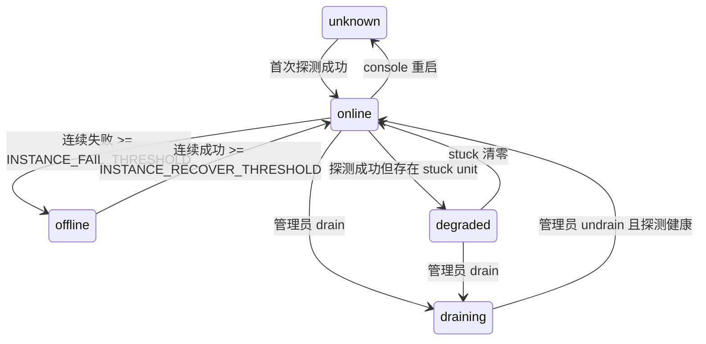

# Console 配置服务

参数配置平台（`console/`）的部署与使用说明：它是什么、默认账号密码、端口入口、
本地怎么跑起来、每个环境变量管什么、以及启动顺序和常见故障。

代码位置：`console/backend`（FastAPI）+ `console/frontend`（Vue 3 + Vite）。

---

## 1. 这是什么

一个镜像、两个进程，由 supervisord 拉起（`console/deploy/supervisord.conf`）：

| 进程 | 命令 | 监听 | 对外 |
|---|---|---|---|
| `console` | `uvicorn app.main:app --host 0.0.0.0 --port 8000 --workers 1` | `0.0.0.0:8000` | 是，compose 里唯一 publish 的端口 |
| `pipeline` | `speech-to-speech serve -f /app/config/prod.yaml --name prod` | `0.0.0.0:8765` | 否，只 `expose` 在容器内 |

职责边界：

- `console` 是 `/app/config` 的**唯一写入方**，`pipeline` 只读；
- `pipeline` 崩了页面照常可访问，`console` 重启不影响正在跑的通话；
- 配置改动只有两条生效链路：**链路 A** 进程级重启（supervisor XML-RPC，丢在途通话）、
  **链路 B** 会话内热更新（`S2S_ADMIN_TOKEN`，不丢通话）。二者都由 console 发起。

---

## 2. 默认账号与密码

| 用户名 | 密码 | 角色 |
|---|---|---|
| `admin` | `admin123456` | `admin` |

这组凭据由 **`DEFAULT_ADMIN_*`** 在**空库首次启动**时自动创建，值来自
`console/backend/.env.example`（开发模板）：

```dotenv
DEFAULT_ADMIN_USERNAME=admin
DEFAULT_ADMIN_PASSWORD=admin123456
DEFAULT_ADMIN_ROLE=admin
```

### 2.1 规则（重要）

- **只在用户名不存在时创建**。`param_user` 里已有该用户名就什么都不做——
  重启、扩容、回滚都不会覆盖你后来改过的密码。
- **密码留空 = 关闭自动建号**。这是代码里的默认值，也是镜像的默认姿态：
  一个随镜像发布的口令等于一个所有人都知道的口令。
- 密码短于 8 位、`DEFAULT_ADMIN_ROLE` 不在 `admin` / `operator` 里，
  都只打 WARNING 然后跳过，不会让服务起不来。
- 建号成功会留一条 WARNING，方便你在日志里第一眼看到：

```text
WARNING app.services.bootstrap_service created the default admin account 'admin'
        from DEFAULT_ADMIN_*; change that password before exposing the console
```

### 2.2 其它建号 / 改密方式

容器默认**不**带 `DEFAULT_ADMIN_*`（`config/prod.env` 由参数平台渲染，
不该长期存放口令），所以生产环境的第一个管理员用脚本建：

```bash
# 首次建号：交互输入密码（≥8 位）
PYTHONPATH=. python scripts/seed_admin.py --username admin --role admin

# 无人值守（CI / 一次性初始化）
echo 'admin123456' | PYTHONPATH=. python scripts/seed_admin.py \
    --username admin --role admin --password-stdin

# 忘记密码：复位一个已存在的账号
echo 'admin123456' | PYTHONPATH=. python scripts/seed_admin.py \
    --username admin --password-stdin --update-password

# 容器内（console 与 pipeline 共享同一个 venv 和 /app/data）
docker compose exec -e PYTHONPATH=/app/console pipeline \
    python /app/console/scripts/seed_admin.py --username admin --role admin
```

`--update-password` 是唯一会改写已有账号的入口；不带它会以退出码 1 报
`user admin already exists`。

> 首次启动前先迁移，否则 `param_user` 表不存在，自动建号会打
> `default admin bootstrap skipped` 然后跳过：
> `python -m alembic upgrade head`（镜像同样不在启动时迁移）。

### 2.3 安全边界

- `admin123456` 只用于本机开发。控制台一旦对网络可达，先改它。
- 鉴权只保护 `/api/v1/*`；`/api/*`（demo 面）是匿名可读的，`/api/config` 不返回任何密钥。
- 令牌：access `30` 分钟、refresh `7` 天
  （`JWT_ACCESS_TOKEN_EXPIRE_MINUTES` / `JWT_REFRESH_TOKEN_EXPIRE_DAYS`）。
- 同一 IP 5 次失败 / 300 秒内 → `429 too_many_attempts`；
  「用户不存在」和「密码错误」返回完全相同的 401，不做用户名探测。
- **没有**注册页、改密页、密码找回，也没有多租户或权限树（spec §3.8）。
- 两个角色：`admin` 可发布 / 回滚 / 丢弃草稿 / 删音色 / 改 `ops` 级参数；
  `operator` 只能改 `basic`、`advanced` 级参数草稿。

### 2.4 验证

```bash
curl -s -X POST http://127.0.0.1:8000/api/v1/auth/login \
  -H 'Content-Type: application/json' \
  -d '{"username":"admin","password":"admin123456"}'
```

```json
{"code":200,"data":{"accessToken":"...","tokenType":"bearer","expiresIn":1800,
 "refreshToken":"...","user":{"username":"admin","role":"admin"}}}
```

```bash
curl -s http://127.0.0.1:8000/api/v1/auth/me -H "Authorization: Bearer <accessToken>"
# {"code":200,"data":{"username":"admin","role":"admin","lastLoginAt":"..."}}
```

---

## 3. 端口与入口

| 部分 | 入口 | 地址 | 必须的工作目录 |
|---|---|---|---|
| console 后端 | `uvicorn app.main:app`（`app/main.py` 末行 `app = create_app()`） | `127.0.0.1:8000`（容器 `0.0.0.0:8000`） | `console/backend` |
| 前端（开发） | `npm run dev`（= `vite`） | `:3000`，被占用自动 `+1` | `console/frontend` |
| 前端（生产） | 构建产物由后端托管 | 同后端 `:8000`，页面在 `/console` | — |
| pipeline | `speech-to-speech serve -f config/prod.yaml --name prod` | `127.0.0.1:8765`（容器内 loopback） | 仓库根 |

Vite 开发代理（`console/frontend/vite.config.ts`）：`/api`、`/vendor`、`/v1`
（`ws: true`）全部转发到 `process.env.VITE_DEV_BACKEND ?? http://localhost:8000`。
所以**后端必须是 8000**，否则前端页面能开、接口全挂。

---

## 4. 本机跑起来

### 4.1 命令行五步（后端）

```powershell
cd console\backend
python -m pip install -e ..\.. --no-deps        # 让 speech_to_speech.config 可 import
python -m pip install -r requirements-dev.txt
Copy-Item .env.example .env                    # 已带 admin/admin123456
python -m alembic upgrade head                 # 建 param_user 等表
python -m uvicorn app.main:app --port 8000
```

- 用 `python -m uvicorn` 时**不需要**设 `PYTHONPATH`：`-m` 会把当前目录放进 `sys.path`。
- 只有直接跑 `scripts/seed_admin.py` 这类脚本时才需要 `PYTHONPATH=.`。
- 调试时**不要**加 `--reload`：reloader 会 fork 子进程，断点常常不命中。

### 4.2 前端

```powershell
cd console\frontend
npm ci
npm run dev                    # http://127.0.0.1:3000/console
# 后端不在 8000：
$env:VITE_DEV_BACKEND="http://127.0.0.1:8001"; npm run dev
```

只跑后端时，必须有一个真实的 `STATIC_DIR`（默认 `../frontend/dist`）。
没有就先 `npm run build`，否则 `mount_spa()` 直接抛
`static dir ... is missing; the image was built without the frontend`。

### 4.3 PyCharm 运行配置

`.idea/runConfigurations/` 里已经放好，打开工程后下拉框直接可选：

| 配置名 | 类型 | 关键字段 |
|---|---|---|
| `s2s-console-backend` | Python | Module name `uvicorn`；Parameters `app.main:app --host 127.0.0.1 --port 8000`；Working dir `console/backend`；EnvFile `.env`；勾 Add content roots to PYTHONPATH |
| `s2s-console-backend (reload)` | Python | 同上 + `--reload`（本机无 `watchfiles` 时退回 1 秒轮询） |
| `s2s-console-frontend` | npm | package.json `console/frontend/package.json`；command `run`；script `dev`；env `VITE_DEV_BACKEND` |
| `s2s-pipeline-prod` | Python | Module name `speech_to_speech.cli`；Parameters `serve -f config/prod.yaml --name prod`；Working dir 仓库根 |
| `s2s-dev (backend + frontend)` | Compound | 同时起 backend (reload) + frontend |

调试请选**不带 reload** 的那个。`config/prod.yaml` 是容器口径
（`/root/.cache/*`、`device: cuda`、`0.0.0.0`），Windows 原生跑不起来；
本机联调 pipeline 建议用 Docker，或自备一份轻量 YAML。

---

## 5. 配置项

全部通过 `.env`（相对**进程 CWD**，即 `console/backend`）或同名环境变量读取；
环境变量优先级高于 `.env`。

### 5.1 三个硬前置

| 变量 | 缺了会怎样 |
|---|---|
| `JWT_SECRET_KEY` | `RuntimeError: JWT_SECRET_KEY is required; console refuses to start without it` |
| `STATIC_DIR` | `RuntimeError: static dir ... is missing`（目录必须真实存在） |
| `DATABASE_URL` | 能启动，但日志 `startup recovery skipped: unable to open database file`，一切登录 500 |

### 5.2 开发默认值

| 变量 | 代码内默认（容器口径） | 开发值 | 说明 |
|---|---|---|---|
| `DATABASE_URL` | `sqlite:////app/data/console.sqlite3` | `sqlite:///./dev.db` | 空库要先 `alembic upgrade head` |
| `USAGE_DB_PATH` | `/app/data/usage.sqlite3` | `./usage-dev.sqlite3` | demo 面计量库，裸 sqlite3 |
| `PARAM_CONFIG_DIR` | `/app/config` | `../../config` | 可发布 profile 的 YAML 目录 |
| `PARAM_CATALOG_PATH` | `/app/catalog/parameter-catalog.yaml` | `../../docs/parameter-catalog.yaml` | 参数目录，缺文件则发布校验降级 |
| `STATIC_DIR` | `/app/console/static` | `../frontend/dist` | SPA 产物 |
| `PIPELINE_BASE_URL` | `http://127.0.0.1:8765` | 同 | 探活 `/v1/pool` 的目标 |
| `PIPELINE_TIMEOUT_S` | `180` | 同 | `/v1/pool` 请求超时 |
| `SUPERVISOR_SOCKET` | `/run/s2s-console/supervisor.sock` | `/tmp/s2s-console/supervisor.sock` | XML-RPC over AF_UNIX |
| `SUPERVISOR_PROGRAM` | `pipeline` | 同 | 要重启的 program 名 |
| `RESTART_MODE` | `supervisor` | `noop` | 见 §6.2 |
| `CORS_ORIGINS` | 空 | `http://localhost:3000,http://127.0.0.1:3000` | 前端直连后端时需要 |
| `DEFAULT_ADMIN_USERNAME` | `admin` | `admin` | 首次启动建号用 |
| `DEFAULT_ADMIN_PASSWORD` | 空（关闭） | `admin123456` | 空 = 不自动建号 |
| `DEFAULT_ADMIN_ROLE` | `admin` | `admin` | 只能是 `admin` / `operator` |

其它只读旁路：`MODEL_METRICS_LOG`、`LOG_DIR`、`DATA_DIR`、`VOICE_DATA_DIR`
以及 demo 面的 `SERPER_API_KEY` / `LOAD_BALANCER_URL` / `OAUTH_CLIENT_ID` 等，
默认全部关闭，与本机开发无关。

> `.env.example` 里的 `PARAM_CONFIG_DIR` / `PARAM_CATALOG_PATH` 早期写成
> `../../../`，从 `console/backend` 出发会落到仓库外；现已改为 `../../`。
> 如果你沿用旧值，症状是参数树为空或目录读取失败。

### 5.3 实例注册与本地分配

实例注册、巡检、本地分配（多实例负载均衡）的全部开关。字段名是代码内短名，
env 名一律走 `validation_alias`（前缀不统一，不能用 `env_prefix`）。默认组合
（`ALLOCATOR_MODE=off` + 空 seed）= 引入本期之前的行为完全不变。

| 变量 | 默认值 | 作什么用 |
|---|---|---|
| `ALLOCATOR_MODE` | `off` | `off` = 单实例直连现状；`local` = 启用注册表选台 + 本地签发 grant。回退手段就是把它设回 `off` |
| `CONSOLE_ID` | 空 | 指标 `observed_by`，多 console 无共享多活时区分采样来源；空则回退到 `socket.gethostname()` |
| `INSTANCES_SEED_PATH` | 空 | 实例 seed 文件路径；空则跳过 seed，DB 为唯一来源 |
| `INSTANCE_PROBE_INTERVAL_S` | `5` | 巡检轮询 `/v1/pool` 的间隔秒 |
| `INSTANCE_PROBE_TIMEOUT_S` | `2` | 单次 `/v1/pool` 探测超时秒 |
| `INSTANCE_FAIL_THRESHOLD` | `3` | 连续失败几次判定 `offline`（摘除，只停新分配） |
| `INSTANCE_RECOVER_THRESHOLD` | `2` | `offline` 后连续成功几次恢复 `online`（抖动抑制） |
| `INSTANCE_GRANT_TTL_S` | `60` | 本地签发 grant 的存活秒（单调时钟回收） |
| `INSTANCE_USAGE_INTERVAL_S` | `30` | `/v1/usage` 读取间隔秒；失败只产生 `usage_unavailable` 告警，不影响健康判定 |
| `INSTANCE_METRIC_RETENTION_DAYS` | `7` | 指标采样行保留天数，巡检循环顺带清理更早的 |
| `INSTANCE_QUEUE_ENABLED` | `false` | 本地满员队列。本期关闭：满则直接 503 `at_capacity` |
| `INSTANCE_WEBRTC_HANGUP_ENABLED` | `false` | console 侧跨机挂断代理路由 `POST /instances/{id}/hangup` 的开关；关则该路径根本没注册 |

---

## 6. 启动顺序与依赖

```text
alembic upgrade head        ← 建表（空库必须，镜像不自动迁移）
        │
        ▼
console backend :8000  ──┬──► 自动建 admin（DEFAULT_ADMIN_*）
        │                └──► 探活 pipeline /v1/pool
        ▼
frontend :3000（Vite 代理 /api /vendor /v1 → :8000）
        ▲
        │ 可选：没有它页面照常开，只是实例页显示不可达
pipeline :8765
```

### 6.1 pipeline 没起会怎样

`GET /api/v1/instances` 仍然 **200**，因为「pipeline 不可达」是正常状态而不是错误：

```json
{"pool": null, "alerts": ["pool_unreachable", "pipeline_stopped"]}
```

发布 / 回滚则会失败（既没有可重启的进程，也没有健康的 pool 可等）。

### 6.2 `RESTART_MODE=noop` 的精确语义

| 环节 | `supervisor`（容器） | `noop`（本机） |
|---|---|---|
| 调 supervisor 发重启 | 是 | **否**，整段跳过 |
| `wait_running()` 等进程起来 | 是 | **仍然执行** |
| `/v1/pool` 探活 | 是 | **仍然执行** |

所以 `noop` 不等于「假安装」：它只是不发重启命令。本机没有 pipeline 时点发布，
会在 60 秒后拿到 `502 restart_unavailable`。Windows 上也装不了 `supervisor`
包（POSIX-only），本机只能这么用。

> 探活在任何模式下都真实发生：`process_probe` 连不上 socket 会返回
> `ProcessInfo(running=False, state="unknown", detail="supervisor socket ... does not exist")`。

---

## 7. 接口速查

| 方法 | 路径 | 鉴权 | 说明 |
|---|---|---|---|
| GET | `/api/v1/health` | 无 | `{"status":"ok","version":"..."}`；DB 不通返回 503 `db_unavailable` |
| POST | `/api/v1/auth/login` | 无 | 见 §2.4 |
| POST | `/api/v1/auth/refresh` | refresh token | 换一对新令牌 |
| GET | `/api/v1/auth/me` | access token | 用户名、角色、上次登录 |
| GET | `/api/v1/instances` | access token | 实例与 pool 状态、告警 |
| GET | `/api/v1/instances/{id}` | access token | 单实例详情：状态、units、探测历史、p50/p95、usage |
| GET | `/api/v1/instances/{id}/metrics?window=1h` | operator | 趋势采样（`window` 取 1h/6h/24h/7d） |
| POST | `/api/v1/instances/{id}/drain` | operator | 申请摘除：不再入选新分配，写 DB + 同步内存态 + 审计 |
| POST | `/api/v1/instances/{id}/undrain` | operator | 取消摘除（同上） |
| POST | `/api/v1/instances/{id}/probe` | operator | 绕过 2s 缓存立即探测一轮 |
| POST | `/api/v1/instances/{id}/hangup` | admin | 跨机代理实例侧 WebRTC 挂断；**默认不注册**，需 `INSTANCE_WEBRTC_HANGUP_ENABLED=true` |
| GET | `/api/config` | 无 | demo 面配置（8 个键，不含密钥） |
| WS | `/v1/realtime` | 无 | 反代到 pipeline；上游连不上时 close `1013` |
| POST | `/v1/realtime/calls` | 无 | 转发 SDP |

前端页面统一在 `/console`（`/console/login` 为登录页）；`/assets`、`/worklets`
走 immutable 缓存，`index.html` 走 `no-store`。

---

## 8. 常见故障

| 症状 | 原因与处理 |
|---|---|
| `RuntimeError: JWT_SECRET_KEY is required` | `.env` 没生效，或 CWD 不是 `console/backend` |
| `RuntimeError: static dir ... is missing` | 没 `npm run build`，或 `STATIC_DIR` 指错 |
| 登录 401，账号密码确认无误 | 表没建（`alembic upgrade head`），或 `param_user` 里的密码是别人设的 → `--update-password` |
| 登录 429 `too_many_attempts` | 5 次/300 秒；等窗口过去，或重启进程清空内存计数 |
| `startup recovery skipped: unable to open database file` | `DATABASE_URL` 指到不存在的目录（常见于默认 `/app/data`） |
| 发布 502 `restart_unavailable` | `RESTART_MODE=noop` 下 pipeline 没起；或真的重启失败超过 60 秒 |
| 实例页 `pool_unreachable` | pipeline 没起 / `PIPELINE_BASE_URL` 指错，两者都不影响其它页面 |
| Vite 起在 3001 | 3000 被占用（本机常见），代理仍然正常，用打印出的端口即可 |
| 前端能开、接口全 404/502 | Vite 代理目标不是 8000；设 `VITE_DEV_BACKEND` |
| 改了 `.env` 没反应 | pydantic-settings 只在**启动时**读文件；热更新要重启进程 |
| 实例行一直停在 `unknown` | 首轮巡检未跑（`ALLOCATOR_MODE=off` 时不起巡检任务），或 seed 落了库但 `enabled=false` |
| `drain` 后仍拿到 grant | 看到的是已签发未领取的 pending（`INSTANCE_GRANT_TTL_S` 内不会消失），或 console 重启后忘了 `refresh_specs()` |
| `POST …/hangup` 返回 404/405 | `INSTANCE_WEBRTC_HANGUP_ENABLED` 没开，路由根本没注册（默认关，spec §9.2；SPA catch-all 只注册 GET，故未挂载的 POST 返 405） |
| `POST …/hangup` 返回 503 `admin_disabled` | 这台 console 的 `S2S_ADMIN_TOKEN` 为空；多 console 必须与实例侧同值（spec §12） |

---

## 9. 相关文件

| 路径 | 作用 |
|---|---|
| `console/backend/app/main.py` | `create_app()`、lifespan（建默认管理员、恢复中断的发布） |
| `console/backend/app/config/_bootstrap.py` | `DEFAULT_ADMIN_*` 三个变量的定义 |
| `console/backend/app/services/bootstrap_service.py` | 首次启动建号的唯一实现 |
| `console/backend/scripts/seed_admin.py` | 建号 / 改密脚本 |
| `console/backend/app/routers/auth.py` | 登录、刷新、`/me` |
| `console/backend/app/core/spa.py` | SPA 托管与 `STATIC_DIR` 校验 |
| `console/deploy/supervisord.conf` | 容器里两个进程的命令与日志路径 |
| `docker-compose.yml` | 只 publish 8000；`env_file: ./config/prod.env` |
| `console/backend/app/services/instance_registry.py` | 实例级状态机（unknown/online/degraded/offline/draining）与 effective_free 建模 |
| `console/backend/app/services/instance_monitor.py` | 常驻巡检循环 + 探测缓存 + 指标采样与清理 |
| `console/backend/app/services/allocator.py` / `allocator_store.py` | 本地分配选台/grant/503 换台；`AllocatorStore` 为 Phase 2 替换点 |
| `console/backend/app/services/instance_seed.py` | seed 幂等 upsert 与 `instance_seed_conflict`/`instance_removed_from_seed` 告警 |
| `console/backend/alembic/versions/0005_instances.py` | 两张新表（`param_instance` / `param_instance_metric`）的迁移 |

---

## 10. 实例注册、巡检与多 console

本节把多实例（一台 console 管多台 pipeline 机）从配置到运维的心智模型串起来。
开关清单见 §5.3，接口见 §7，故障见 §8。

### 10.1 双模式判定与回退

分支唯一落在 `routers/demo/session.py`（spec §8.1）：

| 条件 | 行为 |
|---|---|
| `demo.lb_url` 非空 | 现有 `lb_service.start/poll/leave` 转发，**逐字不变** |
| `lb_url` 空 且 `ALLOCATOR_MODE=local` 且注册表存在可分配实例 | 本地 `allocator.allocate()` 选台签发 grant |
| 其余 | 保持现状（`SPEECH_TO_SPEECH_URL` 直连 / 404 防探测） |

回退手段：把 `ALLOCATOR_MODE` 设回 `off` 即退回本期之前的单实例行为（spec §8.4）。
`lb_service.py` 不修改；演示面保持匿名、无 envelope 的既有形态。

### 10.2 seed 文件格式与幂等规则

`INSTANCES_SEED_PATH` 指向 `instances.yaml`（空则跳过 seed，DB 为唯一来源）。启动时在
lifespan 内做一次幂等 upsert（键 `instance_id`）：写入/更新 `base_url`、`weight`、
`max_sessions_hint`、`labels_json`；**不覆盖** `enabled`、`drain_requested`（运维开关
优先于 seed）。形状（照抄 spec §7）：

```yaml
instances:
  - id: pipe-a
    base_url: http://192.168.40.31:8765
    weight: 2
    max_sessions_hint: 4
    labels: {rack: A, gpu: "4090"}
  - id: pipe-b
    base_url: http://192.168.40.32:8765
    weight: 1
```

四类告警名（前三个来自 seed/巡检，`usage_unavailable` 来自 usage 采样）：

| 告警 | 触发条件 |
|---|---|
| `instance_capacity_mismatch:{id}` | `max_sessions_hint` 非空且 `/v1/pool.size != max_sessions_hint` |
| `instance_removed_from_seed:{id}` | DB 里有、seed 里消失（不删行，只告警） |
| `instance_seed_conflict:{id}` | seed 与 DB 的 `base_url` 不一致（以 DB 为准） |
| `usage_unavailable` | `/v1/usage` 读取失败；不参与健康判定，仅告警 |

### 10.3 实例级状态机

两层状态绝不混用：unit 级（idle/active/draining/stuck）原样来自 `/v1/pool`；机器级
由 console 巡检推导。摘除只停新分配，绝不触碰活跃会话。下图照抄 spec §6.2：



### 10.4 远程实例运维流程

- 本机实例（`base_url == console.pipeline_base_url`）继续走现有 `publish_flow_service`
  + supervisor + `pool.wait_healthy`，本设计不改其语义。
- 远程实例 console 无权重启，手工流程为：`drain` → 该机自行发布/重启 → 巡检自动
  回到 `online` → `undrain`（spec §9.1）。发布成功后可调 `instance_monitor.invalidate()`
  让面板立即反映新状态。

### 10.5 多 console 一致性前提

多台 console 指向同一批实例时，以下变量**必须**各机一致（spec §12）：
`JWT_SECRET_KEY`、`USAGE_HASH_SECRET`、`S2S_ADMIN_TOKEN`、`S2S_INTERNAL_TOKEN`、
`INSTANCES_SEED_PATH` 指向的 seed 内容。`GET /api/v1/status` 暴露以下新字段供核对
（Task 11）：`allocatorMode` / `instancesRegistered` / `seedConfigured` / `consoleId` /
`secretsConsistent`（后者对上面这串密钥做一致性校验，任一为空或不匹配即 false）。

多 console 无共享存储时，本机的乐观修正（`pending_local`）只防同机重复派发，看不见
对端的 pending；实例是槽位的最终仲裁者，短期超发的唯一下场就是一次 503 换台，换台
无可换则 `allocate` 返回 `None` → 调用方回 `503 at_capacity`（spec §8.4/§15 P1.6）。

### 10.6 部署前提（鉴权边界）

- `/v1/pool`、`/v1/usage` **无应用层鉴权**，靠网络 ACL 限制来源（spec §16）。
- `DELETE /v1/realtime/calls/{call_id}` 从 P1.6 起要求 `S2S_ADMIN_TOKEN` Bearer
  （spec §9.2）：**升级前先确认各机都配了 token**，否则现有的 WebRTC 挂断调用会吃
  `503 admin_disabled`（未配置）或 `401 unauthorized`（token 不匹配）。
- console 侧跨机挂断代理 `POST /instances/{id}/hangup` 默认不注册，需
  `INSTANCE_WEBRTC_HANGUP_ENABLED=true` 且操作者为 admin。

### 10.7 指标口径

- 会话时长为**估算**：`grant_ts → 该 unit 不再 active` 的差；`/v1/pool` 不返回开始
  时间，UI 须明确标注"估算"。
- 跳变计数（`evict_count` / `recover_count`）**不累加**，按 console 分组展示，避免
  多 console ×N（spec §10）。跨 console 聚合规则：同一秒桶内按 `instance_id` 取最新
  一行，重复采样互不累加。

### 10.8 console 单 worker 约束

console 以 `--workers 1` 运行（§1）：内存 `AllocatorStore` 与 `publish_flow_service` 的
进程内锁同前提——多 worker 会让 grant 与发布状态在进程间不一致（spec §13/§16）。
Phase 2 换 `PostgresAllocatorStore` 后此约束才放开。
