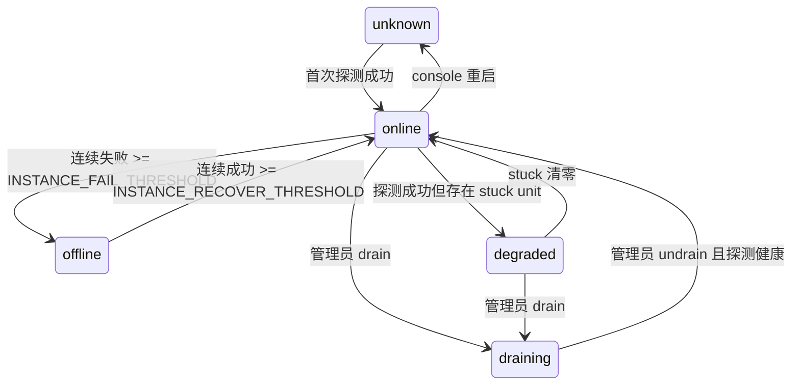

# Console 配置服务

参数配置平台（`console/`）的部署与使用说明：它是什么、默认账号密码、端口入口、
本地怎么跑起来、每个环境变量管什么、以及启动顺序和常见故障。

代码位置：`console/backend`（FastAPI）+ `console/frontend`（Vue 3 + Vite）。

---

## 1. 这是什么

一个镜像、两个进程，由 supervisord 拉起（`console/deploy/supervisord.conf`）：

| 进程 | 命令 | 监听 | 对外 |
|---|---|---|---|
| `console` | `uvicorn app.main:app --host 0.0.0.0 --port 8000 --workers 1` | `0.0.0.0:8000` | 是，compose 里唯一 publish 的端口 |
| `pipeline` | `speech-to-speech serve -f /app/config/prod.yaml --name prod` | `0.0.0.0:8765` | 否，只 `expose` 在容器内 |

职责边界：

- `console` 是 `/app/config` 的**唯一写入方**，`pipeline` 只读；
- `pipeline` 崩了页面照常可访问，`console` 重启不影响正在跑的通话；
- 配置改动只有两条生效链路：**链路 A** 进程级重启（supervisor XML-RPC，丢在途通话）、
  **链路 B** 会话内热更新（`S2S_ADMIN_TOKEN`，不丢通话）。二者都由 console 发起。

---

## 2. 默认账号与密码

| 用户名 | 密码 | 角色 |
|---|---|---|
| `admin` | `admin123456` | `admin` |

这组凭据由 **`DEFAULT_ADMIN_*`** 在**空库首次启动**时自动创建，值来自
`console/backend/.env.example`（开发模板）：

```dotenv
DEFAULT_ADMIN_USERNAME=admin
DEFAULT_ADMIN_PASSWORD=admin123456
DEFAULT_ADMIN_ROLE=admin
```

### 2.1 规则（重要）

- **只在用户名不存在时创建**。`param_user` 里已有该用户名就什么都不做——
  重启、扩容、回滚都不会覆盖你后来改过的密码。
- **密码留空 = 关闭自动建号**。这是代码里的默认值，也是镜像的默认姿态：
  一个随镜像发布的口令等于一个所有人都知道的口令。
- 密码短于 8 位、`DEFAULT_ADMIN_ROLE` 不在 `admin` / `operator` 里，
  都只打 WARNING 然后跳过，不会让服务起不来。
- 建号成功会留一条 WARNING，方便你在日志里第一眼看到：

```text
WARNING app.services.bootstrap_service created the default admin account 'admin'
        from DEFAULT_ADMIN_*; change that password before exposing the console
```

### 2.2 其它建号 / 改密方式

容器默认**不**带 `DEFAULT_ADMIN_*`（`config/prod.env` 由参数平台渲染，
不该长期存放口令），所以生产环境的第一个管理员用脚本建：

```bash
# 首次建号：交互输入密码（≥8 位）
PYTHONPATH=. python scripts/seed_admin.py --username admin --role admin

# 无人值守（CI / 一次性初始化）
echo 'admin123456' | PYTHONPATH=. python scripts/seed_admin.py \
    --username admin --role admin --password-stdin

# 忘记密码：复位一个已存在的账号
echo 'admin123456' | PYTHONPATH=. python scripts/seed_admin.py \
    --username admin --password-stdin --update-password

# 容器内（console 与 pipeline 共享同一个 venv 和 /app/data）
docker compose exec -e PYTHONPATH=/app/console pipeline \
    python /app/console/scripts/seed_admin.py --username admin --role admin
```

`--update-password` 是唯一会改写已有账号的入口；不带它会以退出码 1 报
`user admin already exists`。

> 首次启动前先迁移，否则 `param_user` 表不存在，自动建号会打
> `default admin bootstrap skipped` 然后跳过：
> `python -m alembic upgrade head`（镜像同样不在启动时迁移）。

### 2.3 安全边界

- `admin123456` 只用于本机开发。控制台一旦对网络可达，先改它。
- 鉴权只保护 `/api/v1/*`；`/api/*`（demo 面）是匿名可读的，`/api/config` 不返回任何密钥。
- 令牌：access `30` 分钟、refresh `7` 天
  （`JWT_ACCESS_TOKEN_EXPIRE_MINUTES` / `JWT_REFRESH_TOKEN_EXPIRE_DAYS`）。
- 同一 IP 5 次失败 / 300 秒内 → `429 too_many_attempts`；
  「用户不存在」和「密码错误」返回完全相同的 401，不做用户名探测。
- **没有**注册页、改密页、密码找回，也没有多租户或权限树（spec §3.8）。
- 两个角色：`admin` 可发布 / 回滚 / 丢弃草稿 / 删音色 / 改 `ops` 级参数；
  `operator` 只能改 `basic`、`advanced` 级参数草稿。

### 2.4 验证

```bash
curl -s -X POST http://127.0.0.1:8000/api/v1/auth/login \
  -H 'Content-Type: application/json' \
  -d '{"username":"admin","password":"admin123456"}'
```

```json
{"code":200,"data":{"accessToken":"...","tokenType":"bearer","expiresIn":1800,
 "refreshToken":"...","user":{"username":"admin","role":"admin"}}}
```

```bash
curl -s http://127.0.0.1:8000/api/v1/auth/me -H "Authorization: Bearer <accessToken>"
# {"code":200,"data":{"username":"admin","role":"admin","lastLoginAt":"..."}}
```

---

## 3. 端口与入口

| 部分 | 入口 | 地址 | 必须的工作目录 |
|---|---|---|---|
| console 后端 | `uvicorn app.main:app`（`app/main.py` 末行 `app = create_app()`） | `127.0.0.1:8000`（容器 `0.0.0.0:8000`） | `console/backend` |
| 前端（开发） | `npm run dev`（= `vite`） | `:3000`，被占用自动 `+1` | `console/frontend` |
| 前端（生产） | 构建产物由后端托管 | 同后端 `:8000`，页面在 `/console` | — |
| pipeline | `speech-to-speech serve -f config/prod.yaml --name prod` | `127.0.0.1:8765`（容器内 loopback） | 仓库根 |
| SER（情感，GPU 编排） | `docker compose --env-file .env -f docker-compose.gpu.yml up -d --build` @ `mediation-deploy/ser` | `127.0.0.1:8023/ser`（nginx）/ `8022`（推理） | 见 `docs/service-enablement-CN.md` |

交付形态（`docker-compose.yml`）只 publish `:8000`：8765 已从宿主机网段收回，
外部调用方统一走 console 的 `/v1/audio/*`，浏览器走同源 `/v1/realtime`。
见 §11。

Vite 开发代理（`console/frontend/vite.config.ts`）：`/api`、`/vendor`、`/v1`
（`ws: true`）全部转发到 `process.env.VITE_DEV_BACKEND ?? http://localhost:8000`。
所以**后端必须是 8000**，否则前端页面能开、接口全挂。

---

## 4. 本机跑起来

### 4.1 命令行五步（后端）

```powershell
cd console\backend
python -m pip install -e ..\.. --no-deps        # 让 speech_to_speech.config 可 import
python -m pip install -r requirements-dev.txt
Copy-Item .env.example .env                    # 已带 admin/admin123456
python -m alembic upgrade head                 # 建 param_user 等表
python -m uvicorn app.main:app --port 8000
```

- 用 `python -m uvicorn` 时**不需要**设 `PYTHONPATH`：`-m` 会把当前目录放进 `sys.path`。
- 只有直接跑 `scripts/seed_admin.py` 这类脚本时才需要 `PYTHONPATH=.`。
- 调试时**不要**加 `--reload`：reloader 会 fork 子进程，断点常常不命中。

### 4.2 前端

```powershell
cd console\frontend
npm ci
npm run dev                    # http://127.0.0.1:3000/console
# 后端不在 8000：
$env:VITE_DEV_BACKEND="http://127.0.0.1:8001"; npm run dev
```

只跑后端时，必须有一个真实的 `STATIC_DIR`（默认 `../frontend/dist`）。
没有就先 `npm run build`，否则 `mount_spa()` 直接抛
`static dir ... is missing; the image was built without the frontend`。

### 4.3 PyCharm 运行配置

`.idea/runConfigurations/` 里已经放好，打开工程后下拉框直接可选：

| 配置名 | 类型 | 关键字段 |
|---|---|---|
| `s2s-console-backend` | Python | Module name `uvicorn`；Parameters `app.main:app --host 127.0.0.1 --port 8000`；Working dir `console/backend`；EnvFile `.env`；勾 Add content roots to PYTHONPATH |
| `s2s-console-backend (reload)` | Python | 同上 + `--reload`（本机无 `watchfiles` 时退回 1 秒轮询） |
| `s2s-console-frontend` | npm | package.json `console/frontend/package.json`；command `run`；script `dev`；env `VITE_DEV_BACKEND` |
| `s2s-pipeline-prod` | Python | Module name `speech_to_speech.cli`；Parameters `serve -f config/prod.yaml --name prod`；Working dir 仓库根 |
| `s2s-dev (backend + frontend)` | Compound | 同时起 backend (reload) + frontend |

调试请选**不带 reload** 的那个。`config/prod.yaml` 已把权重路径改为本机 `cache/`
（`{env: S2S_ASR_MODEL_DIR}` / `{env: S2S_TTS_MODEL_DIR}` 由 `config/prod.env` 提供），
需要本机 CUDA 与已下载的权重；容器部署仍走 CLI flags，不使用该 YAML。

选 `s2s-pipeline-prod`（不带 `--with-console`）时 console 保持在 8000 独立运行；
若选 `s2s-pipeline-prod-with-console`，console 会在 8765 同进程再起一份，两者不要同时开。

8765 除 WS `/v1/realtime` 外还提供 ASR / TTS / 声纹 / 情感四类独立端点，
启用方式、env 清单与冒烟步骤见 `docs/service-enablement-CN.md`。

---

## 5. 配置项

配置项有**两个来源**：环境变量（`.env` 或同名环境变量，环境变量优先级高于 `.env`）
与数据库配置表 `param_config`。

- **库里的值优先**：库里有的键用库里的值，库里没有的键回退环境变量；
- **env 只做首次播种与兜底**：首次启动把 env 的默认值写进配置表（只写缺失的键），
  之后以表为准——改 `.env` 不影响已经在跑的实例，要改就改表；
- **热生效**：除少数"启动期开关"外，改表后数秒内生效，不必重启控制台；
- **密钥不进表**：`JWT_SECRET_KEY`、`USAGE_HASH_SECRET`、`S2S_*_TOKEN`、
  `DEFAULT_ADMIN_PASSWORD`、demo 面的 `SERPER_API_KEY` / `LB_HF_TOKEN` 只走 env。

详见 §5.4；接口见 §7。

### 5.1 三个硬前置

| 变量 | 缺了会怎样 |
|---|---|
| `JWT_SECRET_KEY` | `RuntimeError: JWT_SECRET_KEY is required; console refuses to start without it` |
| `STATIC_DIR` | `RuntimeError: static dir ... is missing`（目录必须真实存在） |
| `DATABASE_URL` | 能启动，但日志 `startup recovery skipped: unable to open database file`，一切登录 500 |

### 5.2 开发默认值

| 变量 | 代码内默认（容器口径） | 开发值 | 说明 |
|---|---|---|---|
| `DATABASE_URL` | `sqlite:////app/data/console.sqlite3` | `sqlite:///./dev.db` | 空库要先 `alembic upgrade head` |
| `USAGE_DB_PATH` | `/app/data/usage.sqlite3` | `./usage-dev.sqlite3` | demo 面计量库，裸 sqlite3 |
| `PARAM_CONFIG_DIR` | `/app/config` | `../../config` | 可发布 profile 的 YAML 目录 |
| `PARAM_CATALOG_PATH` | `/app/catalog/parameter-catalog.yaml` | `../../docs/parameter-catalog.yaml` | 参数目录，缺文件则发布校验降级 |
| `STATIC_DIR` | `/app/console/static` | `../frontend/dist` | SPA 产物 |
| `PIPELINE_BASE_URL` | `http://127.0.0.1:8765` | 同 | 探活 `/v1/pool` 的目标 |
| `PIPELINE_TIMEOUT_S` | `180` | 同 | `/v1/pool` 请求超时 |
| `SUPERVISOR_SOCKET` | `/run/s2s-console/supervisor.sock` | `/tmp/s2s-console/supervisor.sock` | XML-RPC over AF_UNIX |
| `SUPERVISOR_PROGRAM` | `pipeline` | 同 | 要重启的 program 名 |
| `RESTART_MODE` | `supervisor` | `noop` | 见 §6.2 |
| `CORS_ORIGINS` | 空 | `http://localhost:3000,http://127.0.0.1:3000` | 前端直连后端时需要 |
| `DEFAULT_ADMIN_USERNAME` | `admin` | `admin` | 首次启动建号用 |
| `DEFAULT_ADMIN_PASSWORD` | 空（关闭） | `admin123456` | 空 = 不自动建号 |
| `DEFAULT_ADMIN_ROLE` | `admin` | `admin` | 只能是 `admin` / `operator` |

其它只读旁路：`MODEL_METRICS_LOG`、`LOG_DIR`、`DATA_DIR`、`VOICE_DATA_DIR`
以及 demo 面的 `SERPER_API_KEY` / `LOAD_BALANCER_URL` / `OAUTH_CLIENT_ID` 等，
默认全部关闭，与本机开发无关。

> `.env.example` 里的 `PARAM_CONFIG_DIR` / `PARAM_CATALOG_PATH` 早期写成
> `../../../`，从 `console/backend` 出发会落到仓库外；现已改为 `../../`。
> 如果你沿用旧值，症状是参数树为空或目录读取失败。

### 5.3 实例注册与本地分配

实例注册、巡检、本地分配（多实例负载均衡）的全部开关。字段名是代码内短名，
env 名一律走 `validation_alias`（前缀不统一，不能用 `env_prefix`）。默认组合
（`ALLOCATOR_MODE=off` + 空 seed）= 引入本期之前的行为完全不变。

| 变量 | 默认值 | 作什么用 |
|---|---|---|
| `ALLOCATOR_MODE` | `off` | `off` = 单实例直连现状；`local` = 启用注册表选台 + 本地签发 grant。回退手段就是把它设回 `off` |
| `CONSOLE_ID` | 空 | 指标 `observed_by`，多 console 无共享多活时区分采样来源；空则回退到 `socket.gethostname()` |
| `INSTANCES_SEED_PATH` | 空 | 实例 seed 文件路径；空则跳过 seed，DB 为唯一来源 |
| `INSTANCE_PROBE_INTERVAL_S` | `5` | 巡检轮询 `/v1/pool` 的间隔秒 |
| `INSTANCE_PROBE_TIMEOUT_S` | `2` | 单次 `/v1/pool` 探测超时秒 |
| `INSTANCE_FAIL_THRESHOLD` | `3` | 连续失败几次判定 `offline`（摘除，只停新分配） |
| `INSTANCE_RECOVER_THRESHOLD` | `2` | `offline` 后连续成功几次恢复 `online`（抖动抑制） |
| `INSTANCE_GRANT_TTL_S` | `60` | 本地签发 grant 的存活秒（单调时钟回收） |
| `INSTANCE_USAGE_INTERVAL_S` | `30` | `/v1/usage` 读取间隔秒；失败只产生 `usage_unavailable` 告警，不影响健康判定 |
| `INSTANCE_METRIC_RETENTION_DAYS` | `7` | 指标采样行保留天数，巡检循环顺带清理更早的 |
| `INSTANCE_QUEUE_ENABLED` | `false` | 本地满员队列。本期关闭：满则直接 503 `at_capacity` |
| `INSTANCE_WEBRTC_HANGUP_ENABLED` | `false` | console 侧跨机挂断代理路由 `POST /instances/{id}/hangup` 的开关；关则该路径根本没注册 |

上表每一项都可以在控制台里在线改（`PUT /api/v1/config`，§5.4）；其中
`ALLOCATOR_MODE`、`INSTANCES_SEED_PATH`、`INSTANCE_WEBRTC_HANGUP_ENABLED` 是
**启动期语义**，改完要重启控制台才生效。

### 5.4 配置面：库优先、热生效

设计定稿见 `docs/superpowers/specs/2026-11-17-console-db-backed-registry-and-config-design.md`。

**登记表**：`console/backend/app/config/_schema.py` 列出每一个可在线修改的键
（键名、env 名、类型、取值域、是否需重启、说明）。**只有登记在册的键能进表**——
配置表是白名单，不是任意键值袋。

登记表**从参数目录派生**：键集合、类型、取值域、说明的唯一真源是
`docs/parameter-catalog.yaml` 的 `console_parameters` 段（控制台自己的运行开关，
与 pipeline 部署参数那一段分开，不进部署页的参数树），`_schema.py` 只做翻译，
不再手写第二份清单。两边漂移由 `console/backend/scripts/validate_catalog_schema.py`
在 CI 里挡住（双向一致 + `choices` 与 `type` 相容 + env 名对得上 settings +
默认值落在取值域内）。目录文件不可用时登记表为空，所有开关退回 env 默认值，
控制台照常启动。

**读**：调用点不变（`from app.config import console` 后照旧 `console.lb_mode`），
取值改成库优先。进程内缓存 2s（TTL），本进程写完立即失效，其他副本数秒内跟上。
**读库失败自动回退 env**，语音链路不中断。

**写**：`PUT /api/v1/config`（管理员）。逐项校验类型与取值域，**任一项非法就整批
拒绝**（400，一项都不落库）；写入留审计，`fields` 只记字段名不记值。

| 端点 | 权限 | 说明 |
|---|---|---|
| `GET /api/v1/config` | 登录 | 全部配置项的有效值 + 来源（`db` / `env`）+ 类型 + 说明 + 是否需重启 |
| `GET /api/v1/config/schema` | 登录 | 配置项元数据，供前端渲染表单 |
| `PUT /api/v1/config` | 管理员 | 批量写入 |

**生效边界**：

| 类别 | 例子 | 生效 |
|---|---|---|
| 热生效 | 探针间隔与阈值、换台次数、各端点超时、上传闸、能力探测间隔、LB 模式、目录路径、音色/会话上限、演示面开关 | 数秒内 |
| 需重启 | `ALLOCATOR_MODE`（是否起巡检任务）、`INSTANCES_SEED_PATH`（播种来源）、`INSTANCE_WEBRTC_HANGUP_ENABLED`（是否注册路由） | 重启控制台 |

**状态接口**：`GET /api/v1/status` 增加 `configSource`（`db` / `env` / `mixed`）、
`configDbOk`、`registryRuntimePersisted`——一眼能看出"改了 env 为什么没生效"。

**迁移**：`alembic upgrade head` 会建 `param_config`；`param_instance_runtime`
与 `param_allocator_lease` 见 §10.2 与 §11。

---

## 6. 启动顺序与依赖

```text
alembic upgrade head        ← 建表（空库必须，镜像不自动迁移）
        │
        ▼
console backend :8000  ──┬──► 自动建 admin（DEFAULT_ADMIN_*）
        │                └──► 探活 pipeline /v1/pool
        ▼
frontend :3000（Vite 代理 /api /vendor /v1 → :8000）
        ▲
        │ 可选：没有它页面照常开，只是实例页显示不可达
pipeline :8765
```

### 6.1 pipeline 没起会怎样

`GET /api/v1/instances` 仍然 **200**，因为「pipeline 不可达」是正常状态而不是错误：

```json
{"pool": null, "alerts": ["pool_unreachable", "pipeline_stopped"]}
```

发布 / 回滚则会失败（既没有可重启的进程，也没有健康的 pool 可等）。

### 6.2 `RESTART_MODE=noop` 的精确语义

| 环节 | `supervisor`（容器） | `noop`（本机） |
|---|---|---|
| 调 supervisor 发重启 | 是 | **否**，整段跳过 |
| `wait_running()` 等进程起来 | 是 | **仍然执行** |
| `/v1/pool` 探活 | 是 | **仍然执行** |

所以 `noop` 不等于「假安装」：它只是不发重启命令。本机没有 pipeline 时点发布，
会在 60 秒后拿到 `502 restart_unavailable`。Windows 上也装不了 `supervisor`
包（POSIX-only），本机只能这么用。

> 探活在任何模式下都真实发生：`process_probe` 连不上 socket 会返回
> `ProcessInfo(running=False, state="unknown", detail="supervisor socket ... does not exist")`。

---

## 7. 接口速查

| 方法 | 路径 | 鉴权 | 说明 |
|---|---|---|---|
| GET | `/api/v1/health` | 无 | `{"status":"ok","version":"..."}`；DB 不通返回 503 `db_unavailable` |
| POST | `/api/v1/auth/login` | 无 | 见 §2.4 |
| POST | `/api/v1/auth/refresh` | refresh token | 换一对新令牌 |
| GET | `/api/v1/auth/me` | access token | 用户名、角色、上次登录 |
| GET | `/api/v1/instances` | access token | 实例与 pool 状态、告警 |
| GET | `/api/v1/instances/{id}` | access token | 单实例详情：状态、units、探测历史、p50/p95、usage |
| GET | `/api/v1/instances/{id}/metrics?window=1h` | operator | 趋势采样（`window` 取 1h/6h/24h/7d） |
| POST | `/api/v1/instances/{id}/drain` | operator | 申请摘除：不再入选新分配，写 DB + 同步内存态 + 审计 |
| POST | `/api/v1/instances/{id}/undrain` | operator | 取消摘除（同上） |
| POST | `/api/v1/instances/{id}/probe` | operator | 绕过 2s 缓存立即探测一轮 |
| POST | `/api/v1/instances/{id}/hangup` | admin | 跨机代理实例侧 WebRTC 挂断；**默认不注册**，需 `INSTANCE_WEBRTC_HANGUP_ENABLED=true` |
| POST | `/api/v1/instances` | admin | 在线纳管实例（不必改 seed + 重启） |
| DELETE | `/api/v1/instances/{id}` | admin | 摘除实例：占位租约、运行时状态、声明数据一起清 |
| GET | `/api/v1/config` | access token | 控制台配置面：全部有效值 + 来源（db/env）+ 是否需重启 |
| GET | `/api/v1/config/schema` | access token | 配置项元数据（类型、取值域、说明），供前端渲染 |
| PUT | `/api/v1/config` | admin | 批量写配置；任一项非法整批拒绝（400），写审计（只记字段名） |
| GET | `/api/config` | 无 | demo 面配置（8 个键，不含密钥） |
| WS | `/v1/realtime` | 无 | 反代到 pipeline；上游连不上时 close `1013` |
| POST | `/v1/realtime/calls` | 无 | 转发 SDP |

pipeline 独立端点（`8765`，由 `create_app()` 直接挂载，非 console 自身的路由）：

| 方法 | 路径 | 鉴权 | 说明 |
|---|---|---|---|
| POST | `/v1/audio/transcriptions` | 无 | ASR，复用同进程 `Qwen3ASRSTTHandler` |
| POST | `/v1/audio/speech` | 无 | TTS，复用同进程 `Qwen3TTSHandler`，wav |
| POST | `/v1/audio/embeddings` | Bearer `VOICEPRINT_API_KEY` | 声纹嵌入（方案 C，CPU encoder） |
| GET | `/v1/audio/embeddings/capability` | Bearer | 声纹能力探活（`dim` 自报） |
| POST | `/v1/audio/emotion` | 无（服务端注入 SER 的 `X-API-Key`） | 情感代理到现成 emotion2vec_plus_large 服务 |
| GET | `/v1/audio/emotion/health` | 同上 | 转发 SER `/health` |

`SER_ENABLED=true` 但 `SER_API_KEY` 为空时情感路由不会注册（fail-closed）。
完整 env 映射与错误码见 `docs/service-enablement-CN.md`。

前端页面统一在 `/console`（`/console/login` 为登录页）；`/assets`、`/worklets`
走 immutable 缓存，`index.html` 走 `no-store`。

---

## 8. 常见故障

| 症状 | 原因与处理 |
|---|---|
| `RuntimeError: JWT_SECRET_KEY is required` | `.env` 没生效，或 CWD 不是 `console/backend` |
| `RuntimeError: static dir ... is missing` | 没 `npm run build`，或 `STATIC_DIR` 指错 |
| 登录 401，账号密码确认无误 | 表没建（`alembic upgrade head`），或 `param_user` 里的密码是别人设的 → `--update-password` |
| 登录 429 `too_many_attempts` | 5 次/300 秒；等窗口过去，或重启进程清空内存计数 |
| `startup recovery skipped: unable to open database file` | `DATABASE_URL` 指到不存在的目录（常见于默认 `/app/data`） |
| 发布 502 `restart_unavailable` | `RESTART_MODE=noop` 下 pipeline 没起；或真的重启失败超过 60 秒 |
| 实例页 `pool_unreachable` | pipeline 没起 / `PIPELINE_BASE_URL` 指错，两者都不影响其它页面 |
| Vite 起在 3001 | 3000 被占用（本机常见），代理仍然正常，用打印出的端口即可 |
| 前端能开、接口全 404/502 | Vite 代理目标不是 8000；设 `VITE_DEV_BACKEND` |
| 改了 `.env` 没反应 | 配置以**数据库为准**（env 只做首次播种与兜底）；要改就改表或 `PUT /api/v1/config`，改完数秒内生效 |
| 改了 `.env` 没反应，且配置页是空的 | 参数目录文件不在（`PARAM_CATALOG_PATH` 指错或挂载丢了）：配置项登记表派生自目录，目录不可用时登记表为空、所有开关退回 env 默认值；看启动日志的"参数目录不可用"告警 |
| 实例行一直停在 `unknown` | 首轮巡检未跑（`ALLOCATOR_MODE=off` 时不起巡检任务），或 seed 落了库但 `enabled=false` |
| `drain` 后仍拿到 grant | 看到的是已签发未领取的 pending（`INSTANCE_GRANT_TTL_S` 内不会消失），或 console 重启后忘了 `refresh_specs()` |
| `POST …/hangup` 返回 404/405 | `INSTANCE_WEBRTC_HANGUP_ENABLED` 没开，路由根本没注册（默认关，spec §9.2；SPA catch-all 只注册 GET，故未挂载的 POST 返 405） |
| `POST …/hangup` 返回 503 `admin_disabled` | 这台 console 的 `S2S_ADMIN_TOKEN` 为空；多 console 必须与实例侧同值（spec §12） |
| 浏览器语音连不上（LB 模式） | 查 `CONSOLE_LB_MODE`、`ALLOCATOR_MODE`、实例页的 `capabilities` 列；冷启动时 pipeline 还没加载完也会这样（§11.6） |
| `/v1/audio/*` 回 501 `lb_disabled` | `CONSOLE_LB_MODE` 还是 `off`（§11.1） |
| `/v1/audio/*` 回 503 `no_available_instance` | 注册表里没有可用实例：seed 没落库、实例 `enabled=false`、或还在 `unknown`/`offline`（§11.6） |
| 声纹返回 503 | 该实例没配 `VOICEPRINT_API_KEY`（路由在但未配置，§11.5） |

---

## 9. 相关文件

| 路径 | 作用 |
|---|---|
| `console/backend/app/main.py` | `create_app()`、lifespan（建默认管理员、恢复中断的发布） |
| `console/backend/app/config/_bootstrap.py` | `DEFAULT_ADMIN_*` 三个变量的定义 |
| `console/backend/app/services/bootstrap_service.py` | 首次启动建号的唯一实现 |
| `console/backend/scripts/seed_admin.py` | 建号 / 改密脚本 |
| `console/backend/scripts/validate_catalog_schema.py` | 参数目录 ↔ 配置项登记表的双向一致性闸（CI 跑，不通过非零退出） |
| `console/backend/app/routers/auth.py` | 登录、刷新、`/me` |
| `console/backend/app/core/spa.py` | SPA 托管与 `STATIC_DIR` 校验 |
| `console/deploy/supervisord.conf` | 容器里两个进程的命令与日志路径 |
| `docker-compose.yml` | 只 publish 8000；`env_file: ./config/prod.env`（8765 已取消 publish，见 §11.2） |
| `config/instances.yaml` | 实例注册表的声明式 seed（交付形态登记本机 pipeline） |
| `console/backend/app/routers/audio_proxy.py` | `/v1/audio/*` 六条反代路由的注册（off 模式也注册） |
| `console/backend/app/services/audio_proxy_service.py` | ASR/TTS/声纹/情感反代：选台、白名单头透传、体积闸、错误映射 |
| `console/backend/app/services/upstream_resolver.py` | 两套选台策略（session 容量感知 / stateless 在途感知）与在途计数 |
| `console/backend/app/services/capability_probe.py` | 能力指纹探测与"存在但不可用"的判定 |
| `console/backend/app/routers/realtime.py` | `/v1/realtime` 的静默换台与三种终态 |
| `console/backend/app/services/instance_registry.py` | 实例级状态机（unknown/online/degraded/offline/draining）与 effective_free 建模 |
| `console/backend/app/services/instance_monitor.py` | 常驻巡检循环 + 探测缓存 + 指标采样与清理 |
| `console/backend/app/services/allocator.py` / `allocator_store.py` | 本地分配选台/grant/503 换台；`AllocatorStore` 为 Phase 2 替换点 |
| `console/backend/app/services/instance_seed.py` | seed 幂等 upsert 与 `instance_seed_conflict`/`instance_removed_from_seed` 告警 |
| `console/backend/alembic/versions/0005_instances.py` | 两张新表（`param_instance` / `param_instance_metric`）的迁移 |

---

## 10. 实例注册、巡检与多 console

本节把多实例（一台 console 管多台 pipeline 机）从配置到运维的心智模型串起来。
开关清单见 §5.3，接口见 §7，故障见 §8。

### 10.1 双模式判定与回退

分支唯一落在 `routers/demo/session.py`（spec §8.1）：

| 条件 | 行为 |
|---|---|
| `demo.lb_url` 非空 | 现有 `lb_service.start/poll/leave` 转发，**逐字不变** |
| `lb_url` 空 且 `ALLOCATOR_MODE=local` 且注册表存在可分配实例 | 本地 `allocator.allocate()` 选台签发 grant |
| 其余 | 保持现状（`SPEECH_TO_SPEECH_URL` 直连 / 404 防探测） |

回退手段：把 `ALLOCATOR_MODE` 设回 `off` 即退回本期之前的单实例行为（spec §8.4）。
`lb_service.py` 不修改；演示面保持匿名、无 envelope 的既有形态。

### 10.2 seed 文件格式与幂等规则

`INSTANCES_SEED_PATH` 指向 `instances.yaml`（空则跳过 seed，DB 为唯一来源）。启动时在
lifespan 内做一次幂等 upsert（键 `instance_id`）：写入/更新 `base_url`、`weight`、
`max_sessions_hint`、`labels_json`；**不覆盖** `enabled`、`drain_requested`（运维开关
优先于 seed）。形状（照抄 spec §7）：

```yaml
instances:
  - id: pipe-a
    base_url: http://192.168.40.31:8765
    weight: 2
    max_sessions_hint: 4
    labels: {rack: A, gpu: "4090"}
  - id: pipe-b
    base_url: http://192.168.40.32:8765
    weight: 1
```

四类告警名（前三个来自 seed/巡检，`usage_unavailable` 来自 usage 采样）：

| 告警 | 触发条件 |
|---|---|
| `instance_capacity_mismatch:{id}` | `max_sessions_hint` 非空且 `/v1/pool.size != max_sessions_hint` |
| `instance_removed_from_seed:{id}` | DB 里有、seed 里消失（不删行，只告警） |
| `instance_seed_conflict:{id}` | seed 与 DB 的 `base_url` 不一致（以 DB 为准） |
| `usage_unavailable` | `/v1/usage` 读取失败；不参与健康判定，仅告警 |

**在线纳管**（2026-11-17 起）：seed 不再是唯一入口。

| 端点 | 权限 | 说明 |
|---|---|---|
| `POST /api/v1/instances` | 管理员 | 新增实例（`instance_id` / `base_url` / `weight` / `labels` / `cluster_id`）；巡检下一轮就会探它 |
| `DELETE /api/v1/instances/{id}` | 管理员 | 摘除实例：占位租约、运行时状态、声明数据一起清 |

**运行时状态落库**（2026-11-17 起）：巡检把观测结果写进 `param_instance_runtime`
（健康五态、槽位占用、能力指纹、探测计数、失败计数）。控制台重启后直接读到上次的
状态，不必等首轮探测；多副本共享同一份健康真相源（最后写入者胜，探测对象相同，
覆盖无害）。`reserved`（占位数）归选台所有，巡检不碰它。

### 10.3 实例级状态机

两层状态绝不混用：unit 级（idle/active/draining/stuck）原样来自 `/v1/pool`；机器级
由 console 巡检推导。摘除只停新分配，绝不触碰活跃会话。下图照抄 spec §6.2：



### 10.4 远程实例运维流程

- 本机实例（`base_url == console.pipeline_base_url`）继续走现有 `publish_flow_service`
  + supervisor + `pool.wait_healthy`，本设计不改其语义。
- 远程实例 console 无权重启，手工流程为：`drain` → 该机自行发布/重启 → 巡检自动
  回到 `online` → `undrain`（spec §9.1）。发布成功后可调 `instance_monitor.invalidate()`
  让面板立即反映新状态。

### 10.5 多 console 一致性前提

多台 console 指向同一批实例时，以下变量**必须**各机一致（spec §12）：
`JWT_SECRET_KEY`、`USAGE_HASH_SECRET`、`S2S_ADMIN_TOKEN`、`S2S_INTERNAL_TOKEN`、
`INSTANCES_SEED_PATH` 指向的 seed 内容。`GET /api/v1/status` 暴露以下新字段供核对
（Task 11）：`allocatorMode` / `instancesRegistered` / `seedConfigured` / `consoleId` /
`secretsConsistent`（后者对上面这串密钥做一致性校验，任一为空或不匹配即 false）。

**共享存储（2026-11-17 起）**：多 console 指向**同一个数据库**时，选台占位落库
（`param_allocator_lease` + `param_instance_runtime.reserved`），各副本共享同一份
余量：占位判定用一条带条件的原子 UPDATE（`reserved < size - in_use - stuck`）看
`rowcount`，两个副本不会各自看到"还有空位"而同时派发到同一台。
DB 不可用时占位直接失败（选台回 503），**绝不用陈旧租约继续派发**——宁可少派不超发。

多 console 各用各的库时，退回本机乐观修正（`pending_local`）：只防同机重复派发，
看不见对端的 pending；实例是槽位的最终仲裁者，短期超发的唯一下场就是一次 503 换台，
换台无可换则 `allocate` 返回 `None` → 调用方回 `503 at_capacity`（spec §8.4/§15 P1.6）。

### 10.6 部署前提（鉴权边界）

- `/v1/pool`、`/v1/usage` **无应用层鉴权**，靠网络 ACL 限制来源（spec §16）。
- `DELETE /v1/realtime/calls/{call_id}` 从 P1.6 起要求 `S2S_ADMIN_TOKEN` Bearer
  （spec §9.2）：**升级前先确认各机都配了 token**，否则现有的 WebRTC 挂断调用会吃
  `503 admin_disabled`（未配置）或 `401 unauthorized`（token 不匹配）。
- console 侧跨机挂断代理 `POST /instances/{id}/hangup` 默认不注册，需
  `INSTANCE_WEBRTC_HANGUP_ENABLED=true` 且操作者为 admin。

### 10.7 指标口径

- 会话时长为**估算**：`grant_ts → 该 unit 不再 active` 的差；`/v1/pool` 不返回开始
  时间，UI 须明确标注"估算"。
- 跳变计数（`evict_count` / `recover_count`）**不累加**，按 console 分组展示，避免
  多 console ×N（spec §10）。跨 console 聚合规则：同一秒桶内按 `instance_id` 取最新
  一行，重复采样互不累加。

### 10.8 console 单 worker 约束

console 以 `--workers 1` 运行（§1）：内存 `AllocatorStore` 与 `publish_flow_service` 的
进程内锁同前提——多 worker 会让 grant 与发布状态在进程间不一致（spec §13/§16）。

2026-11-17 起多了 `DbAllocatorStore`（占位落库，多副本共享余量），但**单 worker 约束
不变**：进程内事务（去重、grant 缓存、满员队列、计数器）仍然只在进程内成立，
`publish_flow_service` 的发布状态也一样。多副本要靠"一个副本一个盒子"来满足，
不是靠多 worker。

---

## 11. S2S 数据面负载均衡（spec 2026-11-16）

一句话：**console 是唯一数据面入口**。浏览器与外部调用方只跟 `:8000` 说话，console
按实例注册表选台后转发给 pipeline；`8765` 收敛为容器内/内网端口。

设计全文见 `docs/superpowers/specs/2026-11-16-console-s2s-load-balancing-design.md`，
实施计划见 `docs/superpowers/plans/2026-11-16-console-s2s-load-balancing.md`。

### 11.1 两种模式与端点矩阵

开关只有一个：`CONSOLE_LB_MODE`（默认 `off` = 与本期之前行为等价）。

| `CONSOLE_LB_MODE` | `/v1/realtime`（WS） | `/v1/audio/*`（ASR/TTS/声纹/情感） | `/api/calls`（WebRTC SDP） |
|---|---|---|---|
| `off` | 反代到回环 pipeline（`PIPELINE_BASE_URL`） | **注册但回 501 `lb_disabled`** | 转发到 env 钉死的 `SPEECH_TO_SPEECH_URL`（无 pin 则 404） |
| `proxy` | 选台后反代到实例 | 选台后反代到实例 | 选台后转发到实例 |

`off` 也注册 `/v1/audio/*` 是有意的：不注册的话 `GET /v1/audio/embeddings/capability`
会命中 SPA catch-all 拿到 **200 + index.html**（探针解析 JSON 直接炸），POST 则拿到
**405**。显式注册并回 501 JSON，调用方至少拿到一个可解析的"未启用"。

`proxy` 的前提：`ALLOCATOR_MODE=local`（spec §4.2）且注册表非空。前提不满足时
**不会**悄悄退回 `off`，而是明确回 503 `no_available_instance`——安静降级比报错更难查。
选台用两套策略：

- **占 unit 槽位的端点**（WS、WebRTC）按 `free/capacity` 降序 + 权重随机；
- **不占槽位的端点**（ASR/TTS/声纹/情感复用 pool 里的 handler，不 claim unit）
  按 console 侧记录的在途请求数升序（least-conn 的近似）。

### 11.2 8765 收敛清单

| compose | 处置 | 理由 |
|---|---|---|
| `docker-compose.yml` | **收敛**（删 publish，保留 `expose: 8765/tcp`） | 交付形态，唯一对外入口是 console `:8000` |
| `docker-compose.local.yml` | 保留 publish | 本地开发要直连 8765 调试 |
| `docker-compose.baked.yml` / `.baked.cu130.yml` | 保留 | 烘焙镜像的实验形态 |
| `.cu130.yml` / `.gpustack.yml` / `.llm-bundled.yml` / `.vn.ms.llm-bundled.yml` | 保留 | 服务器/GPUStack 部署形态，外部有直连调用方 |
| `.thirdparty.yml` / `.voiceprint.yml` | 保留 | 声纹/情感的外部调用方直连 8765 |

取消 publish 的收益：`/v1/pool`、`/v1/usage`、`/v1/audio/*` 大多无应用层鉴权
（声纹除外），收敛后这些端点不再对宿主机网段暴露。

入口切换的前置条件：`config/prod.env` 的 `SPEECH_TO_SPEECH_URL` **必须留空**。
填了值 → 前端 `allowDirect=true` 且 `s2sUrl` 指向 8765 → 浏览器绕过 console 直连，
删 publish 等于直接打断语音链路。留空后前端自动回落同源 `/v1/realtime`（前端零改动）。

### 11.3 WS 的三种终态

| 终态 | 浏览器看到 | 触发条件 |
|---|---|---|
| 成功 | 101 + 正常会话 | 上游首帧是 `session.created` |
| 满员 | 101 + `error/session_limit_reached` 事件 + close 1008 | 上游明确回满员且换台耗尽（与改造前直连 pipeline 完全一致） |
| 不可达 / 无候选 | **HTTP 403 握手失败** | 连不上、首帧超时、或注册表里没有可用实例 |

> **WS 阶段没有 HTTP 503**。Starlette 在 `accept()` 之前 close 只回 HTTP 403，
> close code 送不到浏览器——这是既有事实，别把 503 写进前端的期望。

换台是**静默**的：console 先与上游握手、验首帧，上游满员就换下一台，浏览器看不到
中间态。换台次数 `LB_FAILOVER_ATTEMPTS`（默认 2，不含首次）。

### 11.4 REST 错误码（`/v1/audio/*`）

反代面用 pipeline 风格的错误体 `{"error":{"code","message","retryable"}}`，
**不用** console 的 `{code,message,detail,requestId}` 信封——保持 OpenAI 兼容面的
调用方不改。

| 情况 | 状态码 | `error.code` |
|---|---|---|
| 上游 2xx/4xx/5xx | 原样 | 原样（声纹的 401/403/404/503 也原样） |
| 上游连不上 | 502 | `upstream_unreachable` |
| 上游超时 | 504 | `upstream_timeout` |
| 无可用实例 | 503 | `no_available_instance` |
| 请求体超限 | 413 | `request_too_large` |
| LB 未启用（`off`） | 501 | `lb_disabled` |

上传体积闸由**代理自己**判（`LB_AUDIO_MAX_BYTES`，默认 11 MiB = 声纹 10 MiB +
1 MiB multipart 余量）：中间件对这三条上传路径豁免，413 的错误体全网只有这一处
产生，形状不会打架。上传必须带 `content-length`（超限时上游一个字节都收不到）。

### 11.5 灰度与回滚

灰度分两步，本期交付的是第二步：

1. 先上 `CONSOLE_LB_MODE=proxy`（8765 仍 publish）→ 验证：浏览器同源
   `/v1/realtime` 能连上、`POST /v1/audio/transcriptions` 返回 200。
2. 再删 publish 条目（本次）→ 验证：宿主机 `curl :8765` 拒绝连接，
   `:8000/v1/audio/*` 仍然 200。

| 症状 | 回滚动作 |
|---|---|
| 语音链路整体不通 | `CONSOLE_LB_MODE=off` + 恢复 `SPEECH_TO_SPEECH_URL` + 恢复 8765 publish（三处一起） |
| 只有 `/v1/audio/*` 不通 | 看实例页的 `capabilities` 列与 `capability_issues`：声纹返回 503 说明该实例没配 `VOICEPRINT_API_KEY` |
| 想临时直连 8765 | 本地调试用 `docker-compose.local.yml`；交付形态别开 publish，否则安全收敛失效 |

### 11.6 单盒形态的已知点

- **冷启动窗口**：容器里 console 先于 pipeline 起来（supervisord priority 10 < 20），
  pipeline 加载模型期间注册表里还没有 `online` 实例，语音请求会拿到
  503 `no_available_instance`（改造前是连不上 8765，性质相同）。pipeline 起来后
  巡检会在 `INSTANCE_RECOVER_THRESHOLD` 次成功后把它恢复成 `online`。
- **单盒形态不广告 WebRTC**：`/api/config` 的 `rtc` 仍以 `SPEECH_TO_SPEECH_URL` 是否
  钉死为准（`demo_config_service.py:38`），清空 pin 后前端只给 WebSocket 一个选项。
  这是有意的：pipeline 的 ICE 候选是容器内地址，远程浏览器本来就连不上。proxy 模式
  的 `/api/calls` 选台转发在服务端已就绪（`calls_service.forward_selected`），
  多机部署且 ICE 可达时可直接启用。
- **`/api/session` 的 connect_url 是容器内回环**（`ws://127.0.0.1:8765/v1/realtime`），
  浏览器不可直连。单盒部署的语音入口是同源 `/v1/realtime`，不是 demo 面的
  `/api/session`。
- **能力指纹只驻留内存**：重启后要等一轮探测（`LB_CAPABILITY_INTERVAL_S`，默认 30s，
  启动时另探一轮）才知道各实例有没有声纹/情感。声纹能力探测返回 401/403 是
  "路由存在"的免费信号——console 不持有声纹 key。

