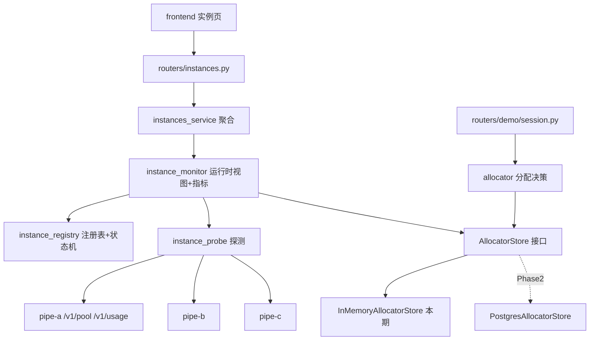
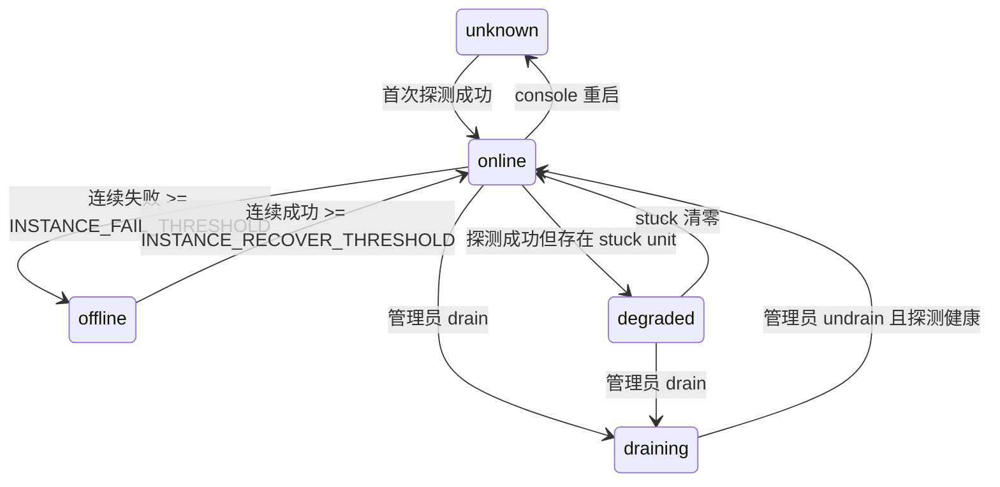

# 实例注册管理 + 运行时监控 + 健康检查（含多 console 无共享多活）设计

日期：2026-10-26
状态：已与需求方逐条确认，待评审
范围：Phase 1（单期交付，含 H2-lite 多活与指标落库）；Postgres 共享状态与主备租约为 Phase 2

## 1. 目标

在 N 台（>2）独立 compose 部署的 speech-to-speech pipeline 实例之上，为控制台提供：

1. **实例注册管理**：声明式 seed + 数据库为真相源的实例台账，含每机的负载能力参数（最大会话数等）。
2. **运行时监控**：跨实例容量视图、指标落库与历史趋势。
3. **健康检查**：常驻周期巡检、连续失败摘除、恢复回归，且摘除只停新分配、不影响活跃会话。
4. **分配型负载均衡（双模式）**：`LOAD_BALANCER_URL` 有值时逐字保持现有"转发外部 LB"语义；为空且注册表非空时由 console 本地分配。
5. **多 console 无共享多活（H2-lite）**：不引入 Postgres/Redis/K8s 的前提下，允许多台 console 并列服务。

## 2. 现状事实（设计依据）

| 事实 | 证据 |
|---|---|
| console 对"选哪台实例"无话语权，只转发、记账、鉴权 | `console/backend/app/services/lb_service.py` `start`/`poll`/`leave` |
| 演示面契约已固化：grant / queued / at_capacity / expired / 402 / 401 | `lb_service.py:139-238`、`routers/demo/session.py`、`routers/demo/queue.py` |
| 配额链路仅在 LB + Space 同时存在时启用，自托管默认关闭 | `config/_demo.py:37-39`（`limiter_enabled = bool(lb_url) and bool(space_id)`） |
| 容量视图只有单实例：`console.pipeline_base_url` 一个字符串 | `config/_console.py:12`、`services/pool.py:51-52` |
| `/v1/pool` 已给出 unit 级状态机 `idle/active/draining/stuck` 与 `size`/`in_use` | `src/speech_to_speech/api/openai_realtime/websocket_router.py:678-713` |
| `/v1/usage` 是池级聚合，遍历全部 unit，代价高于 `/v1/pool` | `websocket_router.py:654-676` |
| 槽位由实例自身最终仲裁，满则 503 `session_limit_reached` | `websocket_router.py:899-909` |
| 健康判定口径已有：可达 / 无 stuck / size 相符 | `services/pool.py:131-138` |
| 巡检口径目前只服务发布期一次性等待 | `services/pool.py:85-128`、`publish_flow_service` 调用点 |
| 实例侧无"断开指定 WS 会话"的端点 | `websocket_router.py` 端点全集：`/v1/usage`、`/v1/pool`、`/internal/sessions/update`、`/admin/sessions/update`、`/v1/realtime`、`POST|DELETE /v1/realtime/calls` |
| WebRTC 挂断端点存在但**无鉴权** | `websocket_router.py:996-1014`（对比 `:796-814` 的 `S2S_ADMIN_TOKEN`） |
| console 已支持 Postgres 方言（为 Phase 2 留好了路） | `repositories/turn_latency_repository.py:8-18`、`alembic/sql/init-postgresql.sql` |
| console 必须单 worker（进程内锁） | `publish_flow_service.py:193-195` |

## 3. 本期不做

- Postgres 共享状态多活（H2 完整版）、主备租约（H1）
- 本地队列启用（契约保留，默认 `INSTANCE_QUEUE_ENABLED=false`，满则 `503 at_capacity`）
- 实例 UI 增删改（注册只走 seed + DB）
- WebSocket 会话服务端强踢（实例侧无能力）
- 跨机会话迁移（会话状态活在 `SessionState` + handler 链，无导出/导入接口）
- 实例自动发现（mDNS / 反向注册回调）
- 远程实例的自动发布/重启编排（console 无 docker socket，这是既有约束）
- coturn / WebRTC 媒体层收敛
- K8s、服务网格

## 4. 架构与分层



新增/改造文件（全部落在 console 现有 `routers / services / repositories / schemas / models / config` 分层内）：

| 动作 | 路径 | 职责 |
|---|---|---|
| 新增 | `app/config/_allocator.py` | `AllocatorSettings`，全部带默认值 |
| 新增 | `app/models/param_instance.py` | 注册表 ORM |
| 新增 | `app/models/param_instance_metric.py` | 指标 ORM |
| 新增 | `app/repositories/instance_repository.py` | seed upsert、按 id 取、列举、状态开关写回 |
| 新增 | `app/repositories/instance_metric_repository.py` | 批量写、窗口读、过期清理（双方言） |
| 新增 | `app/services/instance_probe.py` | 对**指定**实例地址读 pool/usage 并归一化 |
| 新增 | `app/services/instance_registry.py` | 注册表读写 + 实例级状态机跳变 |
| 新增 | `app/services/instance_monitor.py` | 常驻巡检任务、运行时视图缓存、指标采样与清理 |
| 新增 | `app/services/allocator_store.py` | `AllocatorStore` Protocol + `InMemoryAllocatorStore` |
| 新增 | `app/services/allocator.py` | 选实例、签发 grant、pending 回收、失败换台重试 |
| 新增 | `app/schemas/instance.py` | 响应模型（沿用 `schemas/common.ok`/`iso_utc`） |
| 改造 | `app/services/pool.py` | `read_pool(base_url=None)` / `read_usage(base_url=None)`，默认取 `console.pipeline_base_url` |
| 改造 | `app/services/instances_service.py` | 单实例 → N 实例聚合，旧字段全保留 |
| 改造 | `app/routers/instances.py` | 聚合 + 管理动作 |
| 改造 | `app/routers/demo/session.py` | 入口分支：外部 LB 转发 / 本地分配 |
| 改造 | `app/config/__init__.py` | 暴露 `allocator` 设置实例 |
| 改造 | `app/main.py` | lifespan 启停巡检与清理任务（与 `turn_latency_indexer` 同级） |
| 改造 | `app/core/router_registry.py` | 无需新前缀，沿用 `/api/v1` |
| 新增 | `alembic/versions/0005_instances.py` | 两张表 |
| 改造 | `console/backend/.env.example`、`docs/console-service.md` | 配置与文档 |
| 改造 | `console/frontend`（实例页、api 类型、i18n） | 多实例表格 + 汇总卡 + 趋势图 |
| 新增（唯一实例侧改动） | `src/speech_to_speech/api/openai_realtime/websocket_router.py` | `DELETE /v1/realtime/calls/{call_id}` 补 `S2S_ADMIN_TOKEN` 鉴权 |

依赖方向：`routers → services → repositories → models`；`allocator` 只依赖 `AllocatorStore` 与 `instance_registry`，不直接碰 ORM。

## 5. 数据模型

### 5.1 `param_instance`（注册表，落库为真相源）

| 字段 | 类型 | 约束/默认 | 说明 |
|---|---|---|---|
| id | Integer | PK | |
| instance_id | String(64) | unique, not null | 稳定标识，seed 幂等键 |
| base_url | String(255) | not null | `http(s)://host:port` |
| weight | Integer | not null, default 1 | 调度权重，>0 才参与分配 |
| max_sessions_hint | Integer | nullable | 声明容量，仅用于展示与 `capacity` 偏差告警，不参与分配 |
| labels_json | JSON | not null, default `{}` | rack/gpu/region |
| enabled | Boolean | not null, default true | 管理开关；false 永不分配，记录保留 |
| drain_requested | Boolean | not null, default false | 期望态，重启后保持（与内存态区分） |
| created_at / updated_at | DateTime(tz) | not null, default utcnow | |
| updated_by | String(64) | not null, default "" | 审计关联 |

### 5.2 `param_instance_metric`（指标，30s 采样 + 跳变即时落）

| 字段 | 类型 | 说明 |
|---|---|---|
| id | Integer PK | |
| instance_id | String(64) not null, index | 关联 `param_instance.instance_id`（不建 FK，实例删除后指标仍可读） |
| observed_at | DateTime(tz) not null, index | |
| observed_by | String(64) not null | console 标识（`CONSOLE_ID`，默认主机名）——多活必需 |
| kind | String(16) not null | `sample` \| `state_change` |
| size / in_use / free / stuck | Integer nullable | 不可得写 `NULL`，不写 0（沿用 `pool.py` 的 "no data ≠ zero"） |
| status | String(16) not null | 实例级状态 |
| probe_ms | Integer nullable | |
| alloc_ok / alloc_fail_no_instance / alloc_fail_instance_503 | Integer default 0 | 采样窗口内的**增量**，非累计 |
| evict_count / recover_count | Integer default 0 | 同上 |

保留策略：`INSTANCE_METRIC_RETENTION_DAYS`（默认 7）；清理任务每 10 分钟删过期行，按 `observed_at` 删，双方言无需特判。

### 5.3 审计复用形态

不新增审计表。`drain`/`undrain`/`probe`/`hangup`/`seed` 写入现有 `param_audit`：

- `action` ∈ `instance.drain` / `instance.undrain` / `instance.probe` / `instance.hangup` / `instance.seed`
- `profile` 列复用为**目标标识**（存 `instance_id`），使既有 `AuditRepository.list(profile=...)` 过滤直接可用
- `fields` 存名字数组（如 `["drain_requested"]`），遵循"`fields` 只存字段名不存值"的既有约定
- `actor`/`role`/`request_id` 来自 JWT 与 `RequestIdMiddleware`

## 6. 两层状态机

必须分层，混用是这套设计最大的踩坑点。

### 6.1 unit 级（槽位）——原样来自 `/v1/pool`，不重定义

`idle` / `active` / `draining` / `stuck`

### 6.2 实例级（机器）——console 巡检推导



| 状态 | 是否可分配新会话 | 说明 |
|---|---|---|
| `unknown` | 否 | 首轮巡检前 |
| `online` | 是 | 健康有余量 |
| `degraded` | 是 | `effective_free` 扣掉 `stuck` |
| `offline` | 否（摘除） | 活跃会话不受影响，面板显示"离线但仍有 N 个活跃会话" |
| `draining` | 否 | 期望态落库（`drain_requested`），console 重启后仍保持 |

容量建模：

```
capacity         = /v1/pool.size                    # 运行时真相，= 该实例 num_pipelines
stuck            = units 中 state == "stuck" 数
in_use           = /v1/pool.in_use
effective_free   = max(0, capacity - in_use - stuck - pending_local)
declared_mismatch = max_sessions_hint 非空且 capacity != max_sessions_hint → 告警 instance_capacity_mismatch
```

`pending_local` = 本 console 已签发、尚未过期、实例还没反映出来的 grant 数（乐观修正，只防同机重复派发）。多 console 之间互不可见，由 §8.4 的 503 兜底。

## 7. 注册与 seed

- seed 文件：`INSTANCES_SEED_PATH` 指向 `instances.yaml`（空则跳过，DB 为唯一来源）。
- 启动时在 lifespan 内做一次幂等 upsert（键 `instance_id`）：写入/更新 `base_url`、`weight`、`max_sessions_hint`、`labels_json`；**不覆盖** `enabled`、`drain_requested`（运维在 console 上的开关优先于 seed）。
- DB 中已存在、seed 中消失的实例：不删除，仅告警 `instance_removed_from_seed`。
- seed 与 DB 的 `base_url` 不一致：以 DB 为准并告警 `instance_seed_conflict`（多 console 各自 seed 时避免互相覆盖）。
- 多 console 的一致性前提：各机 `INSTANCES_SEED_PATH` 指向的 seed 内容一致；不一致时靠告警发现，不做仲裁。

示例 seed：

```yaml
instances:
  - id: pipe-a
    base_url: http://192.168.40.31:8765
    weight: 2
    max_sessions_hint: 4
    labels: {rack: A, gpu: "4090"}
  - id: pipe-b
    base_url: http://192.168.40.32:8765
    weight: 1
```

## 8. 分配与调度（双模式）

### 8.1 模式判定（`routers/demo/session.py` 唯一分支点）

| 条件 | 行为 |
|---|---|
| `demo.lb_url` 非空 | 现有 `lb_service.start/poll/leave` 转发，**逐字不变** |
| `lb_url` 空 且 `ALLOCATOR_MODE=local` 且注册表存在可分配实例 | 本地 `allocator.allocate()` |
| 其余 | 保持现状（`SPEECH_TO_SPEECH_URL` 直连 / 404 防探测） |

`lb_service.py` 不修改；演示面保持匿名、无 envelope 的既有形态（A.13）。运维面 JWT 与演示面身份互不代理。

### 8.2 选择算法

1. 过滤：`enabled` 且 `weight > 0` 且状态 ∈ {`online`,`degraded`} 且 `effective_free > 0`。
2. 主排序：`effective_free / capacity` 降序（least-loaded）。
3. 同分：按 `weight` 加权随机（`random.Random(seed)` 可注入，保证测试确定性）。
4. `weight` 语义：新机多引流、同机房优先；纯 `free_ratio` 相同时才起作用。

### 8.3 grant 生命周期

1. 选中实例 → `store.reserve(instance_id, session_id, ttl)` 原子占位。
2. 返回 `{session_id, connect_url, expires_in}`；`connect_url` 由 `base_url` 派生 ws/wss（与 `calls_service.handshake_url` 的规整规则对称，复用其 scheme 映射表）。
3. `INSTANCE_GRANT_TTL_S`（默认 60s）内未领取 → 单调时钟（`time.monotonic`）判过期并回收 `pending_local`。
4. 领取即 `store.release(session_id)`，之后容量真相完全交给 `/v1/pool`。

不使用墙钟做 TTL，避免多实例机器间时钟偏差导致租约抖动。

### 8.4 冲突与降级（多活的核心）

- 实例返回 503 `session_limit_reached` 或客户端连不上 → **换一台重试一次** → 仍失败返回 `503 at_capacity`（前端已有该分支）。
- 这是可能的短期超发的兜底，也是"分配可弱一致"成立的根因：实例是槽位的最终仲裁者。
- `ALLOCATOR_MODE` 可回退到 `off`，即退回本期之前的行为，作为运维降级手段。
- 队列：契约与 `/api/queue/*` 路由保留，`INSTANCE_QUEUE_ENABLED=false` 时 `allocator` 不建票，直接 `at_capacity`。

### 8.5 幂等

`POST /api/session` 按 `store.begin_once(dedupe_key)` 去重，`dedupe_key` 优先取 `X-Request-Id` 头，缺省时取匿名 cookie id + 10s 时间桶；命中时返回**同一个** grant，不重复占位。

## 9. 巡检与健康检查

| 项 | 参数 | 默认 |
|---|---|---|
| pool 探测 | `INSTANCE_PROBE_INTERVAL_S` | 5s（分配依赖它，需新鲜） |
| 探测超时 | `INSTANCE_PROBE_TIMEOUT_S` | 2s |
| 摘除阈值 | `INSTANCE_FAIL_THRESHOLD` | 连续 3 次失败（≈15s 摘除） |
| 恢复阈值 | `INSTANCE_RECOVER_THRESHOLD` | 连续 2 次成功（≈10s 恢复，抑制抖动） |
| usage 采样 | `INSTANCE_USAGE_INTERVAL_S` | 30s（`/v1/usage` 遍历全池，代价高） |
| 指标落库 | 同上 30s + 状态跳变即时落 | |
| 保留期 | `INSTANCE_METRIC_RETENTION_DAYS` | 7 天 |

- 探测方式：`GET {base_url}/v1/pool`，复用 `pool.read_pool(base_url=...)` 与 `_judge` 的判定口径，**不新增实例侧端点**。
- 并发：一轮内 `asyncio.gather` 全部实例；单台超时不影响其余。
- `usage` 失败**不参与健康判定**，只产生 `usage_unavailable` 告警（沿用 `instances_service` 现有 alert 名）。
- 视图缓存：运行时快照驻留内存，读接口 2s 防抖（与 `runtime_service._TTL_S` 同思路）；`POST /instances/{id}/probe` 可强制绕过缓存立即探一次。
- 摘除影响：**只停新分配，绝不触碰活跃会话**；不强踢、不迁移。
- 后台任务启停挂在 `lifespan`，与 `turn_latency_indexer.run_forever()` 同模式；异常只记日志不杀任务（同 `_usage_sweeper`）。

### 9.1 与发布流程的关系

- 本机实例（`base_url == console.pipeline_base_url`）继续走现有 `publish_flow_service` + supervisor + `pool.wait_healthy`，本设计不改其语义。
- 远程实例 console 无权重启，运维流程为手工：`drain` → 该机自行发布/重启 → 巡检自动回到 `online` → `undrain`。
- 发布成功后调用 `instance_monitor.invalidate()` 让面板立即反映新状态。

### 9.2 WebRTC 挂断（默认关闭）

- `POST /api/v1/instances/{id}/hangup {session_id}`，仅当 `INSTANCE_WEBRTC_HANGUP_ENABLED=true` 时注册路由。
- **前置条件（P1.6 同期交付的强制项）**：`DELETE /v1/realtime/calls/{call_id}` 必须补 `S2S_ADMIN_TOKEN` Bearer 校验。现状该端点无任何鉴权，`call_id` 形态可猜，等于任意人可挂断他人通话；在 console 跨机代理它之前必须修。
- 仅对 WebRTC 传输有效。WS 会话无服务端断开能力，本期不提供。

## 10. 指标与口径

| 指标 | 来源 | 口径 |
|---|---|---|
| 在线/离线/降级/摘除实例数 | 巡检 | 实例级状态计数 |
| 总槽位 / 占用 / 空闲 | `/v1/pool` 求和 | `free` 含 `stuck` 与 `pending_local` 扣减 |
| 每实例 unit 分布 | `/v1/pool.units` | 原样渲染四态 |
| pending grants | `AllocatorStore` | 已签发未领取 |
| 分配成功 / 无可用实例 / 实例 503 | allocator 自增 | 采样窗口增量 |
| 摘除 / 恢复次数 | 状态机边沿计数 | 每次跳变 +1 |
| 探测耗时 p50/p95 | 巡检 | 每实例滚动 20 次 |
| 会话时长 | **估算** | `grant_ts → 该 unit 不再 active` 的差；UI 明确标注"估算"，因 `/v1/pool` 不返回开始时间 |
| 模型时延/显存 | 复用现有 `runtime_service` | 不在本设计内重复实现 |

跨 console 聚合规则：**按 `instance_id` 取最新一行**，不同 console 的重复采样互不累加（`evict_count` 等计数按 console 分组展示，避免 ×N）。

## 11. API 契约

运维面（`/api/v1`，JWT）：

| 方法 | 路径 | 角色 | 说明 |
|---|---|---|---|
| GET | `/instances` | operator | 改造：保留 `container`/`pool`/`usage`/`alerts`/`profile`/`version`，新增 `summary` 与 `instances[]` |
| GET | `/instances/{instance_id}` | operator | 详情：units、最近 20 次探测、计数器 |
| GET | `/instances/{instance_id}/metrics?window=1h` | operator | 趋势取数（`1h`/`6h`/`24h`/`7d`） |
| POST | `/instances/{instance_id}/drain` | operator | 停止新分配，落 `drain_requested`，写审计 |
| POST | `/instances/{instance_id}/undrain` | operator | 恢复分配，写审计 |
| POST | `/instances/{instance_id}/probe` | operator | 立即探测一次，绕过缓存 |
| POST | `/instances/{instance_id}/hangup` | admin | 默认不注册（见 §9.2） |

统一走 `schemas.common.ok` 包裹；降级读仍返回 200（沿用 `routers/instances.py:18` 的既定语义）。

演示面（匿名）：`POST /api/session`、`GET|DELETE /api/queue/{id}`、`POST /api/queue/end` 契约不变，仅上游切换。

## 12. 配置项

```
ALLOCATOR_MODE=off|local                    # off 保持现状；local 启用本地分配
CONSOLE_ID=<hostname>                       # 指标 observed_by
INSTANCES_SEED_PATH=                        # 空则只读 DB
INSTANCE_PROBE_INTERVAL_S=5
INSTANCE_PROBE_TIMEOUT_S=2
INSTANCE_FAIL_THRESHOLD=3
INSTANCE_RECOVER_THRESHOLD=2
INSTANCE_GRANT_TTL_S=60
INSTANCE_USAGE_INTERVAL_S=30
INSTANCE_METRIC_RETENTION_DAYS=7
INSTANCE_QUEUE_ENABLED=false
INSTANCE_WEBRTC_HANGUP_ENABLED=false
```

多 console 部署**必须**一致的变量（写入 `.env.example` 注释并在 `/status` 暴露校验结果）：`JWT_SECRET_KEY`、`USAGE_HASH_SECRET`（启用配额时）、`S2S_ADMIN_TOKEN`、`S2S_INTERNAL_TOKEN`、`INSTANCES_SEED_PATH` 内容。

## 13. `AllocatorStore` 接口（Phase 2 替换点，签名冻结）

```python
class AllocatorStore(Protocol):
    def list_instances(self) -> list[InstanceSpec]: ...
    def snapshot_runtime(self) -> dict[str, RuntimeState]: ...
    def upsert_runtime(self, state: RuntimeState) -> None: ...
    def reserve(self, instance_id: str, session_id: str, ttl_s: int) -> bool: ...
    def release(self, session_id: str) -> None: ...
    def expire_pending(self) -> list[str]: ...
    def begin_once(self, dedupe_key: str, window_s: int) -> str | None: ...
    def enqueue(self, ticket_id: str, meta: dict) -> int: ...
    def peek_queue(self) -> list[QueueTicket]: ...
    def pop_queue(self) -> QueueTicket | None: ...
    def bump(self, counter: str, delta: int = 1) -> int: ...
```

- Phase 1：`InMemoryAllocatorStore`（单把 `threading.Lock`，与 console 单 worker 约束一致）。
- Phase 2：`PostgresAllocatorStore`（`reserve` 用条件 UPDATE / `SELECT ... FOR UPDATE`，队列与计量跨机互斥），业务代码零改动，仅换注入。
- Phase 1→2 期间被削弱的能力：`bump` 计数与 `expire_pending` 从全局一致变为 per-console 一致，故指标必须带 `observed_by`。

## 14. 前端改造

- 菜单：在现有侧栏新增「负载均衡」菜单组，下辖两项——「实例管理」（汇总卡 + 实例表格 + drain/undrain/probe 行内操作）与「趋势」（单实例容量/空闲/探测耗时时间线，独立成页）。原「运维台」下的「实例」项迁入本组并改名「实例管理」。实例管理行的「趋势」入口跳转趋势页并以 `?id=` 预选实例。
- 实例页：顶部汇总卡（在线数、总/占用/空闲槽位、pending grants、摘除次数、告警）+ 实例表格（每行一实例：状态灯、`size/in_use/free/stuck`、`weight`、最近探测、探测 p95、24h 分配成功率、`drain/undrain/probe` 行内操作）。
- 趋势图：单实例容量/占用/探测耗时时间线，沿用 `turn_latency` 页已有的取数与图表组件，不新造图形体系。
- `drain`/`undrain` 二次确认 + 操作后 toast；`observed_by` 以列或筛选器呈现，避免同一实例出现多行。
- i18n：新增 key 同步中英文（`frontend/src/i18n`）。
- 类型：`src/types` 补 `InstanceRow`/`InstancesSummary`/`InstanceMetricPoint`。

## 15. 分期与验收

| 阶段 | 内容 | 验收标准 |
|---|---|---|
| **P1.0** | 配置项 + 两张表 + alembic `0005` + seed 幂等 + 双方言 SQL 重生成 | 空库启动写入 N 条；重复启动不产生重复行；`read_pool()` 无参行为不变；`test_schema_sql.py` 双方言通过 |
| **P1.1** | `instance_probe` + `instance_registry` 状态机 | 单测覆盖全部跳变与阈值边界（2 次失败不摘、3 次摘；恢复 2 次）；`stuck` 扣减 `effective_free` 正确 |
| **P1.2** | `instance_monitor` 常驻巡检 + 视图缓存 + 指标落库与清理 | 停一台 15s 内 `offline`、恢复 10s 内 `online`；采样行按 30s 落、跳变即时落；过期清理生效；任务异常不杀循环 |
| **P1.3** | GET 聚合改造 + drain/undrain/probe + 审计 | 旧字段断言全绿（向后兼容）；drain 后 allocator 不再选它；`param_audit` 有 `instance.drain` 行 |
| **P1.4** | `allocator` 本地分配 + 双模式分支 + 503 换台重试 | `lb_url` 有值时 `lb_service` 调用次数与入参逐字不变（mock 断言）；注册表空时行为回到现状；注入 503 时重试一次并成功；grant 过期回收；`begin_once` 去重生效 |
| **P1.5** | 前端多实例表格 + 汇总卡 + 趋势图 + i18n | vitest 覆盖取数与状态映射；`npm run build` 通过；`observed_by` 不产生重复行 |
| **P1.6** | 多 console 部署验证 + hangup 鉴权前置项 + 文档 | 两台 console 指向同一批实例：无重复会话损坏、超发只表现为一次 503 重试；`DELETE /v1/realtime/calls` 无 token 返回 401，有 token 返回 200；`docs/console-service.md` 增章 |

## 16. 风险与缓解

| 风险 | 缓解 |
|---|---|
| 单 console 故障仍是分配单点 | 本期以 H2-lite 多 console 缓解；主备租约与 Postgres 共享状态留 Phase 2 |
| 多 console 短期超发 | 实例 503 + 一次换台重试；`at_capacity` 前端已有分支 |
| 摘除/分配计数跨 console 翻倍 | 指标带 `observed_by`，聚合按实例取最新、不累加 |
| `/v1/pool`、`/v1/usage` 无鉴权且跨网段暴露 | 依赖网络 ACL，本期不加应用层鉴权；文档标注为部署前提 |
| `DELETE /v1/realtime/calls` 现状无鉴权 | P1.6 强制补 token 校验，且挂断开关默认关闭 |
| 探测放大 | pool 5s / usage 30s 分频；一轮内并发、单台超时不阻塞其余 |
| 时钟偏差影响租约 | 一律 `time.monotonic` |
| 内存 store 与多 worker 冲突 | 明确约束 console 单 worker（沿用 `publish_flow_service` 的进程内锁前提），写入 `.env.example` 注释 |
| 会话时长被误读为精确值 | UI 与文档标注"估算口径" |

## 17. 测试策略

- **单元**：状态机跳变与阈值、`effective_free` 计算、`weight` 加权随机（注入固定 seed）、`handshake_url` 对称派生、seed upsert 不覆盖运维开关。
- **服务层**：`instance_probe` 以 monkeypatch 替换 httpx（沿用 `lb_service._http` 的"单独一层测试替换点"惯例）；`allocator` 的 reserve/expire/重试/去重。
- **契约回归**：`lb_url` 配置下 `lb_service.start/poll/leave` 的调用序列与请求头不变（现有 `tests/demo/*` 全绿）。
- **API**：operator/admin 角色边界、降级读返回 200、审计落行。
- **多活**：两个 store 实例并行分配同一批实例，注入满载，断言只产生 `at_capacity` 而无异常态。
- **前端**：vitest 取数与状态映射；`npm run build`。

## 18. 已确认的决策记录

1. 目标部署：N 台（>2）独立 compose，各 `num_pipelines = N`；console 内网可直连各实例 8765（方案 A）。
2. 双模式（C）：LB 有值走转发（现有代码零改动），空且注册表非空走本地分配。
3. 容量以 `/v1/pool.size` 为运行时真相，不臆造显存推算；`max_sessions_hint` 仅展示与偏差告警。
4. 注册表落库、运行时状态驻留内存、`drain_requested` 落库。
5. 摘除 = 只停新分配，不影响活跃会话。
6. 无 UI 增删改（seed + DB）；本地队列本期关闭；drain/undrain 写 `param_audit`；`weight` 本期生效；前端实例页本期改造。
7. 多活采用 H2-lite（无共享状态），Postgres 完整多活与主备租约推迟到 Phase 2。
8. 指标落库与趋势图本期做；WS 强踢与跨机迁移不做。
